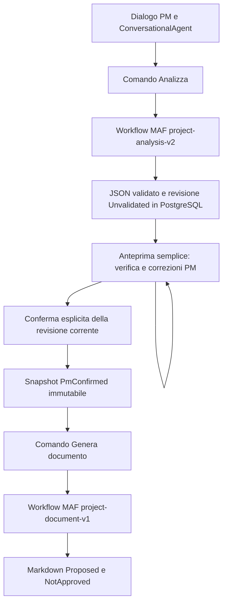

# Implementation Plan: Dal dialogo alla bozza Markdown verificabile

**Branch**: `restart/speckit-clean` | **Date**: 2026-10-28 | **Spec**: [spec.md](spec.md)
**Feature**: `001-project-draft`. Consolidamento F-01–F-07; nessuna nuova feature.
La modifica approvata sostituisce il precedente Analizza → generazione diretta.

## Summary

Monolite ASP.NET Core modulare, Angular + Bootstrap, PostgreSQL e Docker Compose.
MAF .NET 1.26.0 è l'unico framework per agenti, sessioni e workflow AI.
Il PM conversa, richiede l'analisi JSON, modifica/conferma l'anteprima e solo poi
richiede esplicitamente il Markdown. Il documento rimane una proposta da revisionare.

La chat mantiene stato distinto dall'analisi formale. Due grafi MAF finiti coprono
analisi e generazione; l'attesa umana è uno stato persistente della revisione, non
un workflow in memoria. Si riusano dispatcher, database e tabella delle elaborazioni,
senza motore applicativo parallelo. Revisioni e conferme sono responsabilità di dominio.

## Technical Context

**Language/Version**: C#/.NET 10 LTS; TypeScript secondo matrice Angular 22.
**Primary Dependencies**: ASP.NET Core/Identity/EF Core 10, Npgsql EF 10.0.3;
Microsoft.Agents.AI/OpenAI/Workflows esattamente 1.26.0; Angular 22, Bootstrap 5.3.8
e SCSS compilato con Dart Sass. Niente Material, PrimeNG, Tailwind o altre librerie UI superflue.
Pin delle transitive e lockfile nella futura implementazione, senza nuovi framework agentici.
**Storage**: PostgreSQL 18 con patch supportata, per dominio, revisioni e JSON MAF.
**Testing**: controlli deterministici di contratti/dominio; integrazioni PostgreSQL/MAF/DGX
reali e prove E2E, crash, retry, conferme concorrenti e compattazione effettiva.
**Target Platform**: Linux Compose con web, app e database; DGX Spark separato e interno.
**Project Type**: web monorepo; un processo backend include il BackgroundService.
**Performance Goals**: SC-001–SC-012; ogni fase AI nominale entro 180 secondi in assenza
di altra coda; errori previsti valutati separatamente. Attesa PM esclusa dalle deadline.
**Constraints**: LLM interni, originali append-only, una chat attiva e una elaborazione
formale attiva per progetto; limite AI globale iniziale uno; nessuna lunghezza a parole.
**Scale/Scope**: prima slice con due PM per accettazione, non chat illimitata o pilota esteso.

## UX/UI essenziale e streaming

Design system minimale Modern Enterprise SaaS: tema chiaro, palette sobria, contrasto
e tipografia leggibile. Variabili SCSS per colori, spaziature, caratteri e focus;
riuso dei componenti Bootstrap, senza un layer UI generalista. AdminLTE 4 è opzionale
solo se semplifica concretamente l'application shell; la soluzione iniziale usa
la shell Bootstrap e non aggiunge tale dipendenza senza utilità dimostrata.

Sidebar per selezionare/creare progetti, chat centrale, viste dedicate all'anteprima
editabile e al documento in sola lettura. Desktop-first; su mobile sidebar richiudibile
e contenuto su una colonna. Indicatore del percorso e stato della revisione sempre
riconoscibili. Azione primaria per fase: Invia nella chat, Analizza per passare
all'analisi (secondaria nel composer), Salva modifiche se il form è sporco,
Conferma analisi dopo il salvataggio, Genera documento solo sulla revisione confermata.
Mai confermare modifiche non salvate. La conferma non avvia generazione e non approva
il documento; una nuova modifica rende nuovamente necessaria la conferma.

Spinner indeterminato e descrizioni testuali per coda/esecuzione; progressi formali
derivati esclusivamente da lastObservedStage osservato ai confini del grafo MAF.
Niente thinking, percentuali, avanzamenti temporizzati o fasi inventate. Errori
contestuali mantengono dati e ultimo risultato; i retry dei comandi formali usano
nuova chiave soltanto dopo Failed, mentre un esito incerto viene riconciliato.
Nessun reinvio automatico del messaggio PM per un errore della risposta chat.

ConversationalAgent usa RunStreamingAsync al posto di RunAsync per consegnare gli
aggiornamenti testuali della risposta; stessi cutoff, sessioni, FIFO e commit atomico.
Trasporto preferito SSE sul backend esistente, consumato con fetch autenticato
tramite bearer in memoria, senza token nella URL. Un solo stream per progetto
aperto; nessuna nuova infrastruttura o persistenza dei token. I frammenti sono
provvisori e legati a turno/tentativo; il commit fenced resta l'autorità del risultato.
I workflow formali espongono eventi di fase, non JSON o Markdown parziali.
Riconnessione o perdita dello stream recuperano lo stato via GET; polling ogni due
secondi è il fallback. Il contratto HTTP definisce gli eventi e la riconciliazione.

Obiettivo WCAG 2.2 AA: markup semantico, label/errori associati, focus visibile e
non occultato, contrasto testo almeno 4,5:1 (3:1 testo grande), componenti/focus
almeno 3:1 e target almeno 24×24 CSS pixel salvo eccezioni WCAG. Navigazione da
tastiera, stato in live region senza annunciare ogni token, rispetto di
prefers-reduced-motion; niente informazione affidata soltanto al colore.
Test browser E2E del percorso nominale completo e, separatamente, gating della
generazione, conflitto di revisione, errori/retry e riconnessione senza duplicati.
Verifiche responsive a 1440/390 pixel, tastiera, annunci e contrasto completano
i controlli automatici: prove da eseguire in implementazione, nessun PASS attuale.

## Constitution Check

Riesame documentale dopo il consolidamento; i riferimenti di evidenza sono nella
[checklist canonica](checklists/requirements.md). Nessun PASS runtime dichiarato.

| Principio | Applicazione e confine |
| --- | --- |
| I. KISS/YAGNI | Monolite, database/runner esistenti; nessun broker o layer generico nuovo |
| II. MAF riferimento | AIAgent, AgentSession, workflow e compattazione nativi |
| III. Native prima di custom | Binding/checkpoint MAF; adapter SQL concreti, nessun engine; HITL nativo valutato ma non necessario per tenere aperta la revisione |
| IV. Dominio applicativo | Originali, Identity, autorizzazioni, revisioni e conferma controllati dal backend |
| V. LLM interni | Endpoint esplicito autorizzato, nessun fallback esterno |
| VI. Slice complete | Chat → anteprima correggibile/confermata → generazione → lettura |
| VII. Autorizzazione | Conferma PM e generazione sono atti distinti; nessuna pubblicazione esterna |
| VIII. Integrazioni reali | Gate tecnici identificati nel quickstart, ancora da eseguire |
| IX. ADR proporzionati | Decisioni approvate documentate qui; nessuna ADR nuova |

Non sono richieste deroghe costituzionali; disponibilità runtime e qualità del
modello restano verifiche dell'implementazione, distinte dalla coerenza documentale.

## Project Structure

### Documentation (this feature)

```text
specs/001-project-draft/
├── spec.md
├── checklists/requirements.md
├── plan.md
├── research.md
├── data-model.md
├── quickstart.md
└── contracts/
    ├── http-api.md
    └── ai-workflow.md
```

Non viene generato tasks.md in questa fase.

### Source Code (repository root)

Struttura prevista, non creata da questo comando:

```text
backend/
├── bProjects.sln
├── src/bProjects.App/
│   ├── Identity/
│   ├── Projects/
│   ├── Conversations/
│   ├── Analysis/
│   ├── AI/
│   └── Persistence/
└── tests/bProjects.IntegrationTests/
frontend/
└── src/app/
    ├── auth/
    └── projects/
tests/e2e/
infra/
└── compose.yaml
```

**Structure Decision**: un progetto backend con moduli per responsabilità, un'app
Angular e test separati. Niente repository generici, plugin framework, registri
multimodello o librerie condivise vuote. AI contiene grafo e adapter concreti.

## Disegno della slice

### Confini applicativi e UI

L'app salva immediatamente ogni messaggio PM in PostgreSQL con autore/ruolo/sequenza,
anche se il modello è indisponibile. Le risposte assistant sono append-only, non
decisioni del PM. Tutti i PM autorizzati accedono ai progetti della baseline.
Identity/JWT breve, refresh ruotato HttpOnly Secure, protezione CSRF cookie-based;
niente signup pubblico o amministrazione estesa.

Pagina progetto: chat con esiti dei turni, Analizza, anteprima a campi/liste,
salvataggio edit, conferma esplicita, Genera documento abilitato dalla conferma,
stato delle fasi e bozza in sola lettura. Le fonti PM/AI/edit hanno etichette distinte.
Il form permette requisiti/testi, integrazioni, assunzioni, conflitti aperti o risolti;
non include editor Word/Markdown, revisioni AI per sezione o un requirements manager.

Polling ogni due secondi per elaborazioni pendenti; la revisione/conferma è persistente
e recuperabile dopo giorni. Markdown e risposte chat sanitizzati, HTML raw e fetch
remoti disabilitati. La bozza indica la revisione usata e nuove note/revisioni eventuali.

### Chat: FIFO, cutoff e sessione ricostruibile — F-01

POST messaggio committa originale e ChatTurn insieme; cutoff = sequenza del trigger.
La FIFO non consente sorpasso di turni non terminali, compresi quelli in backoff.
Un solo proprietario valido per conversazione/progetto. L'ultimo snapshot MAF della
Conversation include ContextThroughSequence e versione/configurazione.
Se più avanzato del cutoff assegnato, si crea una sessione nuova e il provider carica
solo originali <= cutoff. Anche un insieme di riferimenti precedenti che non sia
prefisso ordinato della nuova history impone rebase, come specificato nel contratto AI. Non si riusa una sintesi che contenga una risposta tardiva.
Il trigger è passato una sola volta; nessun archivio di copie integrali per messaggio.

ConversationalAgent.RunStreamingAsync usa MAF per dialogo e contesto; risposta, snapshot,
watermark ed esito vengono committati atomicamente con fencing e revisione.
Le sessioni chat non sono quelle dei grafi formali. La serializzazione è derivata,
mentre lo storico originale rimane la fonte. Caso U1/U2/A1 e protocollo normativo
sono in [contratto AI §1](contracts/ai-workflow.md#1-turno-conversazionale-fifo-e-cutoff--f-01).

### Recovery e retry limitati — F-02

Stesso BackgroundService, claim SQL e lease per ChatTurn e ProcessingRun.
Default configurabili: lease 30 s, rinnovo 10 s, massimo 3 attempt totali,
backoff 2/4 s, deadline 180 s dal comando. Tempo e fencing sono controllati dal DB.
Running abbandonato viene riacquisito automaticamente; errore transitorio torna
Queued con NextAttemptAt; errore permanente/esaurimento termina Failed.
Il turno precedente blocca i successivi della chat finché non è terminale.
Il contatore comprende recovery e retry e non si azzera al restart.

Gli errori di trasporto sono distinti da schema, configurazione o budget invalidi.
SDK retry automatici sono disabilitati per evitare moltiplicazione dei tentativi.
Il dispatcher non schedula fasi: per chat invoca MAF, per Kind formale avvia/riprende
il relativo grafo. Non sceglie nodi, archi o checkpoint di dominio.
Le fasi formali usano checkpoint nativi validi; il singolo turno RunStreamingAsync non promette
checkpoint intra-chiamata. In quest'ultimo caso si ripete da sessione committata/cutoff.

Un vecchio owner non può più scrivere; una chiamata remota può finire comunque, ma
non produrre effetti duplicati. Regole di claim/transizione e classificazione errori
sono normative nel contratto AI §2 e nel data model, non in un altro orchestratore.

### Analisi, anteprima e generazione — F-03/F-04



L'anello dell'anteprima rappresenta edit di dominio persistiti, non un loop AI.
Analizza non chiama DocumentAgent. Conferma non accoda generazione.
Ogni nuova modifica crea una revisione Unvalidated e richiede nuova conferma.

| Definizione MAF | Sequenza e commit terminale |
| --- | --- |
| project-analysis-v2 | LoadDialog → ConversationalAgent (modalità consolidamento) → ValidatePersistAnalysis; schema/fonti validati, revisione AI Unvalidated e Completed |
| project-document-v1 | LoadConfirmedRevision → DocumentAgent → ValidatePersistDraft; Markdown legato a InputRevisionId, Proposed/NotApproved e Completed |

Si mantengono agenti e operazioni di caricamento/validazione/persistenza già previsti;
il precedente grafo è separato nel punto di decisione umana approvato.
WorkflowBuilder, binding nativi AIAgentHostExecutor e protocollo .NET
ChatMessage/List<ChatMessage>/TurnToken gestiscono invocazioni e checkpoint delle sessioni.
ID/Nome e definizioni sono stabili per resume; un vecchio grafo incompatibile non
viene migrato implicitamente. Non esiste una sequenza di executor gestita dall'app.

### Attesa umana persistente: scelta minima verificata

HITL .NET documenta RequestPort, RequestInfoEvent e SendResponseAsync. Gestire un
run unico sospeso per giorni richiederebbe associazione durevole fra richiesta,
revisione, risposta e restore con le stesse identità; non serve a questa slice.
Scelta: due fasi MAF finite e una revisione Unvalidated persistente fra le fasi.
WaitingForPM è una proiezione UI; non trattiene lease, deadline o oggetti in memoria.
Il secondo comando crea un nuovo run MAF sullo snapshot confermato, non riproduce
la logica interna del primo. È il fallback minimo esplicitamente ammesso dalla richiesta.

ProcessingRun generalizza la precedente AnalysisRun con Kind Analysis/Document;
una sola tabella/coda per le due richieste. Si aggiunge solo AnalysisRevision per
contenuto versionato, origine, parent e conferma. Nessuna nuova infrastruttura.

### Revisioni, fonti e concorrenza

AnalysisContent 1.0.0 ha uno schema normativo nel contratto AI: obiettivi,
contesto/perimetro, requisiti/flussi, vincoli/dipendenze, assunzioni/punti aperti,
conflitti con alternative, registro delle fonti e validationState.
L'AI può produrre solo Unvalidated e conflitti Open. I riferimenti a messaggi sono
verificati rispetto al progetto/cutoff; assistant non vale da solo come evidenza fattuale.

PUT dell'anteprima crea una nuova revisione attribuita con fonti PmRevision per gli
edit significativi, lasciando intatti originali e revisione AI. If-Match e lock
dell'analisi impediscono sovrascritture. Conferma cambia solo stato/metadati e congela
la revisione completa, inclusi i conflitti che il PM ha scelto di lasciare aperti.

Genera documento verifica in una transazione che analisi e revisione siano correnti,
che la revisione sia PmConfirmed e che non vi sia un altro run formale attivo.
InputRevisionId è congelato nel run Document. Edit successivi sono ammessi ma non
alterano quel run; ogni ulteriore generazione richiede conferma della nuova revisione.
Questa conferma è del PM, non del cliente, e non approva la bozza finale.

### Documento adattivo e gestione del contesto — F-05/F-06

Non esiste una soglia di parole per input, capacità o qualità. Le 2–5 pagine sono
indicative. Completezza, precisione, evidenze, comprensibilità e assenza di ripetizioni
governano la lunghezza. Le sei aree editoriali applicabili sono definite in FR-024;
sezioni non pertinenti si omettono senza tagliare requisiti o inventare riempitivi.

Chat e analisi integrano da subito CompactionProvider su ChatClientBuilder,
UseAIContextProviders e SummarizationCompactionStrategy nativa. Budget in token
coerente col modello; originali non ridotti, snapshot/sintesi derivati. Dopo
compattazione viene controllato l'intero contesto; guasti o eccedenze sono espliciti.

DocumentAgent non ha history conversazionale: riceve l'intero snapshot confermato,
che non può essere riassunto da una primitiva. Il suo client non registra il
provider di compattazione, evitando filtri custom per proteggere porzioni del prompt.
Preflight del budget sull'intero JSON e istruzioni; se non rientra, fallisce senza
omissioni. Così nessun requisito confermato è sostituito da un riassunto non verificato.
Le conversazioni lunghe sono provate con token/finestra, non conteggi editoriali.

### Persistenza, checkpoint e idempotenza

CheckpointManager.CreateJson con store PostgreSQL mantiene payload opaco e indice
oldest-first per ProcessingRun; nativi sono stato, confini e ripresa dei superstep.
Se esiste un checkpoint compatibile, ResumeStreamingAsync riparte in processo nuovo;
altrimenti input immutabile e limiti del run decidono se si può avviare lo stesso grafo.
Non si promette continuità del singolo token né exactly-once delle chiamate.

Commit di revisione AI + Completed, e commit di bozza + Completed, sono atomici e
univoci per run. Un errore successivo del checkpoint non annulla un risultato già
committato: si riconcilia Completed. Draft precedente e preview riuscito non spariscono
per un tentativo fallito. Tutti gli endpoint di fase sono idempotenti per RequestKey.

### Evoluzione futura preservata

KnowledgeAgent MAF come tool per KB progetto/cliente/prodotto/versione e web pubblico
autorizzato; TextSearchProvider/function tools, citazioni, provenienza/versioni,
conflitti e lacune. Docling nell'ingestion prima dell'indicizzazione.
ReviewAgent, pubblicazione Jira/GitHub e human-in-the-loop esteso restano futuri.
Nessun adapter placeholder, schema KB o infrastruttura viene introdotto ora.

### Osservazioni dal primo test manuale — 2026-10-28

Il percorso reale con 10 messaggi PM (circa 185.000 caratteri complessivi, stima
45–60 mila token) ha prodotto `context_overflow` su chat e analisi con modello
configurato a 32.768 token. Questa prova esplorativa non dimostra da sola se la
compattazione nativa si sia attivata, sia fallita o non possa gestire un singolo
messaggio molto esteso. L'originale PM resta persistito; non è accettabile eliminare
o troncare contenuti per nascondere l'errore.

Interventi **nell'ambito della slice attuale**, senza creare nuovi task o alterare
i contratti:
- **T047 (obbligatorio):** aggiungere la riproduzione con contesto grande e
  diagnostica di token input/budget, trigger ed esito della compattazione per chat
  e Analysis, distinguendo errore inevitabile da regressione; non registrare
  contenuti o segreti nei log. Controllare singolo messaggio oltre budget,
  storico compattabile e negazioni/fonti preservate.
- **T050 (UX guasti):** rappresentare `context_overflow` con messaggio specifico e
  azione praticabile, senza descriverlo genericamente come rifiuto del modello.
  Esporre valori di token e superamento soltanto se misurati e disponibili in
  forma sicura nel contratto; nessuna percentuale o diagnosi inventata.
- **T052 (accettazione):** includere il caso esplorativo come prova di limite
  separata dai cinque casi nominali richiesti. Un errore gestito non è
  un successo nominale e non certifica gestione di documenti lunghi.

### Backlog funzionale successivo alla prima vertical slice (DEFERRED)

Queste voci sono **decisioni di roadmap**, non T054+ e non condizioni aggiuntive
di completamento di T044–T053. Prima di implementarle serviranno specifica,
contratti, criteri di accettazione e task separati. Ordine proposto:

1. **P1 — Allegati come fonti autonome.** Caricamento PDF, Markdown e testo, con
   file originale conservato, hash/versione, metadati, autore e appartenenza al
   progetto. Estrazione tracciabile (Docling dove appropriato), segmenti/pagine
   indirizzabili, errori di parsing espliciti e fonti navigabili. Non incollare il
   contenuto nell'ordinaria cronologia chat; nessuna KB implicita.
2. **P1 — Analisi di materiale oltre la finestra del modello.** Elaborazione per
   segmenti e consolidamento gerarchico verificabile con provenienza fino al
   documento e alle posizioni originali; mantenere esclusioni, vincoli, negazioni,
   evidenze e conflitti. Rilevare omissioni e copertura insufficiente anziché
   presentare un risultato parziale come completo. Distinguere ingestion,
   estrazione, consolidamento e successiva generazione dalla normale compattazione
   conversazionale. Non introdurre un semplice riassunto lossy come sostituzione
   dell'analisi strutturata.
3. **P2 — Indicatori di capienza del contesto.** Informazioni consultabili su
   budget e utilizzo del contesto realmente stimato/misurato, considerando
   istruzioni, output riservato, sintesi, singolo messaggio e operazione; avvisi
   progressivi solo con semantica verificabile. Non indicare una percentuale
   esatta se il contenuto effettivamente inviato è soggetto a compattazione.
4. **P2 — Avviso sugli incollaggi estesi.** Avvertire prima di inviare un messaggio
   potenzialmente superiore al budget; non abbassare automaticamente il limite di
   trasporto di 65.536 caratteri, non troncare e non impedire senza motivo
   documenti che potrebbero essere elaborati dalla pipeline di ingestion.
5. **P2 — Profili di modello e contesto.** Valutare configurazioni DGX a 64k/131k
   soltanto con modello ID, `ctx-size` effettivo, tokenizer, budget e risorse
   coerenti. Benchmark di latenza, completezza, provenienza e qualità sullo
   stesso insieme di casi prima di modificare il modello di riferimento;
   una finestra maggiore da sola non garantisce affidabilità.
6. **P3 — Ottimizzazione degli snapshot di sessione.** Misurare dimensioni,
   latenza e contenuto serializzato MAF prima di ottimizzare; conservare originali
   e provenienza in PostgreSQL, mantenendo restore compatibile e nessuna
   perdita silenziosa. Non usare la dimensione di 138 KB del primo snapshot come
   prova sufficiente di un problema prestazionale.

La prossima milestone funzionale prioritaria è **allegati + ingestion tracciabile
+ analisi gerarchica**, prima di KB/RAG generale, ricerca web o pubblicazioni.
I test di crash, idempotenza, sicurezza e compattazione della slice corrente
rimangono prioritari per stabilire una baseline affidabile.

## Phase 0 — Research

[research.md](research.md) riporta verifica documentale della versione 1.26.0, primitive
pinned consultabili, limiti di reference latest e confronto HITL/fasi distinte.
La configurazione del modello DGX e la prova compilativa sono prerequisiti tecnici
dell'implementazione, non risultati dichiarati già superati.

## Phase 1 — Design e contratti

- [data-model.md](data-model.md): originali, ChatTurn, ProcessingRun, AnalysisRevision, Draft e checkpoint.
- [contracts/http-api.md](contracts/http-api.md): anteprima, edit, conferma e comando separato.
- [contracts/ai-workflow.md](contracts/ai-workflow.md): schema 1.0.0, input snapshot e protocollo MAF.
- [quickstart.md](quickstart.md): scenari nominali distinti dai guasti e prove reali future.
- [checklists/requirements.md](checklists/requirements.md): unica checklist, controlli documentali e tecnici distinti.

## Consolidamento F-01–F-07 e limiti

F-01: cutoff prevalente e rebase da originali. F-02: transizioni/lease/retry limitati.
F-03: schema e fonti tipizzati. F-04: due comandi/fasi e revisione PM persistente.
F-05: qualità e lunghezza adattiva. F-06: compattazione nativa corrente verificabile.
F-07: checklist unica con trasferimento dei controlli, senza certificare runtime.

Nessun blocco progettuale lasciato intenzionalmente irrisolto. Restano da verificare
durante implementazione: compilazione del pacchetto esatto, compatibilità del modello
locale/schema, durabilità PostgreSQL/checkpoint, compattazione sperimentale MAAI001,
tokenizzazione e qualità semantica. Nessuna nuova milestone, ADR o tasks.md.
