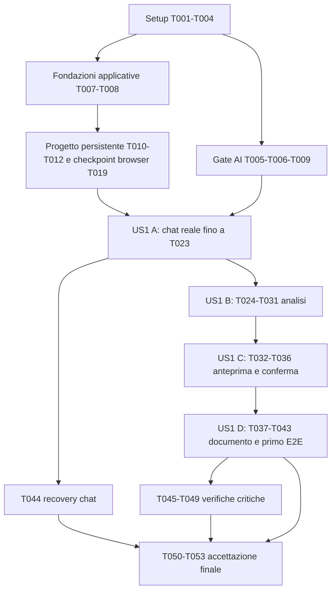

# Tasks: Dal dialogo alla bozza Markdown verificabile

**Feature**: `001-project-draft` — **Data**: 2026-10-28.
**Input**: [spec](spec.md), [plan](plan.md), [ricerca](research.md), [modello dati](data-model.md), [HTTP](contracts/http-api.md), [AI](contracts/ai-workflow.md), [quickstart](quickstart.md), [Constitution](../../.specify/memory/constitution.md).
**Prerequisiti**: artefatti aggiornati F-01–F-07 e UX/UI; task generati, nessuna implementazione o prova runtime eseguita.
**Test**: richiesti dalla specifica e dalla Constitution; scrivere i test contrattuali prima delle rispettive implementazioni e verificarli fallire, poi renderli verdi. Le prove di guasto non sostituiscono quelle nominali.
**Formato**: checkbox, ID sequenziale, [P] solo per file distinti dopo dipendenze soddisfatte, [US1] solo nella fase della storia. I percorsi di sorgenti/test sono destinazioni da creare, non file già esistenti.
**Perimetro**: monolite e tre container già previsti; MAF unico motore AI. Nessun vecchio backlog, nuova ADR, KB/KnowledgeAgent/Docling/RAG/web/ReviewAgent, adapter futuro o editor avanzato.

## Phase 1 — Setup

Preparare soltanto i progetti e gli strumenti necessari; nessuna funzionalità futura.

- [x] T001 Creare solution e progetto ASP.NET Core/.NET 10 modulare in `backend/bProjects.sln` e `backend/src/bProjects.App/bProjects.App.csproj`; fissare MAF core/OpenAI/Workflows esattamente 1.26.0, EF/Identity 10 e Npgsql 10.0.3 con lockfile; verificare restore/build della struttura vuota.
- [x] T002 [P] Creare Angular 22 con Bootstrap 5.3.8 e SCSS/Dart Sass in `frontend/package.json`, `frontend/angular.json` e `frontend/src/styles.scss`; definire palette chiara, tipografia, spaziature/focus e script build/test:ci; nessuna libreria UI aggiuntiva (AdminLTE non necessario inizialmente).
- [x] T003 Predisporre xUnit e harness PostgreSQL/DGX in `backend/tests/bProjects.IntegrationTests/bProjects.IntegrationTests.csproj` e browser E2E Playwright in `tests/e2e/playwright.config.ts`; collegare `frontend/package.json` a test:e2e; dati/DB di test isolati, categorie Integration/MafReal e asserzioni reali senza mock sostitutivi. Dipende da T001, T002.
- [x] T004 Configurare soltanto web/app/db, volumi persistenti, build Angular e reverse proxy same-origin compatibile SSE senza buffering in `infra/compose.yaml`, `infra/web.conf`, `backend/Dockerfile` e `frontend/Dockerfile`; verificare avvio e conservazione del volume al restart, segreti fuori dal repository. Dipende da T001, T002.

## Phase 2 — Fondazioni e gate tecnici

Distinguere fondazioni applicative T007/T008 e gate AI T005/T006/T009: il primo incremento progetto non richiede il DGX.

- [x] T005 Scrivere ed eseguire contro i NuGet bloccati la prova compilativa in `backend/tests/bProjects.IntegrationTests/MafApiCompatibilityTests.cs`: AIAgent, AgentSession Create/Serialize/Deserialize, ChatHistoryProvider, RunStreamingAsync, CompactionProvider/UseAIContextProviders/SummarizationCompactionStrategy (MAAI001), WorkflowBuilder/AIAgentHostExecutor, protocollo ChatMessage/TurnToken e CheckpointManager.CreateJson/ResumeStreamingAsync; bloccare le funzionalità MAF a valle in caso di firme incompatibili, senza cambiare framework. Dipende da T001, T003.
- [x] T006 Configurare il client interno in `backend/src/bProjects.App/AI/InternalModelClient.cs` e provarlo in `backend/tests/bProjects.IntegrationTests/LocalProviderTests.cs`: endpoint Chat Completions DGX, streaming reale, modello/finestra/tokenizer misurati, JsonSchema se supportato altrimenti ValidatedTextJson; disabilitare retry SDK e qualunque fallback esterno. Verificare esplicitamente la configurazione effettiva, senza inviare dati a servizi pubblici. Dipende da T005.
- [x] T007 Configurare DbContext/Identity e migrazione iniziale in `backend/src/bProjects.App/Persistence/AppDbContext.cs` e `backend/src/bProjects.App/Persistence/Migrations/`; RefreshSession con «Id UUID, UserId, TokenHash, ExpiresAt, RevokedAt/ReplacedById opzionali», rotazione/revoca atomiche; bootstrap esplicito di due PM tramite `backend/src/bProjects.App/Identity/AccountBootstrap.cs`, senza signup pubblico. Dipende da T001, T004.
- [x] T008 Implementare login/refresh/logout e protezioni in `backend/src/bProjects.App/Identity/AuthEndpoints.cs`, `frontend/src/app/auth/auth.service.ts` e `backend/tests/bProjects.IntegrationTests/AuthTests.cs`: JWT in memoria, refresh HttpOnly/Secure/SameSite, CSRF cookie/header, rotazione/revoca, PM autorizzati su tutti i progetti e 401/403 corretti; nessuna UI Admin. Dipende da T002, T003, T007.
- [x] T009 Validare opzioni, redigere Problem Details e log sicuri in `backend/src/bProjects.App/AI/AiOptions.cs`, `backend/src/bProjects.App/AI/ExecutionOptions.cs` e `backend/src/bProjects.App/Program.cs`: lease 30s/rinnovo 10s (< metà lease), MaxAttempts=3 incluso primo claim, backoff 2/4s massimo 10s, deadline 180s dal comando; budget/finestra positivi coerenti e soglia fra 1 e InputBudget; endpoint interno allowlisted e nessun segreto/contenuto integrale nei log. La validazione all'avvio verifica la configurazione, non richiede DGX raggiungibile; un modello offline non impedisce creazione/riapertura dei progetti. Dipende da T006, T007, T008.

## Phase 3 — US1: dialogo → anteprima confermata → bozza (P1)

Unica user story della specifica. Gli incrementi A–E non sono nuove storie né feature indipendenti. La storia è completata solo con tutte le prove pertinenti.

### A — Progetto e chat conversazionale persistente

- [x] T010 [US1] Scrivere prima dell'implementazione i casi progetto/chat in `backend/tests/bProjects.IntegrationTests/ProjectChatContractTests.cs`: nomi omonimi, whitespace/limiti, salvataggio PM con modello offline, replay/conflitto clientMessageId, ruolo/autore server-side, cursori, stato turno e separazione dai comandi formali; verificarli inizialmente fallire. Eseguire subito il sottoinsieme progetto senza inizializzare client/worker AI; i casi chat diventano verdi con i task successivi. Dipende da T008.
- [x] T011 [US1] Mappare Project/Conversation/ConversationMessage/ChatTurn e relativa migrazione in `backend/src/bProjects.App/Conversations/ConversationEntities.cs`, `backend/src/bProjects.App/Projects/Project.cs` e `backend/src/bProjects.App/Persistence/Migrations/`: applicare i vincoli normativi V011 sotto, inclusi originali append-only, indici univoci e FK soltanto verso tabelle già esistenti o create nella stessa migrazione. CurrentAnalysisId/LatestDraftId sono inizialmente UUID nullable senza FK né navigazioni EF verso entità future; aggiungere i vincoli rispettivamente in T025/T038. Verificare PostgreSQL da zero e upgrade da T007, senza tabelle Analysis/Draft né DGX. Dipende da T010.

Vincoli normativi V011 (citazioni del modello finale, parte del task):
le FK di Project verso ProcessingRun/Draft sono differite a T025/T038;
in T011 si creano soltanto i campi UUID nullable, senza anticipare le entità future.

> Project: Id UUID, Name testo non whitespace (massimo 200 caratteri, non univoco),
> Description opzionale (massimo 4.000), CreatedBy e CreatedAt UTC,
> CurrentAnalysisId FK opzionale al ProcessingRun Analysis riuscito, LatestDraftId FK opzionale.
>
> Conversation: Id UUID, ProjectId FK UNIQUE, CreatedAt UTC, LastSequence bigint,
> MafChatSessionState JSONB opzionale, MafVersion, ChatConfigVersion,
> ContextThroughSequence bigint, ChatSessionRevision bigint.
> È conservato soltanto l'ultimo snapshot derivato, non una copia dello storico per turno.
>
> ConversationMessage: Id UUID, ConversationId FK, Sequence bigint, Role=user/assistant,
> Body testo originale, CreatedAt UTC. Per user: ClientMessageId UUID, AuthorId FK.
> Per assistant: AgentId, ReplyToMessageId FK a user e ChatTurnId FK.
> Nessuna mutazione/cancellazione applicativa degli originali, né risposta AI spacciata per PM.
>
> Unicità: (ConversationId, Sequence), (ConversationId, ClientMessageId) per user,
> ReplyToMessageId per risposta assistant pubblicata.
> Testo PM non whitespace, massimo 65.536 caratteri per singolo invio come protezione
> del trasporto, non limite complessivo di conversazione né criterio di qualità.
> Il salvataggio conserva esattamente il testo ricevuto.
> Sequence/LastSequence, originale PM e ChatTurn sono committati insieme sotto lock.
> Una risposta successiva usa lo stesso lock per la propria Sequence.
> Analizza acquisisce il medesimo lock per fissare il cutoff senza note non committate.
>
> ## ChatTurn
>
> | Campo | Regola |
> | --- | --- |
> | Id / ConversationId / TriggerMessageId | UUID e FK; TriggerMessageId user UNIQUE |
> | SourceCutoffSequence | Sequenza del trigger assegnata nel commit originale, immutabile |
> | Status | Queued, Running, Completed, Failed |
> | RequestedAt / StartedAt / CompletedAt | UTC; ultimi due opzionali |
> | DeadlineAt | RequestedAt + RunDeadline; non si azzera al restart |
> | ResultMessageId | FK assistant, obbligatoria solo se Completed |
> | ErrorCode / ErrorMessage | Redatti; valorizzati per Failed |
> | AttemptCount / MaxAttempts | Persistenti, inclusivo del primo claim; default massimo 3 fissato nel turno |
> | NextAttemptAt | UTC di eleggibilità, include backoff/retry-after |
> | LeaseOwner / LeaseUntil / FencingToken | Proprietario temporaneo, scadenza, contatore monotono |
> | PromptVersion / AgentConfig | Configurazione risolta, senza segreti |
> | SessionRevisionAtStart | Revisione derivata usata per confronto al commit |

- [x] T012 [US1] Implementare catalogo, creazione e riapertura in `backend/src/bProjects.App/Projects/ProjectEndpoints.cs`: GET/POST /projects e GET /projects/{p}, conversation creata atomicamente, ProjectView completo secondo contratto (campi risultati null e liste pendenti vuote finché le relative funzionalità sono assenti, senza query verso tabelle future), paginazione e scope PM; far passare i relativi casi T010. Dipende da T011.
- [x] T013 [US1] Implementare salvataggio e lettura dialogo/turni in `backend/src/bProjects.App/Conversations/ConversationEndpoints.cs`: lock Conversation, sequenza, originale PM+Queued/cutoff nella stessa transazione prima dell'AI, replay identico senza enqueue e conflitto con testo diverso; GET messages/chat-turn e POST statuses secondo contratto, testo esatto non trim-mato. Dipende da T011.
- [x] T014 [US1] Implementare il solo dispatch di ChatTurn nel BackgroundService e SQL di claim in `backend/src/bProjects.App/AI/AiDispatchService.cs` e `backend/src/bProjects.App/Persistence/ExecutionLeaseStore.cs`: FIFO senza sorpasso in backoff, un lease valido per progetto, limite AI globale uno, rinnovo/reclaim con tempo DB e fencing, contatori/deadline persistenti; classificazione retry distinta dal crash, Failed/Completed terminali. Nessuno scheduler di executor. Dipende da T009, T013.
- [x] T015 [US1] Implementare ChatHistoryProvider PostgreSQL e restore delle sessioni in `backend/src/bProjects.App/AI/PostgresChatHistoryProvider.cs`: history <= cutoff con trigger passato una volta, snapshot unico, watermark/config/provenienza e prefisso ordinato verificati; se incompatibile nuova AgentSession dagli originali, mai sintesi oltre cutoff. Provare U1(seq1)/U2(seq2)/A1(seq3), T2 cutoff2 senza A1. Dipende da T005, T011.
- [x] T016 [US1] Integrare compattazione nativa per chat e analisi in `backend/src/bProjects.App/AI/ContextBudget.cs` e `backend/src/bProjects.App/AI/AgentFactory.cs`: CompactionProvider sul ChatClientBuilder, UseAIContextProviders e SummarizationCompactionStrategy; conteggio finale istruzioni/payload incluso, sintesi derivata e context_overflow/compaction_failed espliciti; nessun troncamento o summarizer custom. Dipende da T006, T009, T015.
- [x] T017 [US1] Collegare ConversationalAgent AIAgent/ChatClientAgent al dispatch in `backend/src/bProjects.App/AI/ConversationalAgent.cs` e prompt in `backend/src/bProjects.App/AI/Prompts/conversation.md`: RunStreamingAsync, risposta pertinente e al massimo una domanda mirata senza ripetizioni; sessione separata dall'analisi, nessuna modifica a requisiti/bozze e nessun comando formale implicito. Dipende da T014, T015, T016.
- [x] T018 [US1] Committare risposta+sessione+watermark+Completed atomicamente in `backend/src/bProjects.App/Conversations/ChatTurnCompletion.cs`: confronto lease/fence/ChatSessionRevision, risposta unica collegata al trigger, ResultMessageId, ContextThroughSequence inclusa assistant, riconciliazione post-commit; un vecchio worker non modifica l'esito né pubblica una risposta definitiva. Dipende da T017.
- [x] T019 [US1] Realizzare login e shell con sidebar progetti, creazione/riapertura e route in `frontend/src/app/auth/login.component.ts`, `frontend/src/app/projects/project-shell.component.ts`, `frontend/src/app/projects/project-shell.component.scss` e `frontend/src/app/app.routes.ts`; desktop-first, sidebar richiudibile a 390px, tema sobrio e focus/label accessibili; catalogo via API reale. Scrivere ed eseguire già come criterio di completamento il checkpoint browser in `tests/e2e/project-persistence.spec.ts`: login, creazione/lista/riapertura, progetti omonimi distinguibili e riavvio app con volume PostgreSQL conservato e dati invariati, con DGX indisponibile. Eseguibile senza completare T005/T006/T009/T014–T018: prima della loro implementazione non registrare client/worker AI; anche dopo, un modello offline non blocca queste funzioni. Dipende da T008, T012.
- [ ] T020 [US1] Realizzare chat centrale in `frontend/src/app/projects/chat.component.ts` e `frontend/src/app/projects/project-api.service.ts`: conferma distinta del salvataggio PM, stato turno e AI non validata, testo recuperabile se POST fallisce, nessun reinvio automatico in caso di Failed; riconciliare POST incerto con stesso clientMessageId e mostrare errori comprensibili. Dipende da T013, T018, T019.
- [ ] T021 [US1] Esporre GET /projects/{p}/events SSE in `backend/src/bProjects.App/Projects/ProjectEventsEndpoint.cs`: chat.delta/chat.state/processing.state del contratto, autorizzazione e no-cache, delta provvisori owner/fence validi con attemptCount/deltaIndex, solo testo assistant e nessun thinking; notifiche effimere nel processo esistente, nessuna tabella/broker; disconnessione non cancella il job. Dipende da T018.
- [ ] T022 [US1] Consumare SSE con fetch bearer in memoria in `frontend/src/app/projects/project-events.service.ts` e collegarlo a `frontend/src/app/projects/chat.component.ts`: una connessione per progetto, nessun token URL, buffer per turno/tentativo/indice, reset al retry/riconnessione e sostituzione da GET dopo Completed; polling 2s di riconciliazione/fallback, chiusura al logout/cambio progetto e nessun nuovo comando alla riconnessione. Dipende da T020, T021.
- [ ] T023 [US1] Eseguire chat reale e secondo incremento browser in `backend/tests/bProjects.IntegrationTests/ConversationMafTests.cs` e `tests/e2e/project-chat.spec.ts`: cinque scambi riusciti <=180s ciascuno a servizio sano senza altra coda, checkpoint progetto T019 ancora superato, nessuna analisi formale, streaming visibile e ripresa storico tra sessioni; modello offline conserva subito l'originale come prova d'errore separata. Dipende da T022.
### B — Analisi strutturata e anteprima disponibile

- [ ] T024 [US1] Scrivere i test analisi prima dell'implementazione in `backend/tests/bProjects.IntegrationTests/AnalysisContractTests.cs` e `backend/tests/bProjects.IntegrationTests/AnalysisContentTests.cs`: cutoff/chiave, no_pm_input, schema/fonti validi e invalidi in entrambe le modalità output, nessun Markdown su Analizza; casi nominali distinti da fallimenti. Dipende da T023.
- [ ] T025 [US1] Mappare ProcessingRun e AnalysisRevision nella migrazione in `backend/src/bProjects.App/Analysis/AnalysisEntities.cs` e `backend/src/bProjects.App/Persistence/Migrations/` secondo V025: unica tabella per Kind, stati/sessioni distinti dalla chat, indice formale attivo unico e vincoli per prima revisione AI; nessuna tabella per step o attesa umana. Aggiungere ora la FK Project.CurrentAnalysisId verso ProcessingRun, mantenendo LatestDraftId senza FK fino a T038. Se ProcessingRun.DraftId è mappato come FK, differire anch'esso e la navigazione EF verso Draft a T038. Verificare PostgreSQL da zero e upgrade da T011 con progetti/messaggi esistenti invariati e rifiuto di riferimenti CurrentAnalysisId inesistenti. Dipende da T024.

Vincoli normativi V025 (citazioni del modello dati, parte del task):

> | Campo | Regola |
> | --- | --- |
> | Id / ProjectId | UUID e FK |
> | Kind | Analysis oppure Document |
> | ConversationId / SourceCutoffSequence | Obbligatori per Analysis; input immutabile |
> | AnalysisId / InputRevisionId | Obbligatori per Document; FK a run Analysis riuscito e sua revisione corrente confermata al momento dell'avvio |
> | RequestKey / RequestedBy / RequestedAt | Idempotenza e paternità della richiesta |
> | Status | Queued, Running, Completed, Failed |
> | StartedAt / CompletedAt / DeadlineAt | Stessa politica temporale di ChatTurn, nessun tempo umano incluso |
> | WorkflowDefinitionVersion | project-analysis-v2 oppure project-document-v1 |
> | MafVersion / AgentConfig / PromptVersions | 1.26.0 e configurazione risolta immutabile, senza segreti |
> | WorkflowSessionId | Identità MAF persistita quando disponibile |
> | AttemptCount / MaxAttempts / NextAttemptAt | Controllo retry/reclaim; stessa politica del contratto AI |
> | LeaseOwner / LeaseUntil / FencingToken | Claim/rinnovo/reclaim e protezione scritture |
> | LastObservedStage / UpdatedAt | Proiezione informativa degli eventi MAF, mai prossimo step |
> | ResultRevisionId / DraftId | Esattamente il risultato pertinente a Kind, obbligatorio per Completed |
> | ErrorCode / ErrorMessage | Errore redatto per Failed |
>
> Unicità (ProjectId, Kind, RequestKey); stessa chiave con input differente è conflitto.
> Indice parziale ProjectId per Queued/Running impedisce elaborazioni formali concorrenti
> di qualsiasi Kind sul progetto. Chat e workflow formale hanno stati/sessioni distinti.
>
> | Campo | Regola |
> | --- | --- |
> | Id / AnalysisId | UUID e FK al ProcessingRun Kind=Analysis |
> | Version | Intero >= 1, univoco per AnalysisId e crescente sotto lock |
> | ParentRevisionId | FK opzionale alla revisione precedente della stessa analisi |
> | Origin | Ai oppure PmEdit |
> | CreatedBy / CreatedAt | Utente richiedente/editore e UTC; per Ai anche agente/prompt nel run |
> | SchemaVersion | 1.0.0 |
> | ContentJson | AnalysisContent del contratto AI, validato prima del commit |
> | ValidationState | Unvalidated oppure PmConfirmed, coerente col campo JSON |
> | ConfirmedBy / ConfirmedAt | Null finché Unvalidated; PM e UTC alla conferma |

- [ ] T026 [US1] Definire DTO tipizzati AnalysisContent 1.0.0 in `backend/src/bProjects.App/Analysis/AnalysisContent.cs` riproducendo integralmente required/types/additionalProperties=false e $defs del JSON normativo nel contratto AI §4; UUID di elementi/fonti e riferimenti, Declared/Inferred/Assumed, Open/Resolved e validationState; nessuna entità KB. Dipende da T024.
- [ ] T027 [US1] Implementare validazione strutturale/semantica in `backend/src/bProjects.App/Analysis/AnalysisContentValidator.cs`: non-whitespace, ID unici e refs risolti, appartenenza progetto/cutoff/ruolo, fatti non sostenuti da sole assistant, AI soltanto Unvalidated/Message/Open, assunzioni Assumed, risoluzioni PM motivate e attribuite; stesse regole per AI/PUT/confirm con privilegi distinti e nessuna riparazione AI. Dipende da T025, T026.
- [ ] T028 [US1] Implementare ICheckpointStore<JsonElement> PostgreSQL in `backend/src/bProjects.App/AI/PostgresCheckpointStore.cs` e `backend/src/bProjects.App/Persistence/Migrations/`: campi/unicità V28, payload opaco, parent e indice oldest-first; CheckpointManager.CreateJson, scritture atomiche fenced, nessuno step applicativo; verificare roundtrip reale. Dipende da T005, T025.

Vincoli normativi V028 (citazioni del modello dati, parte del task):

> ProcessingRunId FK sostituisce il precedente riferimento AnalysisRunId.
> WorkflowSessionId, CheckpointKey, CheckpointInfo/ParentInfo JSON, Payload JSONB opaco,
> CommitSequence, CreatedAt, MafVersion e WorkflowDefinitionVersion.
> Unicità (ProcessingRunId, WorkflowSessionId, CheckpointKey); scrittura atomica con
> fencing corrente e indice oldest-first. Nessun puntatore applicativo allo step successivo.

- [ ] T029 [US1] Definire project-analysis-v2 nativo in `backend/src/bProjects.App/AI/AnalysisWorkflow.cs`: LoadDialog → ConversationalAgent consolidamento → ValidatePersistAnalysis, binding AIAgentHostExecutor/ChatMessage/TurnToken e ForwardIncomingMessages=false, prompt in `backend/src/bProjects.App/AI/Prompts/analysis.md`; validazione prima del commit AI revision+Completed+CurrentAnalysisId, nessun DocumentAgent; proiettare soltanto fasi reali. Dipende da T016, T027, T028.
- [ ] T030 [US1] Implementare comandi/letture analisi in `backend/src/bProjects.App/Analysis/AnalysisEndpoints.cs` e dispatch formale in `backend/src/bProjects.App/AI/AiDispatchService.cs`: cutoff sotto lock, idempotenza (ProjectId,Kind,RequestKey), 422/409 e GET run/anteprima/revisioni; avvio o resume nativo dal checkpoint compatibile, configurazione congelata, nessuna scelta applicativa dello step; fallimento non nasconde ultima analisi. Dipende da T029.
- [ ] T031 [US1] Collegare Analizza e stato/anteprima iniziale in `frontend/src/app/projects/analysis-preview.component.ts` e `frontend/src/app/projects/project-api.service.ts`; eseguire `backend/tests/bProjects.IntegrationTests/AnalysisMafTests.cs`: JSON realmente prodotto entro180s a servizio sano, validato/persistito, Unvalidated/WaitingForPM e zero Markdown, no preview riuscita su errore. Dipende da T030.
### C — Correzione e conferma PM persistente

- [ ] T032 [US1] Scrivere test edit/conferma prima dell'implementazione in `backend/tests/bProjects.IntegrationTests/PreviewRevisionTests.cs`: If-Match mancante/obsoleto, revisioni attribuite, conferma idempotente, AI originale intatta, conflitto aperto o risolto motivatamente, edit dopo conferma e divieto edit durante nuova Analysis. Dipende da T031.
- [ ] T033 [US1] Implementare revisione e conferma sotto lock in `backend/src/bProjects.App/Analysis/PreviewRevisionService.cs`: Version+1/ParentRevisionId/Unvalidated, fonte PmRevision server-side ad autore reale sulle modifiche, preservare alternative/evidenze; conferma cambia solo stato/metadati e congela JSON, aperti restano aperti; nessun run/lease/deadline durante attesa PM. Dipende da T032.
- [ ] T034 [US1] Esporre PUT preview e POST confirm in `backend/src/bProjects.App/Analysis/PreviewEndpoints.cs`: ETag quotato, 400 revision_required/409 revision_conflict/422 preview_invalid con errori di campo, conferma ripetuta200; aggiornare canEdit/canConfirm/canGenerate e blocco durante Analysis, nessuna generazione alla conferma. Dipende da T033.
- [ ] T035 [US1] Completare form semplice dell'anteprima in `frontend/src/app/projects/analysis-preview.component.ts`: testi/requisiti, integrazioni, assunzioni, lacune e conflitti con motivazione; indicare fonti/origine/versione e punti aperti, gestire campi invalidi e conflitti senza sovrascrivere edit; azione primaria Salva se sporco, poi Conferma, poi Genera soltanto sulla revisione confermata; nessun editor avanzato. Dipende da T034.
- [ ] T036 [US1] Verificare revisione e conferma persistenti in `tests/e2e/analysis-preview.spec.ts`: edit completi, risoluzione/rinvio conflitti, salvataggio, conferma e riapertura dopo restart/giorni simulati; contenuti AI/originali intatti, nessuna chiamata documentale automatica e nessuna approvazione cliente. Dipende da T035.
### D — Generazione esplicita e primo percorso completo

- [ ] T037 [US1] Scrivere test generazione prima dell'implementazione in `backend/tests/bProjects.IntegrationTests/DocumentContractTests.cs`: 409 senza revisione corrente confermata e zero invocazioni agente, key replay/conflitto, snapshot immutabile, bozza proposta, nuovo edit durante run e conservazione ultima bozza in caso d'errore. Dipende da T036.
- [ ] T038 [US1] Mappare Draft e migrazione in `backend/src/bProjects.App/Analysis/Draft.cs` e `backend/src/bProjects.App/Persistence/Migrations/`: «Id UUID, ProjectId FK, ProcessingRunId FK Kind=Document UNIQUE», «AnalysisRevisionId FK, Markdown non vuoto, CreatedAt UTC», «Status=Proposed e ApprovalStatus=NotApproved»; FK uguale a InputRevisionId e nessun limite di parole. Dopo aver creato Draft, aggiungere la FK Project.LatestDraftId e l'eventuale FK ProcessingRun.DraftId differita da T025. Verificare PostgreSQL da zero e upgrade da T025/T028 applicando l'intera catena di migrazioni: progetti/chat/analisi precedenti invariati e riferimenti LatestDraftId inesistenti rifiutati. Dipende da T037.
- [ ] T039 [US1] Implementare DocumentAgent MAF in `backend/src/bProjects.App/AI/DocumentAgent.cs` e `backend/src/bProjects.App/AI/Prompts/document.md`: intero JSON confermato+istruzioni senza history né CompactionProvider, preflight token e errore esplicito oltre budget; sezioni applicabili, qualità adattiva senza soglie di parole, fonti/assunzioni/conflitti fedeli e nessuna approvazione. Dipende da T038.
- [ ] T040 [US1] Definire project-document-v1 nativo in `backend/src/bProjects.App/AI/DocumentWorkflow.cs`: LoadConfirmedRevision → DocumentAgent → ValidatePersistDraft, sessioni/checkpoint separati e identità stabili; validare formato/fonti/revisione e commit unico Draft+Completed+LatestDraftId fenced; Completed prevale su guasto checkpoint successivo, nessuna orchestrazione parallela. Dipende da T028, T039.
- [ ] T041 [US1] Esporre POST document-generations e GET draft in `backend/src/bProjects.App/Analysis/DocumentEndpoints.cs`: guardie sotto lock e InputRevisionId congelato, stessa coda/dispatch di T030, replay200/202 e409 coerenti, nessuna generazione da revisione non corrente; DraftView con revisione/versione/Proposed/NotApproved e hasNewNotes/hasNewRevision soltanto secondo regole. Dipende da T040.
- [ ] T042 [US1] Collegare Genera documento e lettura bozza in `frontend/src/app/projects/document-view.component.ts`, `frontend/src/app/projects/analysis-preview.component.ts` e `frontend/src/app/projects/project-api.service.ts`: stato/fasi reali SSE o GET, sola lettura Markdown sanitizzato senza HTML/fetch remoto, fonti navigabili nel dialogo/revisioni e avviso vecchia revisione; ultimo risultato resta visibile, nuova conferma richiesta dopo edit. Dipende da T041.
- [ ] T043 [US1] Eseguire primo percorso completo con servizi reali in `tests/e2e/project-draft-success.spec.ts` e `backend/tests/bProjects.IntegrationTests/DocumentMafTests.cs`: login→creazione→chat streaming→Analizza→anteprima corretta/salvata→conferma→Genera→bozza; restart e tre sessioni conservano esiti. Analisi/generazione nominali <=180s ciascuna senza altra coda, zero invocazioni automatiche e documento legato alla revisione confermata; errori non contano come successo. Dipende da T042.
### E — Recovery e integrazioni critiche della stessa US1

- [ ] T044 [US1] Verificare recovery chat con due connessioni/owner e nuovo processo in `backend/tests/bProjects.IntegrationTests/ChatRecoveryTests.cs`: crash pre/post commit, lease scaduto/rinnovo, vecchio fence rifiutato, FIFO in backoff, ricostruzione cutoff U1/U2/A1 e snapshot incompatibile; un solo assistant/session commit e originali invariati, nessun checkpoint intra-token dichiarato. Dipende da T023.
- [ ] T045 [US1] Verificare restore nativo dei due grafi in nuovo processo in `backend/tests/bProjects.IntegrationTests/WorkflowRecoveryTests.cs`: prima/dopo checkpoint e commit risultato, store reale, topologia/identità/config compatibili, incompatibilità/deadline esplicite; nessuna revisione/bozza duplicata, attesa PM persistente senza workflow Running e Completed non degradato per errore checkpoint finale. Dipende da T028, T030, T040, T043.
- [ ] T046 [US1] Verificare separatamente guasti e retry in `backend/tests/bProjects.IntegrationTests/ExecutionFailureTests.cs`: chat/Analysis/Document, 408/429/5xx/Retry-After vs permanenti, lease30/rinnovo10/max3/backoff2-4/deadline180 configurabili e persistenti, no retry SDK aggiuntivi; Failed terminale conserva originali/anteprima/bozza, un nuovo comando esplicito è distinto da replay/recovery. Dipende da T014, T030, T041.
- [ ] T047 [US1] Eseguire compattazione MAF reale a soglia ridotta su chat e analisi in `backend/tests/bProjects.IntegrationTests/CompactionMafTests.cs`: attivazione nativa, token finali inclusi prompt entro budget, originali/source IDs/negazioni intatti; separare successo da errore sintesi/overflow. Provare Document entro/oltre budget senza provider né riduzione dello snapshot confermato. Dipende da T016, T031, T039.
- [ ] T048 [US1] Verificare concorrenza/idempotenza end-to-end su PostgreSQL in `backend/tests/bProjects.IntegrationTests/RevisionConcurrencyTests.cs`: PUT/confirm/generate simultanei, una sola fase formale, edit durante Document non cambia InputRevisionId, nuova Analysis fallita preserva preview, key ripetute/mismatch e reply unica; hasNewNotes solo per PM oltre cutoff, nuove revisioni richiedono riconferma. Dipende da T034, T041.
- [ ] T049 [US1] Verificare isolamento e sicurezza in `backend/tests/bProjects.IntegrationTests/ContentSecurityTests.cs`: progetti distinti, account/CSRF/401/403, riferimenti fuori progetto/assistant sola fonte rifiutati, prompt injection e HTML/link pericolosi innocui, egress solo interno e nessun tool futuro/pubblicazione; JSON non validato e reasoning mai inviati al browser. Dipende da T008, T022, T034, T041.

## Phase 4 — Rifinitura e accettazione trasversale

Concludere la stessa slice senza aggiungere funzionalità; gli esiti si raccolgono nei test e negli artefatti esistenti.

- [ ] T050 Completare E2E di errore/retry/recovery SSE in `tests/e2e/project-draft-errors.spec.ts`: POST incerto riusa chiave, disconnessione/logout/cambio progetto, delta duplicati o vecchio attempt, polling dopo reconnect, generazione senza conferma vietata, salvataggio PM fallito conserva testo; UI non inventa fasi/percentuali né dichiara riuscito un errore. Dipende da T022, T042, T044, T046.
- [ ] T051 [P] Verificare/adattare responsive e accessibilità in `tests/e2e/accessibility.spec.ts` e `frontend/src/styles.scss`: 1440/390px senza scroll orizzontale pagina, sidebar richiudibile, tastiera/focus, label/errori/live region senza annuncio token, contrasto e target WCAG2.2AA, reduced-motion e una primaria per fase; affiancare controllo manuale agli automatismi, senza conformità presunta. Dipende da T019, T035, T042.
- [ ] T052 Eseguire cinque casi nominali e revisione qualitativa da due PM e tecnico estraneo al dialogo in `backend/tests/bProjects.IntegrationTests/AcceptanceFixtures.cs` e `tests/e2e/project-draft-success.spec.ts`: frammenti/negazioni/lacune/conflitti/progetti distinti, tutte le analisi e generazioni riuscite entro180s, <=5min interazione attiva per PM, zero omissioni/contraddizioni/ripetizioni sostanziali; attestare criteri SC-001–SC-012, capacità tecnica solo in token. Dipende da T043, T044, T045, T046, T047, T048, T049, T050, T051.
- [ ] T053 Eseguire avvio/restore/build e suite Integration/MafReal/test:ci/test:e2e indicati in `specs/001-project-draft/quickstart.md`; aggiornare soltanto istruzioni/esiti verificati in quel file e `specs/001-project-draft/checklists/requirements.md`, distinguendo PASS reali, fallimenti e prove mancanti; nessun nuovo registro/checklist/ADR e nessuna attestazione runtime senza evidenza. Dipende da T052.

## Dependencies & Execution Order

Una sola storia US1 (P1): nessuna dipendenza da altre storie o funzionalità future.
Le dipendenze esplicite nelle righe sono gli archi operativi; l'ordine degli ID
è una sequenza di esecuzione consigliata, non un obbligo di serializzare attività indipendenti.

Per il primo incremento progetto servono setup e T007/T008, non i gate AI:
eseguire T010–T012 e T019 e superare il checkpoint browser senza DGX.
T013 e i task di elaborazione chat non sono prerequisiti di quel checkpoint.
T003 segue T001/T002 poiché modifica package.json già creato da T002.
T005 è gate compilativo MAF1.26.0; T006 resta obbligatorio prima delle funzioni
AI reali T016/T017 e, transitivamente, analisi/generazione e relativi test.
T009 resta prerequisito del dispatcher T014, senza imporre raggiungibilità del
modello per le funzioni puramente applicative.
T007 richiede PostgreSQL disponibile; T008 account bootstrap e origine HTTPS sicura.
T004 richiede Docker/Compose e versioni runtime compatibili.
Se un gate fallisce si corregge l'incompatibilità concreta restando nel framework
e nel perimetro approvati, senza marcare completati i task a valle.

**Primo incremento end-to-end**: progetto persistente e UI verificati in T019,
indipendentemente dal DGX; la chat reale è verificata in T023.
**Percorso completo della feature**: T001–T043, validato da T043; non basta
un endpoint JSON o una bozza senza verifica PM. T044–T053 completano le verifiche
di robustezza, sicurezza, accessibilità e accettazione richieste: non sono opzionali
e il primo demo non equivale alla conclusione della feature.

### Parallel Example — US1

- T002 precede T003: entrambi modificano `frontend/package.json`, quindi non sono paralleli.
- Dopo T001/T002: T003 (harness) e T004 (Compose/Dockerfile/proxy) possono procedere su file distinti; predisporre i test progetto in T003 non richiede DGX raggiungibile.
- Dopo le rispettive dipendenze: T012 (progetti HTTP) e T015 (history MAF) sono indipendenti.
- Dopo T018/T019/T020: T021 (SSE server) può essere eseguito senza modificare i file della UI chat; T022 attende entrambi.
- Dopo T023: T044 può verificare recovery chat mentre T024–T031 sviluppano analisi, in DB di test isolati.
- Dopo il percorso completo: T050 e T051 [P] usano file distinti, rispettando le dipendenze di T050.
- T049 non può correre insieme a test che alterano la medesima configurazione egress;
  DGX a esecuzione globale uno e test di fault/riavvio non si parallelizzano sullo stesso ambiente.
- Non parallelizzare migrazioni, `AppDbContext.cs`, dispatcher, `project-api.service.ts`
  o `analysis-preview.component.ts` quando due task modificano gli stessi file.

## Implementation Strategy

MVP first significa completare US1 nella sua interezza, senza introdurre US2 o tagliare
compattazione, conferma PM o integrazioni reali.
Per ciascun incremento A–D: test contrattuali prima del codice, persistenza e backend,
UI collegata e prova con servizi reali. Ogni checkpoint conserva quanto già funzionante.
E rende verificabili recovery e idempotenza; la fase finale conclude l'accettazione.

Copertura: F-01 T011/T013–T018/T044; F-02 T009/T014/T018/T044–T046;
F-03 T025–T027/T032–T034; F-04 T029–T043/T045/T048; F-05 T039/T052;
F-06 T016/T047; F-07 checklist canonica soltanto in T053.
UX/UI e FR-026–FR-028: T002/T019–T022/T031/T035/T042/T050–T051.
FR-001–FR-025 e SC-001–SC-011 sono coperti dagli incrementi e dalle prove
contrattuali/nominali/fault; SC-012 da T043/T050–T051.
I vincoli citati V11/V25/V28 sono parte dei rispettivi task; restano autorevoli
i documenti collegati, incluso il JSON Schema completo nel contratto AI §4.

**Riepilogo**: 53 task (setup4, fondazioni5, US1 40, rifinitura4).
Nessun controllo runtime è stato eseguito durante questa generazione; nessun task
è segnato completato. Non modificare gli artefatti di progetto per far passare
una prova che non soddisfa i requisiti. Nessuna nuova checklist o registrazione
di governance è richiesta.
