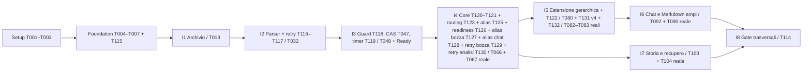

# Tasks: Documenti di progetto con provenienza verificabile

**Input**: artefatti in `specs/002-project-documents/`; repository brownfield `C:\source\repos\babbubba\bProjects`, branch `feature/002-project-documents`.
**Prerequisiti documentali**: Specify/Clarify/Plan conclusi; ultimo aggiornamento di [independent-review.md](checklists/independent-review.md#verifica-indipendente-finale-mirata-b1--2026-11-01) READY documentale. [Constitution](../../.specify/memory/constitution.md), [piano MVP](../../AI-Project-Documentation-MVP-Plan.md), [roadmap](../../docs/roadmap/implementation-coverage.md), [Spec](spec.md), [Plan](plan.md), [Research](research.md), [Data model](data-model.md), [HTTP](contracts/http-api.md), [AI](contracts/ai-workflow.md), [parser](contracts/parser.md), [Quickstart](quickstart.md), [consistency](checklists/consistency.md) e [ADR-0001](../../docs/adr/0001-parser-docling-stateless.md).
**Stato**: generazione documentale del 2026-11-01; **123 task tutti aperti** alla generazione (stato corrente: 132 task; T131/T132 aggiunti il 2026-11-04 in I5 su decisione dell'autore; T130 aggiunto il 2026-11-04 su decisione dell'autore; T125/T126/T127 aggiunti il 2026-11-03 in I4 e T128/T129 aggiunti nella stessa data su decisione dell'autore, T067 e successivi aperti, per lo stato dei singoli task fanno fede le checkbox); rettifica mirata C1/D1–D5/G1/E1 dopo l'ultimo rapporto Analyze NOT READY, con piano tecnico invariato. Nessun codice implementato o test runtime eseguito in questa fase; setup Tasks e controlli statici del documento non attestano runtime. Unica baseline operativa: questo file; i futuri file `validation/` citati sono evidenze di esecuzione, non piani/checklist concorrenti.
**Tests**: obbligatori per mandato e Spec, distinti per livello sotto. Organizzazione per le tre user story P1 della Spec, con sottoincrementi verticali e gate indipendenti. Nessuna nuova user story o priorità di prodotto inventata.

## Autorità e continuità brownfield

**Revisione approvata 2026-11-07 T130/N4**: baseline codice `65a9204`, nuovi task **T135–T143** (T143 aggiunto da C + D; T135/T136 poi completati e committati, T137–T143 aperti). **Decisione C + D 2026-11-07** (esito del gate T138 fallito, [AI §13.6](contracts/ai-workflow.md#136-decisione-c--d-percorso-temporaneo-e-routing-2026-11-07)): aggiunto **T143**; T138 resta aperto e bloccato, non più prerequisito di T139/T141. Totale corrente **143** (134 precedenti + 9 delta); conteggi/status dei riepiloghi storici vanno letti alle rispettive date. T130 resta completato sul vecchio contratto; nuovi obblighi [AI §13](contracts/ai-workflow.md#13-revisione-approvata-t130n4--a--c-minima-2026-11-07). **Dipendenze additive normative**, da unire a quelle delle righe storiche senza rimuoverle: **T067 aggiunge T141, T142 (T141 dipende a sua volta da T143, non da T138); T112 aggiunge T141; T114 aggiunge T142**. T108 già dipende da T112. T067 rimane aperto. T066 storico non acquisisce nuove dipendenze: introdurrebbero un ciclo attraverso I5/T131. Non spuntare delta per sola pianificazione.

Plan consolidato governa la policy temporale e prevale puntualmente sui tre residui editoriali: Research R8 (FAIL N da sola promozione), R10 (timer120) e Data model §Campi temporali (prima classificazione subordinata a PromotionDueAt). Applicare esclusivamente la sostituzione espressa in Plan §Classificazione: PromotionDueAt sempre null, nessun PromotionAfterSeconds, additional_work verificato, profilo prestazionale distinto dal regime. Non correggere gli artefatti sorgente durante questa fase.

Riusare auth/progetti/chat/FIFO, Evidence ledger/coverage, ContextBudget/AgentFactory, dispatcher/ExecutionLeaseStore e checkpoint MAF1.26.0; estendere le responsabilità applicative del monolite, non ricostruirle. Le destinazioni nuove sotto riportate sono file da creare nella futura implementazione, non file già esistenti. `Analysis/DocumentEndpoints.cs` riguarda la bozza esistente; `Documents/DocumentEndpoints.cs` riguarda gli allegati. MAF core/OpenAI/Workflows rimangono fissati a1.26.0, .NET10, Angular22+Bootstrap5.3.8, PostgreSQL18; Python3.12 e Docling2.129.0 come baseline da provare/lockare.

Nessun RAG, Qdrant, pgvector, embedding, KB condivisa, nuovo engine, registro Evidence parallelo, OCR generalizzato, SaaS LLM o stime AI di ore/costi/date/risorse. Nessuna modifica a Constitution o artefatti storici `specs/001-project-draft/`; l'evoluzione dei file di **codice** riusati è il delta autorizzato. T052/T053 di `specs/001-project-draft/tasks.md` restano aperti, FAIL N2/N4/N5 e accettazione con riserve per il solo pilota immutati. Non scrivere in `docs/acceptance-trace/`, non creare worktree/cloni o ulteriori ADR.

## Formato, percorsi e regole di esecuzione

Ogni riga operativa usa `- [ ] Txxx [P?] [USn?] ...`, ID locale stabile alla002 (T001–T114 preservati; nuovi T115–T130 inseriti dove servono), file/componenti, **Dip.** esplicite e **Verifica** concreta. I percorsi sono relativi alla root; `Persistence/`, `AI/`, `Analysis/`, `Evidence/`, `Conversations/` e `Documents/` nelle liste di una riga proseguono il prefisso `backend/src/bProjects.App/`; suffissi `.html/.scss/.spec.ts` si riferiscono al componente nominato immediatamente prima. Per una nuova migration EF l'esatto timestamp generato non è predeterminato: la directory `backend/src/bProjects.App/Persistence/Migrations/` e lo snapshot sono parte del task, con nome coerente al delta. Non modificare una migration storica già applicata.

- **[P]**: lavoro su file distinti parallelizzabile **dopo** le dipendenze elencate; l'ID è un'identità stabile, non la posizione numerica di esecuzione. Seguire l'ordine operativo delle righe e le Dip., anche quando il predecessore ha un numero maggiore; non autorizza esecuzioni DGX simultanee o modifiche concorrenti di componenti condivisi.
- **DET/GOLD**: logica/codec/fixture e fake senza LLM reale; **PG**: PostgreSQL e filesystem reali, modello finto/assente; **PARSER**: conversione/container/pesi reali offline senza DGX; **MAF-FAKE/MAF-PG**: SDK MAF reale, modello finto e, per MAF-PG, PostgreSQL reale; **IMPL**: implementazione con la verifica indicata.
- **E2E-OFFLINE**: browser con fake-stack oppure stack reale con LLM finto, sempre distinguendo i due esiti. **DGX/PM-DGX**: richiedono modello interno reale; PM-DGX richiede anche persone. **SEC/REGRESSION/GATE/DOC**: verifica trasversale come descritta; non sottintendono un ambiente AI reale.
- Scrivere prima i test del sottoincremento e rilevare il fallimento pertinente al delta assente; errore di harness/configurazione non è una prova rossa utile. Un task di implementazione/test integrato si chiude solo dopo la propria verifica positiva; test solo scritto non equivale a funzionalità superata. Test non scoperto, SKIP o guasto gestito non superano il nominale.
- Dipendenze sono gate di evidenza: completamento solo quando i criteri del predecessore sono provati. Per **creare/modificare** test si può lavorare sulla relativa interfaccia contrattuale; per il PASS integrato serve il codice. Per qualsiasi gate DGX/umano mancante registrare NOT VERIFIED e lasciare il task aperto. Non cambiare attese per ottenere PASS.
- Nessun rilascio implicito ai checkpoint: I1/I2 sono utili al PM per archivio/consultazione, I4 completa il percorso piccolo, solo tutti i gate previsti consentono l'accettazione002. Questa generazione non avvia Analyze, Implement, runtime, deploy, commit, push o merge.

## Riepilogo fasi e incrementi

| Fase/incremento | Task | Numero | Risultato verificabile |
| --- | --- | ---: | --- |
| Setup | T001–T003 | 3 | Fixture, corpus e separazione harness |
| Foundation | T004–T007, T115 | 5 | Policy/Admin, archivio e metadati condivisi, migrazione strutturale |
| US1 / I1 | T008–T019 | 12 | Archivio PM senza AI |
| US1 / I2 | T020–T032, T116–T117 | 15 | Parsing offline, consultazione e retry PM minimo |
| US1 / I3 | T033–T055, T118–T119 | 25 | Fonti Ready, Evidence1.1, MAF/B1, guard/CAS/timer |
| US1 / I4 | T056–T067, T120–T121, T123–T130 | 22 | Contratto comune, routing, contratto documentale con alias (T125), readiness bounded (T126), alias nella bozza (T127), alias nella chat (T128), retry guidato unico della bozza (T129), retry guidato unico dell'analisi (T130) e percorso completo piccolo |
| US2 / I5 | T068–T083, T122, T131–T133 | 20 | Estensione gerarchica del core, proiezioni e riconciliazione globale |
| US2 / I6 | T084–T092 | 9 | Chat/Markdown oltre contesto |
| US3 / I7 | T093–T104 | 12 | Versioni/candidate/storia/recupero |
| Trasversale / I8 | T105–T114 | 10 | Compatibilità, sicurezza, performance e PM |
| **Totale** | **T001–T133** | **133** | **US1:74, US2:29, US3:12; condivisi/trasversali:18** |

Nota: conteggio storico a T133; totale corrente 143 (T134–T143), vedi la sezione «Autorità e continuità brownfield» in apertura.

## Phase 1: Setup — fixture e harness riusati

**Scopo**: predisporre solo il delta di verifica 002, senza ricreare solution, autenticazione, progetti o toolchain. Nessuna dipendenza DGX.

- [x] T001 DET — Estendere le fixture esistenti in `backend/tests/bProjects.IntegrationTests/DocumentTestFixtures.cs` e `tests/e2e/support/documents.ts`: builder di risposte document-parse-1/evidence-1.1.0, fake IChatClient con contatore invii e clock controllabile, riusando TestApp/ApiHarness/PostgresDatabaseFixture e fake-stack. **Dip.**: nessuna. **Verifica**: fixture riproducibili, nessuna rete o segreto; test di discovery dei nuovi builder.

- [x] T002 [P] GOLD — Aggiungere corpus autorizzato e attese versionate in `tests/fixtures/documents/manifest.json` e `tests/fixtures/documents/`: PDF testuale, DOCX, MD, TXT, tabelle multipagina, header condivisi, non-BMP, negazioni, file corrotti/protetti/misti e almeno 12 fatti su inizio/metà/fine; hash, locator gold, conflitti distanti e classificazioni separati. **Dip.**: nessuna. **Verifica**: manifest identifica ogni file, attesa e licenza/autorizzazione; nessuna modifica delle fixture 001.

- [x] T003 DET — Separare harness e prerequisiti 002 in `backend/tests/bProjects.IntegrationTests/DocumentTestEnvironment.cs`, `backend/tests/bProjects.IntegrationTests/bProjects.IntegrationTests.csproj` e `tests/e2e/playwright.config.ts`, riusando variabili e MTP esistenti. In Setup verificare configurazione dei livelli DET/PG/parser/MAF-fake/DGX/browser, discovery dei builder/test già disponibili e comportamento dei prerequisiti; i casi futuri non sono richiesti già presenti. Discovery non vuota delle nuove prove richiesta al gate che le introduce; suite completa non-DGX in T108, consuntivo di tutti i livelli inclusi DGX/PM in T114. **Dip.**: T001. **Verifica**: harness iniziale e casi già esistenti scoperti senza DGX; prerequisiti mancanti producono SKIP motivato. Un livello ancora non implementato è dichiarato tale, mai PASS né caso finto creato solo per rendere non vuota la discovery.

---

## Phase 2: Foundational — policy e persistenza minima condivise

**Scopo**: fondazione minima per tutti gli incrementi, completata prima delle fasi user story. T006 modella l'archivio, T115 i metadati minimi di preparazione/job/snapshot e T007 ne verifica lo schema; l'enforcement quote è verificato solo dopo il servizio upload. Migrazioni successive restano nell'incremento che ne usa i dati; nessun gate MAF/DGX blocca l'archivio I1.

- [x] T004 DET — Scrivere casi di policy/configurazione in `backend/tests/bProjects.IntegrationTests/DocumentPolicyTests.cs`: default Plan §Configurazione, quote positive, Extended >=180 finito, snapshot immutabile e limiti rifiutati dal server; nessun PromotionAfterSeconds operativo. **Dip.**: T003. **Verifica**: casi scoperti e fallimento iniziale attribuito al delta mancante; dopo T005 tutti PASS.

- [x] T005 IMPL — Implementare policy e accesso Admin ai limiti in `backend/src/bProjects.App/Documents/DocumentOptions.cs`, `DocumentPolicy.cs`, `DocumentLimitEndpoints.cs`, `Persistence/AppDbContext.cs`/`Persistence/Migrations/`, `Program.cs` e `appsettings.json`. Conservare i default Plan §Configurazione: 50000000 byte/file, 1000000000 byte originali/progetto e quota derivati separata di pari valore, 250000000 byte espansi e derivati/versione,1000 pagine/100000 blocchi,300s parse/upload,3600s preparazione e180/3600s comandi Ordinary/Extended dal t0,512 chiamate,32 livelli/100000 candidati. DocumentPolicy: «Revision, UpdatedBy/At», «una sola riga globale», PUT If-Match atomico. Estendere `Identity/AccountBootstrap.cs` tramite UserManager/RoleManager e configurazione server esplicita per creare/assegnare Admin in modo idempotente; account PM e password esistenti preservati, nessuna elevazione implicita. Estendere `Identity/AuthEndpoints.cs` e policy in `Program.cs` dove necessario: login Admin utilizzabile, claim/ruoli corretti anche al refresh, endpoint limiti riservati ad Admin senza indebolire accessi PM preesistenti. Segreti fuori repository, nessun signup/console Admin o ruolo deciso dal client/documento. Aggiungere prove in `backend/tests/bProjects.IntegrationTests/DocumentAdminAuthorizationTests.cs` riusando AuthTests/ApiHarness. **Dip.**: T004. **Verifica**: T004 PASS; PostgreSQL e API reali senza DGX: provisioning ripetuto non duplica né altera PM/password; Admin effettua login e refresh con claim corretti, GET/PUT limiti riusciti; anonimo401, PM senza Admin403, ruolo assente/credenziali errate rifiutati e If-Match obsoleto409. Il bootstrap non cambia privilegi senza configurazione esplicita. Avvio e lettura limiti indipendenti dal modello.

- [x] T006 IMPL — Modellare il solo archivio e le preferenze in `backend/src/bProjects.App/Documents/DocumentEntities.cs` e `Persistence/AppDbContext.cs`: tutti i campi Data model ProjectDocument, DocumentVersion, UploadReceipt, ProjectSourceSelection/Item. Vincoli: «UUID, timestamp UTC da DB, JSONB per manifesti versionati», «Nome non identità, no unique sul nome; puntatore Ready solo a versione dello stesso documento», «Unique(DocumentId,Version), original bytes immutabili, StorageKey generata/univoca, size >0, FK Restrict», «Unique(ProjectId,RequestKey)», «Status Receiving/Committed/Aborted», «unique(ProjectId,DocumentId), confronto Revision obbligatorio», «Mode LatestReady/Pinned, PinnedVersionId nullable». FK composte progetto e revisioni; finché non pronta nessuna versione è applicabile. Record di preparazione/job e snapshot temporali sono assegnati a T115; migrazione e vincoli DB verificati in T007. Non implementare qui upload, worker, quota aggregata o WorkManifest. **Dip.**: T005. **Verifica**: modello archivio costruibile e vincoli strutturali individuati; originali e preferenze non usano MessageId sintetici o sessioni MAF. Nessun payload storico001 cambiato; test schema positivo in T007 dopo T115.

- [x] T115 IMPL — Separare i metadati condivisi dall'archivio in `backend/src/bProjects.App/Documents/PreparationEntities.cs`, `DocumentJobs.cs`, `SourceSnapshotEntities.cs`, `Conversations/ConversationEntities.cs`, `Analysis/AnalysisEntities.cs` e mapping `Persistence/AppDbContext.cs`: predisporre DocumentPreparation e DocumentJob Queued con campi root/lease Data model, t0 di acquisizione, cap preparazione congelato e FK parent; «Unique(versionId,generation), una generazione aperta/versione», «Kind Parse/ExtractUnit, UnitId opzionale», «Completed richiede risultato; Failed richiede errore». SourceSnapshot/Item e SourceSnapshotId «nullable per legacy», «solo Ready ha estrazione selezionabile». Root/figli usano timestamp UTC DB e cap subordinati; nessun worker, classificatore, record WorkOutput o dati Evidence documentali ancora. La migrazione strutturale unica segue in T007; T028/T029 e T057 estendono questi stessi tipi. **Dip.**: T006. **Verifica**: modello costruibile con progetto/parent e riferimenti coerenti, rami legacy nullable e invariati; fixture può rappresentare fonte indisponibile senza renderla Ready. T007 verifica FK/unique/CHECK e roundtrip sul DB reale senza AI.

- [x] T007 PG — Generare la migrazione dei modelli T006/T115 in `backend/src/bProjects.App/Persistence/Migrations/` e verificarne creazione/upgrade in `backend/tests/bProjects.IntegrationTests/DocumentStorageMigrationTests.cs`, riusando fixture PostgreSQL e comando migrate esplicito. Verificare esclusivamente invarianti strutturali già definiti: unique identità/versione/receipt, FK/progetto/parent, size >0, stati/nullable e completed-result; nessuna migrazione all'avvio o Down distruttiva. Le quote aggregate e riservate sono responsabilità applicativa T012–T013 e gate T018, non CHECK cross-row, trigger o servizi nuovi. **Dip.**: T115. **Verifica**: PostgreSQL reale: FK, unique e CHECK strutturali rifiutano righe invalide, dataset archivio/preparazione Queued e snapshot indisponibile fanno roundtrip; dati/conferme/hash JSON canonici001 preservati. Nessun requisito di PASS sull'enforcement quota prima del servizio di upload.

---

## Phase 3: User Story 1 — Dai documenti alla bozza verificata dal PM (P1)

**Obiettivo US1**: quattro formati → fonti consultabili → chat → Analizza → correzione/conferma → Markdown proposto, con fonti verificabili. **Test indipendente finale**: percorso completo su documenti piccoli, almeno cinque casi SC-003 e tutti i formati, senza assistenza tecnica; le estensioni oltre contesto sono US2. I1–I3 sono capacità parziali utilizzabili, non completamento o accettazione di US1/002.

### Incremento I1 — Archivio PM senza AI (T008–T019)

**Test indipendente**: con DGX e parser indisponibili il PM carica un originale, vede stato acquisito/in coda, aggiunge una versione, cambia inclusione e riscarica bytes identici. Nessuna promessa Ready prima della preparazione.

**Test prima dell'implementazione**: T008–T010; PASS integrato richiesto in T018–T019.

- [x] T008 [P] [US1] DET — Scrivere test contrattuali in `backend/tests/bProjects.IntegrationTests/DocumentArchiveContractTests.cs` per POST documents/versions e GET lista/dettaglio/download, idempotenza 201/200/409, errori HTTP §Documenti e identità separata dal nome. **Dip.**: T007. **Verifica**: discovery e fallimenti iniziali pertinenti; successiva esecuzione in T018 copre ogni route e codice previsto.

- [x] T009 [P] [US1] DET — Scrivere test dello storage in `backend/tests/bProjects.IntegrationTests/DocumentFileStoreTests.cs`: filename/path ostili, symlink, stream e byte limitati, hash, nessun fetch/link/macro e directory fuori webroot, inclusi errore disco e copia originale immutabile. **Dip.**: T007. **Verifica**: nessun accesso fuori root temporanea di test o contenuto integrale nei log; test falliscono prima di T011.

- [x] T010 [P] [US1] PG — Scrivere fault injection e contese receipt/quota in `backend/tests/bProjects.IntegrationTests/DocumentUploadRecoveryTests.cs`: crash prima rename, dopo rename/prima DB, replay stesso input, chiave con input diverso, due upload simultanei e quota derivati separata. Le prove sono scritte qui prima dell'implementazione; il PASS applicativo delle quote è richiesto soltanto dopo T012–T013 nel gate T018, non nella migrazione T007. **Dip.**: T007. **Verifica**: PostgreSQL reale e filesystem isolato; fallimento iniziale motivato, nessuna finta atomicità DB/filesystem; rerun PASS in T018.

- [x] T011 [US1] IMPL — Implementare `backend/src/bProjects.App/Documents/DocumentFileStore.cs`: chiavi generate server non condivise fra progetti, stream/hash SHA-256, temp+flush+rename stesso volume, download originale hash-validato, risoluzione path sicura e temporanei riconciliabili; nessuna sostituzione di versione o sweep di file referenziati. **Dip.**: T009. **Verifica**: T009 PASS con filesystem reale temporaneo, inclusi guasti di scrittura e preservazione dei bytes.

- [x] T012 [US1] IMPL — Implementare upload/receipt in `backend/src/bProjects.App/Documents/DocumentUploadService.cs`: riserva quota sotto lock, formato effettivo/MIME/signature, commit originale+versione+Preparation/DocumentJob Queued+receipt soltanto dopo file durevole. Riconciliazione receipt ExpiresAt e residui con hash/metadata; «acquisizione solo Committed con versione/job; contesa quota serializzata». RequestKey comprende bytes+metadata+target. **Dip.**: T010, T011. **Verifica**: T010 PASS; un crash non crea duplicati o falso acquisito; nessun lock SQL tenuto durante stream. Il record preparazione iniziale è accodato, mai eseguito da una seconda coda.

- [x] T013 [US1] IMPL — Aggiungere validazione del trasporto in `backend/src/bProjects.App/Documents/DocumentUploadValidation.cs`, wiring multipart in `Program.cs` e limiti proxy/volume privato in `infra/web.conf`/`infra/compose.yaml`: 50000000 byte backend, proxy compatibile, timeout ricezione 300 s, quote reali e rifiuto macro-enabled/archivi espansi ostili; segreti solo env. **Dip.**: T011, T012. **Verifica**: test al limite e oltre limite restituiscono 413/415/422/507 pertinenti; originali precedenti restano scaricabili; Compose config valido senza dipendere da DGX.

- [x] T014 [US1] IMPL — Implementare `backend/src/bProjects.App/Documents/DocumentEndpoints.cs` e registrazione in `Program.cs` riusando auth PM, ProjectId e ProblemDetails 001: archivio/versioni/download con no-store/nosniff/attachment, lista cursor limit 1–100 e stato reale; job/preparazione Queued espliciti, accessi ID altro progetto 404, replay non accoda lavoro. **Dip.**: T008, T012, T013. **Verifica**: contratti T008 PASS con API reale+PostgreSQL; download identico e nessuna URL pubblica/path o segreto esposto.

- [x] T015 [US1] IMPL — Implementare preferenze e relative API in `backend/src/bProjects.App/Documents/SourceSelectionService.cs` e `SourceSelectionEndpoints.cs`: GET/PUT completo con ETag/If-Match, revisione, Included e LatestReady/Pinned, esclusione persistente, versione non pronta non applicabile. Riutilizzare lock progetto della T006; nessuna modifica di run/conferme esistenti. Estendere anche `Analysis/AnalysisEndpoints.cs` e `Conversations/ConversationEndpoints.cs` con il guard fonti non pronte e snapshot T115: Analizza bloccata; chat salva messaggio e indisponibilità congelata, fornisce solo stato senza inventare supporto documentale; nessun nuovo documento ignorato silenziosamente. Il guard chat per fonte indisponibile deve raccordarsi all'esecutore/committer esistente in `AI/ConversationalAgent.cs` e `Conversations/ChatTurnCompletion.cs`, senza attendere i workflow documentali I4: messaggio persistito e stato veritiero, nessuna risposta documentata inventata o inferenza necessaria per spiegare l'indisponibilità. **Dip.**: T014. **Verifica**: due PUT sulla stessa revisione hanno un vincitore e un 409; GET non crea job; incluso non pronto riportato fra blockingSources.

- [x] T016 [P] [US1] IMPL — Aggiungere DTO/client dell'archivio in `frontend/src/app/projects/documents-api.service.ts` e `documents-api.service.spec.ts`, riusando HttpClient/auth: multipart, idempotency key conservata sul replay, liste/versioni, download e selezione con ETag; non confondere documenti caricati con bozza DocumentView. **Dip.**: T014, T015. **Verifica**: test HttpTestingController per metodi/errori/replay, nessun prompt/regime/timeout inviato dal client.

- [x] T017 [US1] IMPL — Aggiungere vista archivio in `frontend/src/app/projects/project-documents.component.ts`, `.html`, `.scss`, `.spec.ts` e integrarla in `project-shell.component.ts`/`.html`: upload, metadati, versioni, scelta/esclusione e download, Queued/errore leggibili, tastiera e focus; nessun progresso AI simulato. **Dip.**: T016. **Verifica**: Vitest su stato e conflitti; i controlli archivio restano usabili con servizi AI offline.

- [x] T018 [US1] PG — Concludere T008/T010 e aggiungere `backend/tests/bProjects.IntegrationTests/DocumentArchiveApiTests.cs`: limiti server, ruolo Admin/PM, ID altro progetto, due file omonimi, idempotenza, interruzione originale/DB, riavvio e quota concorrente. Verificare esplicitamente dopo T012–T013 riserva/enforcement sotto lock di quote originali, receipt concorrenti e derivati separati, casi al limite e oltre soglia, senza trigger DB; rieseguire i casi quota T010 contro il servizio effettivo. **Dip.**: T012, T013, T014, T015. **Verifica**: tutte le prove archivio su PostgreSQL+volume reale PASS con modello irraggiungibile; hash/versioni e ultimo risultato precedente invariati.

- [x] T019 [US1] E2E-OFFLINE — Aggiungere `tests/e2e/document-archive.spec.ts` e supporto in `tests/e2e/support/fake-stack.ts`: PM carica, aggiunge v2, esclude, riapre e scarica con errori/quota; registrare esito dell'incremento in `specs/002-project-documents/validation/I1.md` senza checklist parallele. **Dip.**: T017, T018. **Verifica**: browser offline con API simulate e scenario su API+PostgreSQL reale/LLM disabilitato distinti; dati persistono dopo riavvio. È il primo incremento realmente utilizzabile PM.

### Incremento I2 — Consulta testo strutturato e originali (T020–T032, T116–T117)

**Test indipendente**: con parser reale offline e DGX disabilitato, il PM apre testo, tabella e passaggio/locator dei quattro formati. Parsing terminato è distinto da fonte Ready; issue informative mantengono Incomplete. Test T020 prima delle conversioni; gate T026/T031, retry API/UI T116–T117 e gate completo T032, tutti senza DGX.

- [x] T020 [P] [US1] DET — Definire fixture/test del manifest in `parser/tests/test_contract.py` e `parser/tests/test_locators.py` secondo document-parse-1: campi obbligatori, status Complete/Incomplete, inventory/chunks/issues, offset unicode-codepoint, Primary/Context, parentRef/page nullable e hash di versione/config/modelli. **Dip.**: T002, T003, T007. **Verifica**: fixture non richiedono LLM; i test scoprono campi/range invalidi e falliscono finché conversione e servizio non sono disponibili.

- [x] T021 [P] [US1] PARSER — Creare build riproducibile in `parser/pyproject.toml`, `parser/requirements.lock`, `parser/Dockerfile` e `parser/model-artifacts.json`: Python 3.12, Docling 2.129.0 con transitive/hash, pesi locali e licenze registrate. Verificare API della versione fissata e build CPU Linux target; download soltanto in build autorizzata, mai runtime. **Dip.**: T003, T007. **Verifica**: immagine/pacchetti/pesi identificati da hash e test import offline; incompatibilità o licenza non risolta è FAIL del gate, non fallback/new ADR.

- [x] T022 [US1] IMPL — Implementare `parser/service.py` e `parser/conversion_process.py`: health/version e convert sincrono autenticato, una conversione/istanza, subprocess terminabile, timeout e output/byte espansi limitati, cleanup request-local e codici 429/409/415/422/503 del contratto; nessun DB, job durevole, mount originali o LLM. **Dip.**: T020, T021. **Verifica**: test HTTP/processo per busy, kill e errori redatti; nessun flag Ready o retry autonomo; risorse non rinnovano la deadline backend.

- [x] T023 [US1] IMPL — Implementare conversione PDF/DOCX in `parser/converters.py`: DoclingDocument originale, ordine/titoli/celle/span/header, pagine/bbox coordinate native PDF e path DOCX con page=null; OCR/VLM/enrichment/plugin/fetch disabilitati, elementi informativi non trattati in inventory/issues e Complete/Incomplete coerente. **Dip.**: T022. **Verifica**: gold di PDF e DOCX T002/T020 confronta testo e locator, scansione/misto/embedded non diventano Ready fittizi.

- [x] T024 [P] [US1] IMPL — Implementare MD/TXT in `parser/text_sources.py`: MD tramite Docling con originale e righe/range lossless, tabelle/fences/link testuali; TXT UTF-8 con/senza BOM e UTF-16 con BOM, nessun replacement o heading inventato; codifica non ammessa esplicitamente rifiutata. **Dip.**: T022. **Verifica**: gold con non-BMP/newline, code fences e link; nessun accesso remoto, righe e testo ricostruibili dai bytes.

- [x] T025 [US1] IMPL — Produrre chunk e range in `parser/chunk_manifest.py`: HybridChunker con tokenizer locale identificato, rangeKey/blockRef/start/end e source hash, ownership Primary/Context, header replicato verso blocco originale, frase/tabella multipagina come più range ordinati. Non attribuire precisione DGX ai TokenCount stimati. **Dip.**: T023, T024. **Verifica**: ogni item inventory coperto o issue; range integri, nessuna duplicazione proprietaria o citazione del solo testo contestualizzato.

- [x] T026 [US1] PARSER — Eseguire golden/offline e isolamento in `parser/tests/test_offline_conversion.py`, `test_security.py` e configurare servizio/rete privata parser in `infra/compose.yaml`: non-root/read-only/tmpfs, CPU2/RAM4GiB/pids limitati, senza porta host/egress e senza mount originali, segreto interno da env. **Dip.**: T025. **Verifica**: quattro formati, password/corruzione, zip bomb/traversal, kill timeout, rete bloccata e limite output 250 MB PASS; conservare hash e risultati in `specs/002-project-documents/validation/parser.md`, senza DGX.

- [x] T027 [P] [US1] IMPL — Implementare adapter/validatore in `backend/src/bProjects.App/Documents/ParserClient.cs` e `ParsedManifestValidator.cs` con test `backend/tests/bProjects.IntegrationTests/ParsedManifestTests.cs`: hash/versioni, limiti/refs/parent aciclici/range/celle/inventory, conversione codepoint→UTF-16 verificata, source line mapping; trasporto timeout subprocess+max5 s cleanup sempre entro root. **Dip.**: T020, T022. **Verifica**: manifest 200 incompleto/ostile respinto o Incomplete; non-BMP e multi-blocco esatti; mock HTTP non richiede parser o DGX.

- [x] T028 [US1] IMPL — Completare i record preparazione T115 e modellare gli artefatti di parsing in `backend/src/bProjects.App/Documents/PreparationEntities.cs`, mapping `Persistence/AppDbContext.cs` e migrazione in `Persistence/Migrations/`: campi Data model DocumentPreparation di T115 e ParsedArtifact/DocumentBlock/DocumentPortion/PreparationIssue, «Ready solo dopo tutte le porzioni e ledger validi», «Una pubblicazione sotto il fence del job Parse per preparazione», «Unique(ArtifactId,ordinal/ref), ordine di lettura; no pagina inventata», «Ogni range assegnato; copie di header/contesto marcate non proprietarie». Persistire originale Docling+manifest hash-validati append-only. DocumentPortion mantiene «unità originale non modificata da retry»; PreparationIssue comprende Code/Severity/Reason e «Pagina immagine/informazione non trattata rende Incomplete». **Dip.**: T007, T027, T115. **Verifica**: PG vincoli/parent/progetto e roundtrip manifest; parsing resta distinto da estrazione e Ready; metadati/artefatti non dipendono da sessioni MAF.

- [x] T029 [US1] IMPL — Estendere i dati minimi T115 in `backend/src/bProjects.App/Documents/DocumentJobs.cs` e aggiungere `DocumentParseWorker.cs` e wiring in `Program.cs`: attivare la richiesta Queued di T012 con DocumentJob Parse CPU, Preparation parent root Extended dalla acquisizione, lease/fence 30/10 s e max3/backoff2/4 s, commit ParsedArtifact+porzioni fenced, Failed/Incomplete espliciti. Campi DocumentJob: «Kind Parse/ExtractUnit, UnitId opzionale», «Stessa macchina lease 001, unique owner/unità logica, Completed richiede risultato; Failed richiede errore». Root/figli e clock DB governano claim/renew/commit, senza slot DGX o secondo scheduler AI. **Dip.**: T012, T028, T115. **Verifica**: parser reale raggiungibile e DGX spento: il worker progredisce; output tardivo/stale non pubblica, nessun reset al riavvio. Nessun nuovo ordinatore di lavori AI nel worker CPU.

- [x] T030 [US1] IMPL — Estendere `backend/src/bProjects.App/Documents/DocumentEndpoints.cs` e `frontend/src/app/projects/document-passage.component.ts`/`.html`/`.spec.ts`, collegandolo a `project-documents.component.ts`: GET preparazione/blocks/passages paginati, testo strutturato e quote evidenziata, pagina/sezione/bbox/righe disponibili o null, download originale; Parsed/Extracting non presentati come Ready. **Dip.**: T017, T028, T029. **Verifica**: test API e Vitest di PDF/DOCX/MD/TXT e parti ordinate multipagina; niente HTML attivo o pagine simulate.

- [x] T031 [US1] PG — Aggiungere `backend/tests/bProjects.IntegrationTests/DocumentParsingRecoveryTests.cs`: migrazione T028, richieste in coda, parser kill/crash/429, backend interrotto prima/dopo artifact commit, reclaim e padre scaduto; usare parser reale per integrazione e fake HTTP per gare riproducibili. **Dip.**: T026, T029. **Verifica**: unità/artefatti unici, originali preservati, limite 300 s tentativo e 3600 s root inclusa coda, cleanup entro padre; due worker non pubblicano insieme.

- [x] T116 [US1] IMPL — Implementare il retry minimo del parsing in `backend/src/bProjects.App/Documents/DocumentPreparationService.cs` e `DocumentEndpoints.cs` con prove `backend/tests/bProjects.IntegrationTests/DocumentParseRetryTests.cs`: POST /document-jobs/{j}/retry solo per job Parse terminale fallito/incompleto e azione ammessa, auth/progetto e Idempotency-Key validati. Sotto lock creare nuova richiesta/Preparation+Parse job Queued con RetryOfId verso il precedente, nuovo t0 esplicito e cap congelato; il vecchio root, originale, errori/output/deadline restano immutati. Replay stessa chiave/input restituisce stessi ID e non accoda due volte; input diverso/attivo/azione non ammessa dà conflitto coerente col contratto. Riutilizzare upload, modelli T115 e worker T029; nessuna reinvenzione di scheduler/retry o import WorkOutput avanzato. **Dip.**: T029, T031. **Verifica**: API+PostgreSQL+parser reali, DGX assente: terminale→nuova richiesta tracciata202, replay idempotente, conflitto409 dove previsto; GET non ritenta. Verificare errore temporaneo esaurito e root scaduto senza reset del vecchio, tentativi bounded del nuovo e preservazione bytes/hash; rilevare discovery del test nuovo.

- [x] T117 [US1] IMPL — Aggiungere azione PM di retry parsing a `frontend/src/app/projects/documents-api.service.ts`, `project-documents.component.ts`/`.html` e relativi `.spec.ts`, riusando client e viste I1/I2: pulsante soltanto da allowedActions del terminale, chiave conservata nei replay, nuovo job/richiesta collegato visibile con stato persistito; errore/conflict e focus accessibili. Usare esclusivamente l'API T116, nessun retry da refresh/polling o duplicato quando la rete perde la risposta. **Dip.**: T030, T116. **Verifica**: Vitest positivo/negativo per allowedActions, doppio click/replay/409; gate browser T032 usa API e parser reali senza DGX per ripartire da un fallimento recuperabile e mantenere storico, tempi e originali.

- [x] T032 [US1] E2E-OFFLINE — Aggiungere `tests/e2e/document-parsing.spec.ts` e `frontend/src/app/projects/project-documents.component.spec.ts` per consultazione e issue, con backend+PostgreSQL+parser reali e LLM disabilitato oltre al fake-stack; registrare `specs/002-project-documents/validation/I2.md`. **Dip.**: T030, T031, T116, T117, T019. **Verifica**: PM raggiunge passaggio/originale, errore/incompletezza e retry ammesso; fonte non pronta resta non utilizzabile da Analizza. Nessun test conta conversione 200 come Ready. Il retry manuale deve attraversare T116/T117 e produrre un solo nuovo job collegato; non basta un mock UI o il retry automatico del worker.

### Incremento I3 — Fonti Ready nel medesimo ledger Evidence (T033–T055, T118–T119)

**Test indipendente**: ogni porzione estratta ha un output valido o noEvidence motivato; un solo aggregatore pubblica versione Evidence e bundle Ready. Tutto è verificabile con SDK MAF reale e modello finto; T055 è la distinta prova con LLM interno. Il grafo nativo e la policy temporale sono gate dei percorsi AI nuovi, non dell'archivio. Guard T118, CAS atomica T047 e timer/sweep T119 sono responsabilità distinte: solo T048 ne valida l'integrazione prima dell'attivazione AI.

- [x] T033 [P] [US1] DET — Scrivere fixture schema/compatibilità in `backend/tests/bProjects.IntegrationTests/DocumentEvidenceSchemaTests.cs` e `DocumentAnalysisSchemaTests.cs` con output/payload 1.1 chiusi, fonti Message/DocumentPassage, nullable/XOR, enum/stringhe, extra/duplicati/numerici rifiutati e JSON storici 1.0/evidence-1.0/coverage-v1 inalterati. **Dip.**: T001, T028. **Verifica**: decoder legacy resta verificato; test nuovi falliscono per il solo decoder mancante, non per assenza DGX; PASS richiesto in T037.

- [x] T034 [US1] IMPL — Aggiungere codec distinti in `backend/src/bProjects.App/Evidence/DocumentEvidenceContent.cs`/`DocumentEvidenceExtraction.cs` e `Analysis/DocumentAnalysisContent.cs`/`AnalysisSchemaDispatch.cs`, conservando converter const e JSON 1.0 esistenti. Implementare tutti i campi/enum AI §§1–2 strict; Data model: «schema documentale evidence-1.1.0», «Content 1.1 con sources discriminate», «MessageId/sequence XOR campi documentali», «Key globale di versione = unitOrdinal + key locale»; Analysis 1.1 Documented/DocumentPassage e cutoff zero solo con snapshot documentale pronto non vuoto. **Dip.**: T033. **Verifica**: T033 passa per codec; fonte documentale con ipotesi resta Inferred/Assumed, Declared non diventa conferma PM; nessun nuovo registro Evidence.

- [x] T035 [US1] IMPL — Implementare quote/alias/sources in `backend/src/bProjects.App/Evidence/DocumentEvidenceValidation.cs` e `DocumentSourceMap.cs`: campi AI §2 completi, quote esatta su range ammessi, UTF-16 «Range [start,end) ... start≥0, end>start», Primary posseduta, assistant solo Referent, group/part ordinati e header verso originale, target key o alias Pn validi. «Unique(groupId,part), owner progetto/versione coerente e tutti i range verificati». Zero evidenze richiede motivo, Length/JSON invalido è permanente. **Dip.**: T027, T034. **Verifica**: test unitari con quote inventate, non-BMP, header condiviso e fonti fuori snapshot; nessuna riparazione AI o locator deciso dal modello.

- [x] T036 [US1] IMPL — Estendere `backend/src/bProjects.App/Evidence/EvidenceEntities.cs`, `Persistence/AppDbContext.cs` e migrazione in `Persistence/Migrations/`: OriginKind Message/Document e nullable dei campi Message soltanto nel ramo Document, Preparation owner e FK composte; «XOR Message oppure Preparation», «Unique per owner+Version, JobId unico», «FK Restrict»; EvidenceDocumentState/DocumentPromotion per DocumentVersion senza alterare EvidenceMessageState. AnalysisEvidenceSelectionItem discriminata con «XOR nullable MessageId / PreparationId», relazioni di run append-only. **Dip.**: T028, T034. **Verifica**: modello costruibile e SQL migrazione controllato; backfill solo OriginKind=Message, nessun JSON/ID/span/hash/conferma storico riscritto.

- [x] T037 [US1] PG — Eseguire upgrade/codec in `backend/tests/bProjects.IntegrationTests/DocumentEvidenceMigrationTests.cs` e fixture T033: DB 001 con run, bozze, Evidence, citazioni e checkpoint; XOR/FK/progetto, legacy mixed list e conservazione hash canonici. **Dip.**: T035, T036. **Verifica**: decoder e migrazione PASS con PostgreSQL reale senza LLM; ignoti rifiutati esplicitamente, storico non reinterpretato come 1.1.

- [x] T038 [P] [US1] DET — Scrivere test modello/fase e payload completo in `backend/tests/bProjects.IntegrationTests/DocumentContextBudgetTests.cs`: override tokenizer distinti, W=min(cap,misura), O reasoning incluso senza doppia sottrazione, margine calibrato, framing/schema/tool/template, unavailable e calibrated_upper_bound, singolo elemento irriducibile. **Dip.**: T003, T007. **Verifica**: doppio finto runtime distingue modelli e contatori; input esatto al budget e un token oltre verificati; nessuna chiamata fuori budget.

- [x] T039 [US1] IMPL — Estendere `backend/src/bProjects.App/AI/ModelRuntimeMonitor.cs`, `InternalModelClient.cs`, `ContextBudget.cs` e `AgentFactory.cs`: probe/cache/count per modello/fase/template, preflight payload effettivo con fingerprint congelato, agenti batch senza history/compattazione e guard per finestra/tokenizer verificati; nessun registry/provider nuovo né cambio della policy legacy. **Dip.**: T038. **Verifica**: T038 PASS con endpoint finto; sconosciuto non certificato impedisce invio documentale, credenziali solo interne e avvio/archivio indipendenti dal probe.

- [x] T040 [US1] IMPL — Aggiungere dati di lavoro in `backend/src/bProjects.App/AI/DocumentWorkEntities.cs`, mapping `Persistence/AppDbContext.cs` e migrazione: WorkManifest con Config/Source/Runtime/Definition/Algorithm/Policy hash; DerivedBatch con campi Data model §Campi temporali, «unique(owner,batchId), append-only»; WorkOutput completo con «Status Committed», «Unique(owner,batchId) impedisce anche inputHash diverso sullo stesso batch; hash discordante è errore, non update». WorkflowCheckpoint owner ProcessingRun/ChatTurn/DocumentJob con «XOR e FK/progetto»; InferenceCalls quarto owner DocumentJob con «XOR esteso e indici finali per owner». **Dip.**: T036. **Verifica**: PG roundtrip di manifesti e vincoli owner/batch; dati storici leggibili, nessuna tabella NextExecutor.

- [x] T041 [US1] IMPL — Implementare `backend/src/bProjects.App/AI/DocumentWorkStore.cs` e adattare `PostgresCheckpointStore.cs`: output/mappe/figli o ricevuta d'espansione durevoli nello stesso commit fenced, blob hash-validato prima del riferimento DB, unique idempotenti e lookup compatibilità; checkpoint nativo separato, commit sequence sotto lock owner e guard deadline padre attuale. Identità AI §5.2 con attempt/fence fuori hash logico. **Dip.**: T035, T039, T040. **Verifica**: test PostgreSQL per replay identico/input discordante, blob assente/corrotto, checkpoint incompatibile e writer stale; nessun exactly-once dell'inferenza promesso.

- [x] T042 [P] [US1] MAF-FAKE — Scrivere gate SDK 1.26.0 in `backend/tests/bProjects.IntegrationTests/DocumentMafCycleTests.cs` riusando MafApiCompatibilityTests: Executor<TInput>, AddEdge condizionale disgiunto, QueueStateUpdate, CheckpointManager e ResumeStreamingAsync; fake IChatClient osserva tre batch al 60% di B, sessioni distinte e nessuna history cumulativa. **Dip.**: T038, T040. **Verifica**: costruzione/esecuzione SDK reale con modello finto, test nuovo ciclo inizialmente rosso; PASS prima di attivare i workflow T049/T058/T059, senza DGX.

- [x] T043 [US1] IMPL — Implementare grafo nativo fisso in `backend/src/bProjects.App/AI/DocumentBatchWorkflow.cs` e `DocumentBatchExecutors.cs`: Load→PrepareBatch→LookupOutput, Hit→Advance, Miss→InvokeBatch→ValidatePersistBatch→Advance, feedback oppure Assemble→Commit; doppio lookup anche all'ingresso InvokeBatch prima della nuova AgentSession, contesto esplicito contato e contatore invio prima rete; commit prima di Advance. Nuovi owner usano la definizione congelata, legacy bound invariato. **Dip.**: T041, T042. **Verifica**: T042 PASS e rami esclusivi; hit non crea sessione/inferenza, tre invii isolati; fallimento di composizione MAF richiede correzione nativa prima di avanzare, non secondo engine.

- [x] T044 [US1] MAF-PG — Provare B2 in `backend/tests/bProjects.IntegrationTests/DocumentBatchRecoveryTests.cs`: crash dopo Miss/LLM prima output, output Committed prima checkpoint, Advance ripetuto, join genitori, lease perso, checkpoint assente/arretrato o blob invalido e Completed prima checkpoint finale; riavvio da processo nuovo/DB reale. **Dip.**: T043. **Verifica**: output già Committed riusati senza invio e con stessi ID/hash/figli; prima del commit reinferenza ammessa e contatore conservato; stale worker non scrive. SDK reale/fake LLM dichiarati.

- [x] T045 [P] [US1] DET — Scrivere tabella B1 in `backend/tests/bProjects.IntegrationTests/DocumentRegimePolicyTests.cs` secondo Plan aggiornato e QS §B1: soglie T/B e floor/V, prima regola vince, unknown/reject/fail, Pending senza AI a 130/190 s, multipasso, no coda/timer/durata/carico come predicato; fixture A–G e formula N indipendente dal regime. **Dip.**: T038, T040. **Verifica**: stessi input/hash danno stesso esito; N a150 PASS con qualità conforme, N oltre180 FAIL temporale anche dopo promozione; test di policy senza DGX.

- [x] T046 [US1] IMPL — Implementare `backend/src/bProjects.App/AI/DocumentRegimePolicy.cs` e mapping/migrazione in `Persistence/AppDbContext.cs`/`Persistence/Migrations/`: document-regime-v2, ClassificationRecord append-only e schema completo W/O/M/B/T/provenance/skeleton/plannedCalls/unknown, «Unique(owner,ordinal)»; root InitialRegime/Regime/PolicyHash/t0 e «CHECK cap finito e Effective≤Hard; PromotionCount in 0/1», «CHECK DeadlineAt=EffectiveDeadlineAt», legacy nullable. PromotionDueAt sempre null; skeleton versionato e V come Plan, nessuna regola editoriale obsoleta. **Dip.**: T039, T040, T045. **Verifica**: T045 PASS; preflight determina prima deadline dal t0 e non la sposta per il carico; nessuna promozione temporale a120 s.

- [x] T118 [US1] IMPL — Implementare i guard dell'autorità temporale corrente in `backend/src/bProjects.App/AI/DocumentDeadlineGuard.cs`, `Persistence/ExecutionLeaseStore.cs`, `AI/PostgresCheckpointStore.cs` e committer di `Analysis/`/`Conversations/`, estendendo quelli di T029/T041: sotto clock DB/lock pertinente validare root/figlio attivi, owner/fence/lease e now<min(DeadlineAt locale,EffectiveDeadlineAt padre). Claim/renew/release/commit/checkpoint rileggono DeadlineAt=EffectiveDeadlineAt del root documentale; nessun vecchio claim concede autorità o reset. Riutilizzare semantica 001 e helper condiviso nel worker parsing; ramo legacy invariato. Questa parte non implementa la CAS di promozione o un nuovo scheduler. **Dip.**: T029, T041, T046. **Verifica**: test PG in `backend/tests/bProjects.IntegrationTests/DocumentDeadlineGuardTests.cs` su padre scaduto, figlio col limite più stretto, lease stale e proiezione cambiata; nessuna scrittura tardiva o rinnovo del cap, vincoli T046 effettivi. Test e modelli finti bastano; nessun DGX.

- [x] T047 [US1] IMPL — Implementare esclusivamente la transizione atomica di promozione in `backend/src/bProjects.App/AI/DocumentRegimeTransitions.cs`: sotto lock root e guard T118, precedenza terminale→scadenza/errori/limiti→completamento→promozione. Verificare ricevuta additional_work contro WorkOutput Committed, obbligazioni residue reali e nuovo batch necessario senza cache compatibile, input/genitori/hash e piano congelato. Una sola transazione fenced persiste ricevuta/riferimento, batch già determinabili, RegimeTransition «unique(rootId,to=Extended)», PromotionCount0→1 e DeadlineAt=EffectiveDeadlineAt=HardDeadlineAt con timestamp/elapsed; Hard/t0/fence/contatori non azzerati. CAS e tutte queste scritture rimangono indivisibili; coda/inferenza lenta/retry/attesa commit non sono motivi. Timer/sweep sono T119, le gare integrate T048. **Dip.**: T041, T046, T118. **Verifica**: test PG di CAS/ricevuta in `backend/tests/bProjects.IntegrationTests/DocumentPromotionTransitionTests.cs`: un vincitore, rollback completo su ricevuta/batch invalidi, completamento già valido precede promozione, scadenza esatta impedisce entrambe; nessun allungamento da ripetizione e nessun cambio legacy. Non attivare il ramo AI nuovo prima di T048.

- [x] T119 [US1] IMPL — Integrare timer root e sweep nel dispatcher esistente in `backend/src/bProjects.App/AI/AiDispatchService.cs`, `ExecutionOptions.cs` e `Persistence/ExecutionLeaseStore.cs`: usare guard T118 e deadline attuale DB dopo CAS T047, sweep/monitor ogni secondo indipendente dallo slot AI e riconciliazione al restart; chiudere padre scaduto e figli aperti. Riarmare timer root dal DB, lasciare il timeout già assegnato alla chiamata attiva, min residui/locali, max3 tentativi e backoff2/4; heartbeat30/10 non prolunga cap. Nessun secondo scheduler, promozione da timer o modifica delle policy legacy. **Dip.**: T047, T118. **Verifica**: test PG+fake in `backend/tests/bProjects.IntegrationTests/DocumentDeadlineDispatchTests.cs`: vecchio claim/timer a180 non chiude root già promosso, clock esatto3600 impedisce commit e restart non ricrea budget; coda non promuove, monitor continua con slot occupato. T048 verifica insieme guard/CAS/timer prima di T049–T050, senza DGX.

- [x] T048 [US1] PG — Verificare concorrenza/deadline B1 in `backend/tests/bProjects.IntegrationTests/DocumentRegimeConcurrencyTests.cs` su PostgreSQL con clock letto sotto lock: commit/promozione/sweep a119.999/120/179.999/180/3600, due worker, fence scaduto, retry dopo promozione a110 e restart, preflight tardivo e limiti esatti chiamate/byte. Integrare esplicitamente i guard T118, la CAS indivisibile T047 e i timer/sweep T119 nella stessa campagna; nessun PASS del solo componente autorizza l'attivazione del percorso documentale. **Dip.**: T044, T047, T118, T119. **Verifica**: tutti A–G del QS PASS come regole di controllo: un solo terminale/transizione, t0+3600 preservato, nessuna promozione sola coda; finale completo esattamente al max contatore non fallisce per il solo contatore. Discovery non vuota dei nuovi test guard/CAS/timer e tutti i rispettivi casi PG PASS.

- [x] T049 [US1] IMPL — Aggiungere `backend/src/bProjects.App/AI/DocumentPortionPlanner.cs`, `DocumentEvidenceAgent.cs` e `AI/Prompts/document-extraction-v2.md`: partizione esaustiva di tutte le porzioni misurate, range proprietari/contesto, output shape bounded, batch DerivedBatch/WorkOutput via grafo T043 e schema T034. Preparazione sempre Extended, budget per unità, ID/alias stabili e errori permanenti per output non valido/irriducibile; niente porzioni omesse. **Dip.**: T025, T035, T039, T043, T048. **Verifica**: test fake di più porzioni oltre finestra complessiva e zero evidenze motivato, sessioni nuove, 512 invii inclusi retry; API MAF gate superato.

- [x] T050 [US1] IMPL — Estendere il dispatcher esistente in `backend/src/bProjects.App/AI/AiDispatchService.cs` e `Persistence/ExecutionLeaseStore.cs` per ExtractUnit, riusando advisory lock, owner/heartbeat/fence e InferenceCalls. Uno slot AI globale; rilascio dopo unità, chat/run eleggibili prima della prossima unità, CPU parse indipendente, nessuna preemption del modello o concorrenza nuova. Per il routing dei workflow formali/chat documentali usare il raccordo separato T123; questo task non registra un nuovo dispatcher né sostituisce i grafi legacy. **Dip.**: T047, T049. **Verifica**: test scheduling PostgreSQL+fake: preparazione non monopolizza slot, due istanze non inferiscono insieme, FIFO/cutoff 001 restano; scheduler non dipende dalla connessione browser.

- [x] T051 [US1] IMPL — Estendere `backend/src/bProjects.App/Evidence/EvidenceLedgerStore.cs` con aggregazione documentale e `Documents/DocumentBundleStore.cs`: unico EvidenceExtractionJob per Preparation «unique partial», Queued non eleggibile finché tutte le unità sono valide, senza lease/slot in attesa; sotto ordine progetto→Preparation→aggregatore→DocumentVersion controllare padre/deadline/fence/copertura e pubblicare EvidenceVersion/items/sources/relazioni+Completed+Ready+primo current bundle in una transazione. «Unique(JobId)» e numerazione stabile; candidata non sostituisce corrente. **Dip.**: T036, T041, T050. **Verifica**: due publish simultanei hanno un solo risultato; errore ultima unità impedisce Ready; replay ritorna stessa versione, vecchio owner non emette evento definitivo.

- [x] T052 [US1] IMPL — Estendere `backend/src/bProjects.App/Evidence/EvidenceEndpoints.cs`, `EvidenceViews.cs` e `Documents/DocumentEndpoints.cs`: envelope evidenceViewVersion 1.0/1.1 misto, sourceDocuments/message e passaggi/gruppi atomici, filtri documentali, confronto solo stessa Preparation/mapping verificabile; legacy senza formato accetta solo Message e documenti→406, formato ignoto→400, versioni non comparabili→422. GET non esegue AI. **Dip.**: T037, T051. **Verifica**: contract test di liste/dettagli/confronti storici e documentali, gruppi condivisi e quote corrette; vecchi payload invariati.

- [x] T053 [US1] IMPL — Estendere `frontend/src/app/projects/evidence-api.service.ts`, `evidence-format.ts`, `evidence-view.component.ts`/`.html` e `project-documents.component.ts`: discriminare envelope, origine/certainty, tutte le parti citate e bundle corrente; Ready dipende dal commit aggregato, candidata visibile distinta. Aggiungere test nei rispettivi `.spec.ts`. **Dip.**: T030, T052. **Verifica**: liste miste e link storici aprono range esatti; nessun MessageId fittizio, quote multi-blocco non fuse o conferme PM inventate.

- [x] T054 [US1] PG — Aggiungere `backend/tests/bProjects.IntegrationTests/DocumentPreparationCompletionTests.cs`: aggregator unico, noEvidence per tutte le porzioni, unità fallita/issue nota, errori/limiti, due publish/fence obsoleti, Ready corrente e candidata separati; rieseguire migrazioni/contratti T033–T037 con ledger reale. **Dip.**: T048, T051, T052. **Verifica**: Ready solo completo, snapshot/vecchi current intatti, nessun duplicato dopo crash e nessun slot AI tenuto dall'aggregatore; nessun DGX richiesto.

- [x] T055 [US1] DGX — Provare estrazione interna reale in `backend/tests/bProjects.IntegrationTests/DocumentExtractionMafRealTests.cs` e annotare `specs/002-project-documents/validation/I3-real.md`: quattro formati, tokenizer/usage reale, polarità/quantità/qualificatori, relazioni e quote multi-blocco gold, zero evidenze motivato distinto da perdita. **Dip.**: T026, T039, T050, T053, T054, T032. **Verifica**: parser+PostgreSQL+MAF+LLM interno reali; fonti e fedeltà confrontate con gold T002, non solo coverage; fallimento di modello non diventa PASS per errore gestito.

### Incremento I4 — Percorso completo su documenti piccoli (T056–T067, T120–T121, T123–T130)

**Test indipendente**: documenti Ready piccoli → domanda con citazioni → Analizza anche senza messaggi → edit/conferma → Markdown della revisione confermata; nessun upload/GET avvia analisi. T120/T121 rendono disponibili prima di T059 i contratti e la validazione comuni anche al futuro I5; T123 verifica DI/routing attraverso API e dispatcher reali con LLM finto. T066 prova il percorso completo con fake soltanto dopo tali gate; T067 ne dimostra il nominale con modello reale. **Correzione architetturale del 2026-11-03**: la campagna DGX di T067 ha mostrato che il formato di scambio v2 (il modello riproduce UUID, hash e `Source`) è inaffidabile anche a W=131072; T125 introduce il contratto v3 con alias brevi e composizione server-side ([AI §7](contracts/ai-workflow.md)), T126 la readiness bounded del runtime. T127 estende lo stesso principio alla fase di bozza (N3 reale: UUID di item corrotto dal modello); T128 lo estende alla Chat documentale (N3 reale: UUID di fonte malformato) e T129 introduce un solo retry guidato della bozza per item obbligatori omessi (N1 reale: item I24 omesso), su decisione dell'autore del 2026-11-03. T125 precede T126 e T125/T126/T127/T128/T129 precedono T067, che resta aperto; v2 è storico/frozen e T059/T120/T121/T123/T124/T066 restano spuntati. È il primo percorso completo US1, distinto dall'accettazione oltre contesto.

- [x] T056 [P] [US1] DET — Scrivere contract test in `backend/tests/bProjects.IntegrationTests/DocumentSourceSnapshotTests.cs`: selezione congelata al POST, readiness Analizza/chat, replay prima di ricalcolo fonti, cutoff PM, zero document-only e fonti successive/escluse proibite anche da sintesi; revisioni/bozze confermate immutate. **Dip.**: T037, T052. **Verifica**: matrice HTTP §Selezione con 409 sources_not_ready/422 no_source_input e messaggio chat persistito non pronto; test fake/DB senza DGX.

- [x] T057 [US1] IMPL — Completare gli snapshot introdotti in T115/T015 con `backend/src/bProjects.App/Documents/SourceSnapshotStore.cs` e mapping/migrazione in `Persistence/AppDbContext.cs`/`Persistence/Migrations/`, estendendo POST in `Conversations/ConversationEndpoints.cs`, `Analysis/AnalysisEndpoints.cs` e `DocumentEndpoints.cs`: SourceSnapshot/Item con «solo Ready ha estrazione selezionabile», SourceSnapshotId «nullable per legacy», selezione sotto lock condiviso e snapshot di generazione ereditato dalla revisione, mai corrente. Documentale al POST; Evidence PM mantiene gate primo claim entro cutoff. Persistire anche la definizione documentale v2 e schema/prompt/config coerenti alla richiesta, senza convertire run001; T123 è responsabile di registrare e selezionare tale definizione nel dispatch. **Dip.**: T015, T046, T051, T056. **Verifica**: T056 PASS con PostgreSQL, nuovi documenti/promozioni dopo POST non entrano nei retry, replay trova root originario prima di nuovi controlli.

- [x] T120 [P] [US1] DET+IMPL — Introdurre il nucleo DTO/schema condiviso in `backend/src/bProjects.App/AI/ReconciliationContracts.cs` e `ReconciliationReferences.cs`, con test `backend/tests/bProjects.IntegrationTests/ReconciliationCoreContractTests.cs`: ReconcileResult, Candidate/Disposition, Patch/Disposition e envelope reconcile-1 strict di AI §4.1, wrapper singola chiamata {results,analysis,evidenceMap} con A/B/Cross esattamente ordinati, AnalysisContent1.1 riusato. ID/hash server e canonicalizzazione RFC8785/ordinamenti coerenti con WorkManifest T041; risoluzione EvidenceId/EvidenceVersion/sourceId/quote nello snapshot, nullable e enum chiusi. Per la singola chiamata tutti gli originali sono input, descriptor=null/level0 e nessun CatalogNode/Set artificiale. Tipi/range di riferimenti gerarchici rimangono parte del contratto ma schema dei cataloghi e loro risoluzione/membership sono estesi in T071/T122; niente algoritmo gerarchico anticipato. **Dip.**: T034, T035, T040, T041, T057. **Verifica**: scrivere prima fixture valide/invalide e poi ottenere PASS di codec/refs con modelli finti: extra/duplicati/null/enum, source fuori progetto/snapshot, hash e ordine errati rifiutati; zero evidenze motivato accettato senza radici artificiali. Tutti i consumer T059/T070/T071 riusano questi tipi, nessuna seconda definizione. FR-009/010/014 e SC-003/005/009.

- [x] T121 [US1] DET+IMPL — Implementare validazione comune di patch e completezza in `backend/src/bProjects.App/AI/ReconciliationValidation.cs`, `ReconciliationPatchComposer.cs` e `ReconciliationCompletion.cs`, con test `backend/tests/bProjects.IntegrationTests/ReconciliationCoreValidationTests.cs`. Sul caso singola chiamata validare tutte le patch contro medesima baseHash/expectedHash; duplicati un effetto, payload discordante integrity_conflict, Stale/Invalid necessario blocca completezza. SameRule/Contradicts, Supersedes opposti e alternative incompatibili preservano tutte fonti/qualificatori e decisione PM. Distinguere validità del batch da completezza finale: WorkOutput strutturalmente valido può essere Committed con obbligazioni ancora pendenti e giustificare additional_work secondo B1; soltanto visite A/B/Cross, relazioni note/candidati terminali, disposition patch ammesse e mappa di ogni EvidenceId su item autorizzano revisione finale+Completed. Residui validi impediscono il solo completamento finale, non diventano automaticamente output invalido né falso successo; nessuna fiducia in complete AI. Output troncato/JSON o riferimenti invalidi è errore permanente, mai WorkOutput Committed/noEvidence o riparazione AI. Invarianti comuni AI §§4.4–4.5 identici per single-call e gerarchico; quest'ultimo fornisce in I5 le proprie obbligazioni e prove di membership senza duplicare il validatore. **Dip.**: T041, T120. **Verifica**: test con Evidence e snapshot congelati: output valido completo ammesso; endpoint/quote inventati rifiutati, patch invalid/stale necessarie bloccano il finale, batch valido con copertura residua resta riutilizzabile ma non completa; permutare ordine patch conserva hash o stesso conflitto, tutte alternative intatte. Gold semanticamente perso resta FAIL separato anche con visite100%. T059 usa il risultato server di questa validazione prima di WorkOutput e commit finale. FR-010/014/015 e SC-003/008/009.

- [x] T058 [US1] IMPL — Integrare chat documentale piccola in `backend/src/bProjects.App/AI/DocumentChatWorkflow.cs`, `ConversationalAgent.cs`, `PostgresChatHistoryProvider.cs`, `AI/Prompts/document-chat-v2.md` e `Conversations/ChatTurnCompletion.cs`: fonti e dialogo congelati, sessione invalidata su selezione/config/cutoff, citazioni validate prima commit, risposta/progresso provvisori fino al finale. Fonte non pronta dichiarata senza attesa al retry; no_document_use solo per domanda non documentale. Riutilizzare grafo T043 e policy T047. Implementare il ramo eseguibile con interfacce esistenti; registrazione e selezione della definizione congelata sono responsabilità esplicita di T123, inclusa compatibilità del ramo senza documenti. **Dip.**: T035, T043, T048, T057. **Verifica**: fake verifica esclusione indiretta tramite vecchio assistant/sintesi, FIFO U1/U2/A1 e nessuna revisione formale creata; risposta finale fenced e unica.

- [x] T059 [US1] IMPL — Integrare analisi documentale singola chiamata in `backend/src/bProjects.App/AI/DocumentAnalysisWorkflow.cs`, `AI/Prompts/document-analysis-v2.md`, `Analysis/AnalysisRunCompletion.cs` e `Evidence/EvidenceLedgerStore.cs`: schema strict {results,analysis,evidenceMap}, risultati esattamente A/B/Cross, evidenze/fonti integrali, evidenceKeys interni validati/rimossi, relazioni di run append-only. Definition project-analysis-documents-v2 separata da 001; eventuale lavoro aggiuntivo valido persistito e promosso come B1 prima del passo successivo, mai output invalido recuperato. Usare esclusivamente DTO/refs T120 e validatori/compositore/invarianti T121 per le medesime obbligazioni AI §4.5, distinguendo WorkOutput valido incompleto da risultato finale completo; non creare versioni locali semplificate in attesa di I5. Applicare anche le patch incompatibili del nominale piccolo, conservare alternative e rifiutare output strutturalmente invalido prima del WorkOutput; batch valido con ulteriori obbligazioni può essere persistito e motivare additional_work, mai Completed parziale. T123 rende il workflow raggiungibile da API/dispatcher per la definizione congelata. **Dip.**: T034, T035, T043, T048, T057, T120, T121. **Verifica**: fake di snapshot piccolo e conflitto documento-PM: copertura/mappe server, no scelta automatica, cutoff0 document-only, commit revisione+Completed unico; oltre capacità esplicito in attesa US2. Test T120/T121 riusati sul workflow reale con LLM finto; nessun Complete basato sul solo output AI. Invocazione da API/dispatcher e resume distinti verificati in T123/T066.

- [x] T060 [US1] IMPL — Estendere version dispatch di `backend/src/bProjects.App/Analysis/PreviewRevisionService.cs`, `PreviewEndpoints.cs`, `AnalysisContentValidator.cs` e `AnalysisEntities.cs`: edit mantiene schema base, fonti nuove PM come PmRevision, conflitti/risoluzioni motivati, conferma revisione corrente e HTTP409 invariati; output 1.1 da codec T034, legacy 1.0 non convertito. **Dip.**: T034, T057, T059. **Verifica**: test `backend/tests/bProjects.IntegrationTests/DocumentPreviewRevisionTests.cs`: edit/conferma 1.0 e1.1, revisioni concorrenti, Documented non diventa PM-confirmed automaticamente, generazione richiede conferma.

- [x] T061 [US1] IMPL — Integrare generazione documentale piccola in `backend/src/bProjects.App/AI/DocumentSourceDraftWorkflow.cs`, `AI/Prompts/document-draft-v2.md`, `Analysis/DocumentRunCompletion.cs` e `DocumentDraftValidator.cs`: solo item integrali della revisione confermata, output chiuso {sectionKey,blocks:[{itemIds,markdown,sourceIds}]}, marcatori [fonte:<UUID>] atomici coerenti e fonti storiche, nessun summarizer; un Draft «Proposed/NotApproved» con Completed nella stessa transazione. Conservare caricamento/commit version-dispatch 1.0/1.1; T123 registra e seleziona questo grafo senza inoltrare la definizione documentale al guard del workflow001. **Dip.**: T035, T043, T048, T060. **Verifica**: fake valido/quote inventate/revisione cambiata/HTML ostile: validazione e fence impediscono pubblicazione parziale; fonti e item coperti prima commit.

- [x] T123 [US1] MAF-PG+IMPL — Rendere raggiungibili i nuovi workflow tramite la DI e il dispatch esistenti in `backend/src/bProjects.App/Program.cs`, `AI/AiDispatchService.cs`, `AnalysisWorkflow.cs`, `DocumentWorkflow.cs` e `ConversationalAgent.cs`/ConversationalTurnExecutor. Registrare DocumentChatWorkflow, DocumentAnalysisWorkflow e DocumentSourceDraftWorkflow e instradare l'owner claimed alla definizione/prompt/schema/config congelati alla richiesta T057, non alla selezione fonti attuale o al solo tipo Kind. Mantenere esecuzione e resume dei grafi001 con definizione/config proprie; versioni documentali supportate non raggiungono i guard legacy che le rifiuterebbero. Definizione ignota o incompatibile resta errore esplicito, nessun downgrade/reinterpretazione; slot/lease/fencing e checkpoint nativi rimangono unici. Nessun registro di engine o coordinatore nuovo. **Dip.**: T044, T057, T058, T059, T061, T119. **Verifica**: test `backend/tests/bProjects.IntegrationTests/DocumentWorkflowRoutingTests.cs`: API e dispatcher reali, PostgreSQL/MAF1.26.0 reali e IChatClient finto; chat, Analizza document-only e Genera dopo conferma selezionano effettivamente il grafo2 e completano; ramo senza documenti e checkpoint001 riprendono il grafo originale. Contare invii/tipo grafo, provare replay/restart/config congelata e versione ignota: nessun workflow supportato fallisce workflow_incompatible per instradamento. Nessun DGX; T066/T067 chiudono I4 solo dopo questo gate. FR-008/011/012/018/022, SC-007/008/011.
- [x] T124 [US1] MAF-PG+IMPL — Classificare i root documentali al POST/preflight (raccordo prescritto da `plan.md`, «Classificazione automatica riproducibile», senza nuove policy o ADR) in i POST esistenti di chat (`Conversations/`), Analizza (`Analysis/AnalysisEndpoints.cs`) e Genera (`Analysis/DocumentEndpoints.cs`), più `backend/src/bProjects.App/` `AI/AiDispatchService.cs`, `AI/DocumentRegimeTransitions.cs` e `Documents/DocumentRegimePolicy.cs` (+ misure tecniche in `AI/` esistenti), riusando guard/CAS/timer T045/T046, T047/T118/T119 e snapshot/routing T057/T123. Nei POST di chat, Analizza e Genera del ramo documentale persistere `RequestedAt`, snapshot congelato e `Pending` (regime provvisorio Extended, reason `preflight_pending`) mantenendo i POST asincroni; il preflight senza LLM gira nel POST solo se non ne compromette la reattività, altrimenti nel dispatcher esistente prima del primo claim/inferenza. `DocumentRegimePolicy.Classify` con misure reali o esplicitamente `unavailable` (runtime, tokenizer, payload T, budget B, schema, output O, piano chiamate); nessuna inferenza con root `Pending`. Persistere in un'unica transazione `ClassificationRecord` append-only, `InitialRegime`, `Regime`, `PolicyHash`, reason, deadline (sempre dal `RequestedAt` originale) e misure. Replay/retry/recovery idempotenti: nessuna riclassificazione di root `Classified`, nessun azzeramento di budget, nessuna promozione per solo tempo trascorso. Workflow 001 senza documenti invariati; nessun nuovo scheduler. **Dip.**: T045, T046, T047, T057, T118, T119, T123. **Verifica**: test deterministici e PostgreSQL `backend/tests/bProjects.IntegrationTests/DocumentRootClassificationTests.cs`: Pending (nessun invio), Ordinary, Extended, runtime non disponibile, deadline scaduta (`deadline_exceeded` senza invio), restart/replay, concorrenza di due worker, compatibilità legacy (root 001 e root senza campi). Nessun DGX. T064 non si chiude prima di T124. FR-020, SC-012, B1.

- [x] T125 [US1] DET+MAF-PG+IMPL — Contratto documentale con alias brevi e composizione server-side, secondo [AI §7](contracts/ai-workflow.md): il modello interpreta (obiettivi/ambito, requisiti F/NF, flussi, vincoli/dipendenze, assunzioni/domande, relazioni fra evidenze, conflitti e alternative, classificazione, evidenze di supporto esplicite, finding/patch con chiavi locali); il server produce id canonici stabili, hash, provenienza, mapping e integrità referenziale. Nuovi in `backend/src/bProjects.App/AI/`: `AnalysisAliasCatalog.cs` (catalogo immutabile E/S/R, mapping completo, `catalogHash`, `alias-catalog-1`), `AnalysisAliasContracts.cs` (DTO `document-analysis-alias-1`, codec strict, JSON schema) e `AnalysisAliasComposer.cs` (risoluzione alias, id `canon-ids-1` da (rootId, sourceHash, chiave locale), `analysis.sources` dalle sole fonti originali, `evidenceMap` dalle citazioni esplicite, Candidate/Disposition/ItemProposal/Patch con `candidateId`/`patchId`/`baseHash`/`expectedHash` server, composizione di `SingleCallOutput`) e `Prompts/document-analysis-v3.md`. Modificare, senza allentare alcun validatore: `AI/DocumentAnalysisWorkflow.cs` (messaggio con alias, piano e Validate/Commit v3; v2 invariato e selezionato dalla definizione congelata), `AI/AnalysisWorkflow.cs` (routing {v2,v3}), `AI/DocumentRootClassification.cs` e `BuildRegimePayload` (schema DTO v3 nel preflight T124), `AI/ReconciliationReferences.cs` (basis delle relazioni note nello snapshot), `Documents/SourceSnapshotStore.cs` e `Analysis/AnalysisEndpoints.cs` (nuove richieste congelano `project-analysis-documents-v3`, prompt, schema AI, catalogo e id canonici). Versioni esplicite e nuove per schema, prompt, workflow definition, algoritmo, codec/catalogo, id canonici e validazione; nessuna migrazione, nessun nuovo ADR, nessuna modifica a AnalysisContent 1.1.0, reconcile-1, generazione, chat, run 001 o run/WorkOutput v2 già richiesti. Non semplificare gli obblighi del contratto originale: evidenze obbligatorie, riconciliazione A/B/Cross, relazioni note, conflitti doc-doc e doc-PM, polarità/negazioni/qualificatori, multi-blocco, alternative con risoluzione al PM, copertura completa, fencing/checkpoint/WorkOutput/idempotenza, divieto di Completed incompleto; non risolvere con `candidates`/`itemProposals`/`patches` vuoti. **Dip.**: T059, T120, T121, T123, T124. **Verifica**: scrivere prima i test (`AnalysisAliasContractTests.cs`, `AnalysisAliasComposerTests.cs`, `DocumentAnalysisAliasWorkflowTests.cs`, estensioni di `DocumentWorkflowRoutingTests.cs`) e rilevare il rosso pertinente; poi PASS di: alias validi/univoci/inesistenti/fuori snapshot/namespace o formato errato; duplicati e collisioni (chiavi locali, alias in lista, finding/patch, id canonici); id canonici stabili fra esecuzioni, replay, recovery e retry con nuovo root (stesso DTO, solo id di run rimappati); due evidenze con lo stesso SourceId; citazioni multi-blocco con range e gruppi distinti nello stesso ordine; evidenze Message e DocumentPassage; requisiti con più evidenze; conflitti doc-doc e doc-PM con alternative a id canonici e risoluzione solo PM; relazioni note con verdetto e senza (coverage_incomplete); copertura incompleta; output semanticamente malformati; provenienza o catalogo alterati (`checkpoint_incompatible`/`source_snapshot_invalid`); snapshot cambiato dopo il POST (non entra); compatibilità dei workflow storici (run v2 richiesto prima della modifica completato dal codice v2, run 001 e checkpoint 001 invariati, versione ignota `workflow_incompatible`). Rieseguire i test rilevanti di T059/T120/T121/T123/T124/T066 senza ridurre asserzioni, poi regressione non-DGX completa (backend, Vitest, build, Playwright fake-stack) con esiti dichiarati. Solo dopo, **prima verifica DGX N1–N3** su Qwen3.6-35B-Smart, W=131072, reasoning OFF, output 16384, una inferenza alla volta, con registrazione **separata** di validità DTO, ricostruzione, validazione canonica, copertura, citazioni, semantica, conflitti, token/durata/finish in `validation/I4-real.md` (o file di fase dedicato); gate non soddisfatto resta NOT VERIFIED/FAIL, senza adattare gold, asserzioni o contratto e T126 non parte. **Nota di prompt (decisione autore 2026-11-03; N2 reale: un fatto documentato classificato in `assumptions`)**: `Prompts/document-analysis-v3.md` esplicita la classificazione semantica delle assunzioni: `Documented` = fatto/requisito sostenuto dai documenti; `Declared` = dichiarato dal PM; `Assumed` = ipotesi non confermata introdotta come assunzione; `Inferred` = deduzione da validare; un fatto documentato non va spostato in `assumptions` solo perché contiene incertezza o condizione. Il validatore resta rigoroso: nessuna conversione automatica Documented→Assumed. Test di contratto del prompt in `AnalysisAliasContractTests.cs`; T125 è già aperto, nessuna riapertura. Non chiude T067. FR-009/010/014/015, SC-003/005/009.

- [ ] T126 [US1] MAF-PG+IMPL — Readiness bounded del runtime e gestione dei modelli scaricati, nel preflight/dispatcher esistenti (nessun nuovo scheduler, nessun registro, nessun cloud o fallback, nessuna nuova policy o ADR): estendere `backend/src/bProjects.App/AI/ModelRuntimeMonitor.cs`, `ContextBudget.cs` (`ResolveProfileAsync`), `DocumentRootClassification.cs`, `DocumentRegimePolicy.cs`, `AiDispatchService.cs` e `ModelFailure.cs`. Il preflight distingue con motivi diversi nel `ClassificationRecord`: modello scaricato (disponibile ma non caricato), in caricamento, runtime irraggiungibile, runtime incompatibile (modello assente o finestra diversa dalla configurata), finestra insufficiente, tokenizer/template/capacità non verificabili. L'attesa di readiness è una poche-sonde con backoff e tetto fisso, idempotente, **dentro la deadline originale calcolata dal `RequestedAt`**: non riavvia il timer, non aumenta la deadline né il cap, è subordinata al root, non usa retry illimitati e non conta come promozione di regime. Nessuna inferenza prima di una classificazione valida (nessun warm-up con richiesta di generazione nel prodotto: il warm-up dei test reali resta solo del test); un runtime non verificato non è mai compatibile né classificato Ordinary. Esaurita la readiness il root fallisce con il codice del caso (`runtime_unverified`, `model_not_available`, `context_window_mismatch`, `deadline_exceeded`), senza invio. Se il caricamento di un modello scaricato non è raggiungibile senza una richiesta di inferenza (endpoint di load del router non provato), documentare NOT VERIFIED e attendere soltanto ciò che il runtime rende pronto, senza forzare. **Dip.**: T124, T125, dispatcher/deadline/preflight esistenti (T118/T119/T047). **Verifica**: test `backend/tests/bProjects.IntegrationTests/DocumentRuntimeReadinessTests.cs` con fake controllati (clock e runtime): modello scaricato, caricamento lento con readiness entro la deadline, timeout con deadline invariata, riavvio del processo a metà attesa (la deadline resta quella dal `RequestedAt`), due richieste concorrenti (nessuna sonda duplicata né inferenza, un solo classificatore per root), runtime incompatibile e finestra insufficiente (fallimento immediato), tokenizer non verificabile (unavailable, mai Ordinary), nessuna inferenza prima della classificazione, nessun retry oltre il tetto; rieseguire DocumentRootClassificationTests (T124) e DocumentDeadlineDispatchTests (T119) senza ridurre asserzioni. Solo dopo la verifica reale di T125 (N1–N3 con modello reale) provare a modello scaricato su DGX (router, una inferenza alla volta), registrando tempi e motivi in `validation/I4-real.md`; esito non verificabile resta NOT VERIFIED. FR-020, SC-012, B1.
- [x] T127 [US1] DET+MAF-PG+IMPL — Alias brevi nella fase bozza documentale, stesso principio di T125 (il server possiede id canonici, hash e provenienza; il modello la semantica): nel messaggio della generazione gli item (alternative dei conflitti comprese) sono esposti con alias `I<n>` e le sole fonti che sostengono almeno un item con alias `F<n>`, senza UUID, hash né id di analisi/progetto/revisione; id del conflitto e fonti della sola risoluzione non hanno alias (non citabili); il DTO di output `document-draft-alias-1` è `{sectionKey,blocks:[{items:[I<n>],markdown,sources:[F<n>]}]}` con marcatori `[fonte:F<n>]` nel Markdown. Il server risolve gli alias contro il catalogo derivato dalla sola revisione confermata congelata, rifiuta alias sconosciuti, duplicati, non citabili e marcatori non alias, ricostruisce `itemIds`/`sourceIds` canonici e riscrive i marcatori in `[fonte:<UUID>]`; `DocumentDraftValidator` e le sue regole (solo item integrali citabili, fonte ammessa solo se sostiene un item del blocco, copertura degli item, item non rappresentati dichiarati) restano invariati e girano sul risultato canonico: il server non assegna mai item ai blocchi né decide la semantica. Il prompt vieta di ripetere lo stesso contenuto in più voci o sezioni se non richiesto dagli item. Nuovi in `backend/src/bProjects.App/AI/`: `DraftAliasCatalog.cs` (catalogo `draft-alias-catalog-1`, `catalogHash`), `DraftAliasContracts.cs` (DTO, codec strict, JSON schema, composizione canonica) e `Prompts/document-draft-v3.md`. Modificare, senza allentare alcun validatore: `AI/DocumentSourceDraftWorkflow.cs` (messaggio con alias, piano, Validate/Commit con ricomposizione dal DTO committato e verifica degli hash; v2 invariato e scelto dalla definizione congelata), `AI/DocumentWorkflow.cs` (routing {v2,v3}), `AI/DocumentRootClassification.cs` (schema del DTO nel preflight T124) e `Documents/SourceSnapshotStore.cs` con `Analysis/DocumentEndpoints.cs` (le nuove richieste di Genera congelano `project-document-documents-v3`, prompt `document-draft-v3` e versioni di schema, catalogo e validazione). Versioni nuove ed esplicite; compatibilità: i run di bozza già congelati restano v2 con il loro decoder e prompt, nessuna conversione, nessuna migrazione, nessuna ADR, nessuna modifica a AnalysisContent 1.1.0 né alla chat. **Dip.**: T061, T125. **Verifica**: scrivere prima i test (`DocumentDraftAliasTests.cs`, `DocumentDraftAliasWorkflowTests.cs`, aggiornamenti di `DocumentWorkflowRoutingTests.cs`/`DocumentSourceSnapshotTests.cs`/`DocumentSmallFlowTests.cs` dove le nuove richieste congelano v3) e rilevare il rosso pertinente; poi PASS di: alias validi, sconosciuti, duplicati, non citabili (id del conflitto, fonte della risoluzione, UUID al posto dell'alias), marcatori non alias, item non rappresentato, messaggio senza UUID/hash, retry e replay con gli stessi id e senza seconda chiamata, ricomposizione e hash alterati, run v2 completato dal codice v2, definizione ignota `workflow_incompatible`; rieseguire i test di T061/T123/T124/T066 senza ridurre asserzioni. Poi rieseguire solo N3 su DGX per la bozza, senza adattare gold né asserzioni. Non chiude T067. FR-011/014, SC-003/005.
- [x] T128 [US1] DET+MAF-PG+IMPL — Alias brevi per le citazioni della Chat documentale, stesso principio di T125/T127 (il server possiede gli identificativi canonici; il modello la semantica), secondo [AI §8](contracts/ai-workflow.md#8-chat-con-alias-t128-2026-11-03): nel messaggio del turno le fonti ammesse dello snapshot congelato sono esposte con alias `F<n>` e il modello cita con marcatori `[fonte:F1]`. Il catalogo è costruito dal server dalle sole fonti ammesse dello snapshot del turno (struttura reale `Source`/`citationGroupId`/`part`: **gli alias non sono necessariamente uno per Evidence**; una fonte condivisa da più evidenze ha un solo alias, le parti di una citazione multi-blocco restano fonti distinte con il proprio alias e gruppi e ordine invariati) e non ha identità fuori dal turno. Il server verifica il formato esatto, risolve contro il catalogo congelato, rifiuta alias sconosciuti, fuori snapshot, duplicati non consentiti e marcatori malformati, traduce in identificativi canonici, esegue la validazione esistente (`DocumentChatContract.Validate`) sul testo canonico e persiste/restituisce **solo** il formato canonico pubblico `[fonte:<UUID>]`. Vincoli: mai correzione fuzzy né sostituzione per somiglianza, mai aggiunta di fonti non citate, nessuna inferenza per convertire gli alias, nessun UUID/hash nel messaggio; citazioni verbatim, range, provenienza e gruppi multi-blocco invariati; turni storici e checkpoint precedenti compatibili con la loro definizione congelata (nessuna conversione); chat senza documenti invariata; snapshot e mapping immutabili; replay, retry e recovery idempotenti con lo stesso mapping. Versioni nuove ed esplicite (definizione `project-chat-documents-v3`, prompt `document-chat-v3`, schema, catalogo `chat-alias-catalog-1`) in `AI/DocumentChatWorkflow.cs`, nuovo `AI/ChatAliasCatalog.cs`, `AI/Prompts/document-chat-v3.md`, `Documents/SourceSnapshotStore.cs` (freeze delle sole nuove richieste) e routing T123 {v2, v3} con preflight T124 esteso allo schema; v2 storico/frozen invariato; nessuna migrazione, nessuna ADR, nessuna modifica a AnalysisContent 1.1.0. **Dip.**: T058, T123, T125. **Verifica**: scrivere prima i test (`ChatAliasTests.cs`, `DocumentChatAliasWorkflowTests.cs`, aggiornamenti di `DocumentWorkflowRoutingTests.cs`/`DocumentSourceSnapshotTests.cs`) e rilevare il rosso pertinente; poi PASS di: alias validi, sconosciuti, fuori snapshot; fonte condivisa da più evidenze; citazione multi-blocco con gruppi e parti; marcatori ripetuti e malformati; snapshot modificato dopo il POST (non entra); retry/replay senza seconda chiamata e con lo stesso mapping; compatibilità di turni storici e checkpoint v2; nessuna alterazione semantica del testo e nessuna fonte attribuita diversa da quella scelta dal modello; percorso Chat completo con PostgreSQL e modello HTTP simulato; rieseguire i test di T058/T123/T124/T066 senza ridurre asserzioni. Poi rieseguire solo N3 su DGX per la chat, senza adattare gold né asserzioni. Non chiude T067. FR-007/008/011, SC-003/005.
- [x] T129 [US1] DET+MAF-PG+IMPL — Retry guidato unico della bozza per item obbligatori omessi, secondo [AI §9](contracts/ai-workflow.md#9-retry-guidato-della-bozza-t129-2026-11-03), nel grafo esistente `AI/DocumentSourceDraftWorkflow.cs` con MAF/WorkOutput/checkpoint/fencing/budget già previsti (nessuno scheduler parallelo, nessuna ADR). **Un solo retry** quando la validazione identifica item obbligatori **non rappresentati**: il primo output resta invalido e non committato; il secondo messaggio riceve lo snapshot confermato, versioni e fonti canoniche, gli alias ammessi (T127), l'elenco preciso degli item mancanti e l'istruzione di produrre la bozza **completa** (rigenerazione: nessun merge/patch implicito del primo output, il server non scrive testo di item). Limiti: massimo 1 retry per operazione di generazione; consuma normalmente il budget chiamate AI (`MaxAiCalls`); deadline originale invariata; nessun azzeramento di `CallCount`/attempt/contatori di regime; nessuna promozione di regime per sola invalidità; **nessun retry** per errori strutturali generici, fonti inventate, provenienza violata o output malevoli; nessun retry se deadline o budget residuo non bastano; nessun doppio commit; il risultato finale deve superare tutti i validatori (`DocumentDraftValidator` invariato) e la coverage originale; secondo fallimento ⇒ run `Failed`; un crash fra primo fallimento e secondo invio non autorizza tentativi illimitati (stato del retry persistito nel checkpoint/WorkOutput fenced). **Dip.**: T061, T127, T124. **Verifica**: scrivere prima i test (`DocumentDraftRetryTests.cs` ed estensioni di `DocumentDraftAliasWorkflowTests.cs`) e rilevare il rosso pertinente; poi PASS di: prima incompleta/seconda completa; entrambe incomplete; omissione multipla; fonte falsa → nessun retry; output strutturalmente invalido → nessun retry; deadline insufficiente; budget esaurito; restart dopo il primo fallimento; worker concorrenti e fencing; replay del secondo risultato già committato; assenza di duplicati e mantenimento degli item originali; risultato finale Proposed/NotApproved; rieseguire i test di T061/T127/T123/T124/T066 senza ridurre asserzioni. Poi rieseguire solo N1/N3 su DGX per la bozza, senza adattare gold né asserzioni. Non chiude T067. FR-011/014/016, SC-003/005.
- [x] T130 [US1] DET+MAF-PG+IMPL — Retry guidato unico dell'analisi documentale, secondo [AI §10](contracts/ai-workflow.md#10-retry-guidato-dellanalisi-t130-2026-11-04), nel grafo esistente `AI/DocumentAnalysisWorkflow.cs` (piano v3 con alias `AI/DocumentAnalysisAliasPlan.cs`, port comune `AI/DocumentBatchPort.cs`) con MAF/WorkOutput/checkpoint/fencing/budget già previsti (nessuno scheduler parallelo, nessuna ADR); analogo a T129. **Un solo retry** per operazione di analisi, **solo** per (a) chiavi locali duplicate (`work_output_invalid`) e (b) evidenze non mappate su alcun item (`coverage_incomplete`/`evidence_not_mapped`) come unica violazione; il primo output resta invalido e non committato; il secondo messaggio ripete il primo, elenca le chiavi duplicate o le evidenze (alias `E<n>`) non mappate e chiede l'analisi **completa** (rigenerazione: nessun merge/patch implicito, il server non scrive semantica). Limiti: consuma normalmente `MaxAiCalls`; deadline originale invariata; nessun azzeramento di `CallCount`/attempt/contatori di regime; nessuna promozione di regime; **nessun retry** per altri errori strutturali, fonti/citazioni inventate, provenienza violata o output malevoli; nessun retry se deadline o budget residuo non bastano; nessun doppio commit; il risultato finale deve superare tutti i validatori invariati; secondo fallimento ⇒ run `Failed` con il codice del secondo errore; stato del retry persistito (batch-marcatore fenced), quindi un crash fra primo fallimento e secondo invio non autorizza tentativi illimitati; idempotente; il piano v2 congelato non ha retry. **Dip.**: T125, T129, T124. **Verifica**: scrivere prima i test (`DocumentAnalysisGuidedRetryTests.cs`) e rilevare il rosso; poi PASS di: duplicate → successo; evidenza non mappata → successo; secondo fallimento ⇒ Failed; nessun retry per errore diverso/fonti inventate; budget e deadline insufficienti; massimo 1 retry dopo recovery/crash; contatori non azzerati; nessun doppio commit; v2 invariato; rieseguire i test di T125/T123/T124/T129 aggiornando solo il numero atteso di chiamate dei casi che ora ricevono il retry. Rieseguire N3 (e N1/N2) su DGX solo su mandato dell'autore. Non chiude T067. FR-011/014/016, SC-003/005.

- [x] T062 [US1] IMPL — Estendere `backend/src/bProjects.App/Evidence/EvidenceCoverage.cs` e `EvidenceEndpoints.cs` per coverage-2 e GET preparazione/coverage: hash snapshot/parse/estrazioni/revisione/draft, porzioni attese/elaborate/noEvidence/mancanti, collegamenti e modifiche PM; conservare «report coverage-v1 immutati». Errori deterministici, rischi semantici stimati e giudizi PM separati, nessun booleano complete AI autorevole. **Dip.**: T054, T059, T061. **Verifica**: test `backend/tests/bProjects.IntegrationTests/DocumentCoverageTests.cs`: omissione nota bloccante e gold semanticamente errato rilevato separatamente anche con ID100%; storico coverage-v1 leggibile.

- [x] T063 [US1] IMPL — Estendere `frontend/src/app/projects/project-api.service.ts`, `chat.component.ts`/`.html`, `analysis-preview.component.ts`/`.html`, `document-view.component.ts`/`.html` e `markdown.ts`: union 1.0/1.1, fonti DocumentPassage, edit/conferma e apri tutte le parti, avviso hasSourceChanges senza revocare conferma; riusare passage T030. Test nei rispettivi `.spec.ts`, escaping e niente fetch Markdown. **Dip.**: T053, T058, T060, T061. **Verifica**: Vitest del percorso piccolo e legacy; bozza da v1 resta apribile dopo caricamento v2; documento non pronto e conferma mancante hanno messaggi chiari.

- [x] T064 [US1] IMPL — Estendere `backend/src/bProjects.App/AI/InferenceCalls.cs`, `InferenceMetrics.cs`, `InferenceTelemetry.cs`, `Projects/ContextUsageEndpoint.cs` e `ProjectEventsEndpoint.cs`: execution/classificazione/ricevuta hash, document.state/execution.regime-changed, aggregati unità/tentativi, modello/fase effettivi, document_sources, queue/processing/preflight/backoff/recovery intervalli esclusivi come Plan; unavailable dopo crash, niente prompt/documento/thinking/segreti nei log. **Dip.**: T039, T047, T050, T057, T124. **Verifica**: test `backend/tests/bProjects.IntegrationTests/DocumentTelemetryTests.cs`: nessun doppio conteggio figli, total elapsed DB autorevole, dettagli assenti null, Completed non certifica target N e output trasporto redatto.

- [x] T065 [US1] IMPL — Estendere `frontend/src/app/projects/project-events.service.ts`, `context-usage.store.ts`, `context-usage-panel.component.ts`/`.html`, `inference-metrics.component.ts`/`.html`, `failure-text.ts` e test `.spec.ts`: GET/polling2s dopo perdita eventi/logout, coda/calcolo/budget per fase, motivo cambio regime e unità realmente pianificate; app navigabile, nessun selettore strategia o consenso tecnico/percentuale simulata. **Dip.**: T063, T064 (completato, quindi anche T124). **Verifica**: eventi persi riconciliati senza nuovi POST; null resta indisponibile, non zero; testi distinguono limite massimo da durata prevista e fonte salvata da contesto usato.

- [x] T066 [US1] E2E-OFFLINE — Aggiungere `backend/tests/bProjects.IntegrationTests/DocumentSmallFlowTests.cs` e `tests/e2e/document-small-flow.spec.ts`: API+PostgreSQL reali con IChatClient finto e corpus T002, browser fake-stack separato; upload→consulta→chat→Analizza→edit/conferma→Markdown e coverage, errori e keyboard1440/390. Registrare `specs/002-project-documents/validation/I4-deterministic.md`. **Dip.**: T026, T054, T058, T059, T060, T061, T062, T064, T065, T120, T121, T123, T124, T019, T032. Verificare il percorso reale della classificazione (Pending→Classified, regime e ricevuta) con modello simulato, non la sola esistenza dei campi. **Verifica**: prova nominale intera deterministica con output citati, fonti storiche e falsi Completed vietati; nessuna dipendenza da T055 o DGX. Discovery completa e PASS dei test di routing/contratto comune, con API/dispatcher non sostituiti da stub; verificare anche vecchio run001 nello stesso processo.

- [ ] T067 [US1] DGX — Provare US1 piccolo in `backend/tests/bProjects.IntegrationTests/DocumentSmallFlowMafRealTests.cs` e `tests/e2e/document-small-flow-real.spec.ts`, con risultati in `specs/002-project-documents/validation/I4-real.md`: almeno5 nominali SC-003 sui4 formati, conflitti/numeri/negazioni, nuove versioni/esclusioni e correzione PM; parser/DB/MAF/modello/browser reali. **Dip.**: T055, T066, T125, T126, T127, T128, T129 (esito 2026-11-03: campagna diagnostica su v2 FAIL, vedi `validation/I4-real.md`; si riesegue solo dopo T125, T126, T127, T128 e T129, senza adattare asserzioni di accettazione). **Regole di verifica corrette (2026-11-03, autorizzate dall'autore; correzioni di falsi negativi/positivi del test, non dei criteri di accettazione)**: (a) N1: `NegativeMarker` non riconosceva «divieto» (la voce «Divieto di accesso anonimo...» è una negazione corretta, non un'affermazione di accesso anonimo); (b) N3: la regola sul termine di pagamento 30/60 giorni deve distinguere un'affermazione fuori dal conflitto da una domanda o dalla descrizione della discrepanza. Prima/dopo (testo ed esito delle regole) da registrare in `validation/I4-real-v3-N1-N3.md` alla modifica di `DocumentSmallFlowMafRealTests.cs`; i criteri di accettazione (100% citazioni corrette, conflitti gold, bozza proposta, attribuzioni) restano invariati. **Verifica**: tutte le attese annotate e100% citazioni corrette, bozza proposta e attribuzioni visibili; errore gestito non PASS. Non chiude SC-004 oltre contesto né l'accettazione umana finale. **Delta C + D (2026-11-07)**: con la soluzione temporanea AI §13.6 la chiusura di T067 non attesta la valutazione Gap oltre contesto (che fallisce subito, senza LLM); FR-013/SC-004 e la parte Gap gerarchica restano aperti (T138, T082, T083, T090); un run oltre contesto con Gap fallito subito è limite dichiarato, non PASS nominale.

---

### Delta I4 approvato T130/N4 — prima del gate T067, raccordo I5 obbligatorio

Questi task estendono US1 senza riscrivere T125/T130/T066 già completati. L'ordine esecutivo segue le Dip., non il numero: T138 è collocato in I5/US2; **per la decisione C + D (2026-11-07) non è più prerequisito del gate del delta** (gate fallito, T138 bloccato in attesa di una nuova decisione architetturale A/B) e il suo posto operativo è preso da T143 (sicurezza oltre contesto v5, Gap ⇒ fail-fast a zero chiamate). I requisiti oltre contesto restano aperti su T138/T082/T083/T090. Percorsi `AI/`, `Evidence/`, `Documents/` sotto backend/src/bProjects.App come nelle convenzioni iniziali. Tutti i test citati sono attività future, non eseguite da questa revisione.

- [x] T135 [US1] DET+IMPL — Definire i nuovi DTO/schema strict e riuso dei cataloghi e record canonici Gap in `AI/AnalysisAliasContracts.cs`, `AnalysisAliasCatalog.cs`, `ReconcileAliasContracts.cs`, `ReconcileAliasCatalog.cs`, con test in `backend/tests/bProjects.IntegrationTests/AnalysisAliasContractTests.cs` e `ReconcileAliasComposerTests.cs`. Attuare la matrice AI §13.1 senza cambiare decoder storici: alias-2/reconcile-alias-2, gap-assessment-1. Vincoli: `rationale` stringa non vuota; `supportingEvidence` distinto, solo non-Gap nello snapshot; AnsweredInSnapshot ⇒ reason Answered, almeno un supporto e openItem/openConflict null; Open ⇒ NoAnswer/Partial/Ambiguous ed esattamente un riferimento aperto, supporti obbligatori salvo NoAnswer; lista gapAssessments obbligatoria anche vuota. **Dip.**: T125, T130, T131, T133. **Verifica**: test prima del codice e rosso comportamentale; enum/proprietà extra/duplicati/namespace/cicli/fonte fuori snapshot rifiutati; catalogo con Kind già presente, ContractVersion nuovo e hash stabile; vector/hash/decoder vecchi invariati. FR-007/008/015/021, SC-007/009/010.

- [x] T136 [US1] DET+IMPL — Integrare valutazioni e completezza single-call v5 in `AI/AnalysisAliasComposer.cs`, `ReconciliationCompletion.cs`, `DocumentAnalysisAliasPlan.cs`, `DocumentAnalysisWorkflow.cs`; nuovo `AI/Prompts/document-analysis-v4.md`, conservare v3. WorkOutput canonico/aiOutputHash/canonicalHash/coverageHash e gapAssessmentsHash coprono il nuovo payload. Gap senza record ⇒ gap_not_assessed anche se mappato; non-Gap ancora EvidenceMap; Open motivato non equivale a incompleto tecnico. Coerenze AI §13.4: finding incompatibile Open senza conflitto rappresentativo e duplicazione esatta item/alternativa rifiutati, nessun fuzzy/semantica server. **Dip.**: T135. **Verifica**: test prima in `DocumentAnalysisAliasWorkflowTests.cs`, prove compositore/completezza; N4 simulato corretto, record invalidi, visite senza valutazione, Open parziale/ambiguo, provenance e no supporto automatico; nessun validatore storico allentato. FR-010/012/014/015, SC-003/005/009.

- [ ] T137 [US1] DET+MAF-PG+IMPL — Retry informato single-call v5 in `AI/DocumentBatchPort.cs`, `DocumentAnalysisAliasPlan.cs` e preflight/ContextBudget esistente; estendere `backend/tests/bProjects.IntegrationTests/DocumentAnalysisGuidedRetryTests.cs`. Prima risposta esplicita delimitata/escaped come dato non fidato, originali integrali e motivi tipizzati; output autonomo, nessun merge/preservazione automatica. Solo duplicate keys oppure soli evidence_not_mapped/gap_not_assessed, errori misti esclusi. Misurare payload effettivo completo PRIMA di marker/riserva; overflow ⇒ context_budget_exceeded senza invio/taglio, altri errori misura come preflight; ricontrollare autorità/deadline. Marker fenced con firstOutputHash/retryPayloadHash/misura, mai testo; limiti/chiamate/deadline/attempt/regime invariati. **Dip.**: T136, T129, T134. **Verifica**: rosso poi protocollo positivo e negativo, falso conflitto/classificazione/condizione errata correggibili, delimitatori ostili, input al limite/oltre limite, errori misti, budget/deadline; crash prima/dopo marker/reserve/send/commit e concorrenza, no terzo invio/doppio commit, replay senza inferenza, regressioni T129/T134 e v2/v3/v4. Modello finto non dimostra qualità semantica reale. FR-008/014/016/020/021, SC-007/008/010/012.

- [ ] T139 [US1] PG+IMPL — Proiettare GapAssessment dei WorkOutput single-call v5 in coverage-3 (il gerarchico v5 senza Gap conserva coverage-2) tramite `Evidence/EvidenceCoverage.cs` e gli endpoint report esistenti; test `backend/tests/bProjects.IntegrationTests/DocumentCoverageTests.cs` e prove report storici. Riutilizzare JSONB CoverageReport, nessuna nuova tabella/migrazione, AnalysisContent 1.1.0 invariato. Dati esatti data-model e HTTP: riferimento Gap/versione/snapshot/batch, esito/motivo/rationale/supporti/punto aperto e gapAssessmentsHash; hash input include valutazioni. Summary expectedGaps/assessedGaps/answeredGaps/openGaps/unassessedGaps non negativi, expected=assessed+unassessed e assessed=answered+open; non sommarli ai supporti item. Adeguare evidence_unrepresented per i soli Gap rendicontati; rimozioni PM distinte. **Dip.**: T136, T143, T062 (non più T138: decisione C + D, AI §13.6; l'eventuale proiezione delle valutazioni gerarchiche nominali sarà un'estensione dopo T138). **Verifica**: coverage-3 si genera **solo** da revisioni single-call v5 (WorkOutput `document-analysis-alias-2`), anche senza Gap (lista vuota e contatori 0); la versione del report si sceglie dal dato discriminante dell'origine della revisione AI (`AlgorithmVersion`/schema del WorkManifest o dei WorkOutput: `analysis-single-v3`/`document-analysis-alias-2` ⇒ coverage-3, `global-reconcile-v1`/`reconcile-alias-1` ⇒ coverage-2; VIETATO decidere dalla sola definizione v5 o dal solo `SchemaVersion` di AnalysisContent 1.1.0, come oggi in `EvidenceCoverage.cs` ~r.382; il lookup di idempotenza `Find()` è per `CheckerVersion` della versione scelta). Il gerarchico v5 senza Gap (b2, WorkOutput `reconcile-alias-1`, algoritmi v4) conserva **coverage-2** e i suoi contratti di integrità: nessun payload `gap-assessment-1` né `gapAssessmentsHash` generato dal server, nemmeno vuoto (la valutazione Gap è «non disponibile»); un run oltre contesto con Gap (b1) è Failed senza revisione, WorkOutput né report/proiezione; hash incoerente impedisce report, mai lista verde vuota; auth/progetto/fonti apribili, revisione AI distinta da edit/conferma PM, nessuna mutazione storica; coverage-v1/2 e coverage preparazione invariati; GET senza AI/lavori. FR-009/015/018/021, SC-005/007/009/010.

- [ ] T140 [US1] UI+IMPL — Estendere `frontend/src/app/projects/project-api.service.ts` e vista coverage esistente `evidence-view.component.ts`/`.html` con `evidence-view.component.spec.ts`: discriminare coverage-2 da coverage-3 **dalla versione del report** (checkerVersion), mai dalla presenza/assenza di campi, e leggere le valutazioni di HTTP solo per coverage-3; esito AI nello snapshot distinto da supporto/conferma, NoAnswer/Partial/Ambiguous e riferimenti apribili. Un campo assente (`gapAssessments`, contatori) non è mai prova di assenza di Gap: storico, coverage-2 e gerarchico = valutazione Gap «non disponibile». **Dip.**: T139. **Verifica**: Vitest (anche coverage-2 con e senza campi ostili, nessuna interpretazione come «zero Gap»), Vitest e browser offline, tastiera/focus e 1440/390, niente solo colore; edit/conferma non chiudono Gap o conflitto, nessun nuovo POST al GET/reconnect; nessun editor/lifecycle nuovo. FR-015/018/022, SC-009/011.

- [ ] T141 [US1] MAF-PG+REGRESSION — Integrare freeze/routing v5 in `Documents/SourceSnapshotStore.cs`, `AI/AnalysisWorkflow.cs`, `DocumentAnalysisWorkflow.cs`, `DocumentRootClassification.cs` e registrazioni esistenti; test `DocumentWorkflowRoutingTests.cs`, `DocumentSourceSnapshotTests.cs`, `DocumentSmallFlowTests.cs`, `DocumentLimitsSnapshotTests.cs`, suite alias/coverage/recovery pertinenti. Attivare nuove richieste v5 SOLO con single-call completo (T137) e fail-fast oltre contesto T143 (percorso temporaneo AI §13.6: senza Gap come v4, con Gap oltre contesto ⇒ fail-fast a zero chiamate LLM, run Failed document_limit_exceeded con motivo hierarchical_gap_assessment_unsupported, senza revisione né WorkOutput); la gerarchia nominale T138 NON è prerequisito e non è attivata; nessun fallback semantico a v4 per nuove richieste. Routing/freeze esatti: nuove richieste dell'endpoint `Analizza` ⇒ definizione `project-analysis-documents-v5` con TUTTE le chiavi di versione di AI §13.1 e §13.6 (single-call v5 + gerarchia v4 + `reconcileGapPolicy` = `hierarchical-gap-incomplete-1`); la scelta single-call/gerarchico e la presenza di Gap si decidono a runtime dal catalogo congelato e dalla misura (nessuna decisione al POST); `AnalysisWorkflow` instrada v2/v3/v4/v5 (qui si introduce il caso positivo v5 di routing aggiungendo v5 a `AnalysisWorkflow.cs` ~r.391; i casi negativi esistenti restano tali), versioni ignote o chiavi gerarchiche incoerenti ⇒ `workflow_incompatible`; `SourceSnapshotStore.AnalysisDefinition` passa a v5 solo qui. Registrare discovery e PASS/FAIL/SKIP in `specs/002-project-documents/validation/T130-N4-revision.md` (nuova sezione in coda, senza riscrivere il report del gate). **Dip.**: T137, T139, T140, T143, T066 (non più T138). **Verifica**: API reale+PG+SDK MAF e LLM finto, casi (a)–(d) di AI §13.6 (single-call v5 con/senza Gap; oltre contesto con Gap ⇒ fail-fast con ZERO invii al modello finto, nessun WorkOutput, nessuna revisione; oltre contesto senza Gap ⇒ come v4 con coverage-2; test di confine appena dentro/appena oltre la soglia con prompt e schema v5 misurati; run v2/v3/v4 storici invariati), prova con l'endpoint reale `Analizza` (POST) che il run creato è v5 con le chiavi attese, snapshot limiti/config, takeover/replay/hash/lookup versionati, prompt/schema reali misurati, v2/v3/v4 con snapshot valido e 001 leggibili immutati, T129/T134/Chat/Genera senza regressioni; no query vuota classificata PASS, nessun DGX qui. FR-008/012/013/016/018/020, SC-007/008/012.

- [ ] T142 [US1] DGX+E2E — Solo su mandato DGX successivo, verificare delta in `backend/tests/bProjects.IntegrationTests/DocumentSmallFlowMafRealTests.cs`, casi avversi aggiuntivi e `tests/e2e/document-small-flow-real.spec.ts`, risultati nuovi in `specs/002-project-documents/validation/T130-N4-revision.md`. **Dip.**: T141, T055. **Verifica**: almeno tre N4 seriali con riscontro E2/E3 e conflitto Open E1/E3 45/Declared vs 30/Documented, no scelta/duplicazione ordinaria; falsi conflitti e condizioni/classificazioni errate nella proposta respinta, Gap parziali/ambigui, verifica specifica delle valutazioni Gap e del retry informato v5. T142 verifica specificamente retry informato, valutazioni Gap, casi avversi e stabilità v5 con almeno tre N4 seriali conformi; T067 mantiene la verifica finale integrata I4 (N1–N5, browser reale, provenienze, conferma PM e bozza). Riutilizzare evidenze verificabili comuni con riferimenti puntuali a run/output/hash/configurazione ed esiti quando soddisfano integralmente entrambi i task, senza duplicare inferenze DGX né ridurre criteri, numero di prove N4 o livello di verifica. T142 resta obbligatorio; T082/T083 restano gate I5 separati e non condizionano la chiusura I4. **Decisione C + D**: T142 verifica la valutazione Gap solo sul percorso single-call; le verifiche oltre contesto di C + D (run con Gap ⇒ fail-fast `document_limit_exceeded` a zero chiamate, run senza Gap come v4; T142 non attende alcuna esecuzione gerarchica completa con Gap) sono coperte da T143/T141 con modello finto; su DGX solo se già coperte dal corpus/autorizzazione di T082/T083, altrimenti restano «non verificato su DGX» (non PASS, non SKIP-PASS). T142 non attesta capacità gerarchica Gap né chiude FR-013/SC-004 (aperti su T138/T082/T083/T090). Registrare prima attese e modalità dei casi avversi, configurazione/hash/token/tempi e prove autentiche del retry; caso che non attiva retry non ne dimostra il riesame. Nessun gold originale o criterio allentato; 180 s e provenienze invariati. Errori gestiti FAIL nominale; SKIP non PASS. Raccordare evidenze I5 alle prove oltre contesto nei rispettivi gate, senza condizionare la chiusura I4, modificarne corpus o sostituirle; non chiude da solo T067 né accettazione umana. FR-010/012/013/015/016/022, SC-003/004/005/009/011.

- [ ] T143 [US1/US2] DET+PG+MAF-PG+IMPL — Sicurezza del percorso oltre contesto v5 contro i falsi Completed, secondo [AI §13.6](contracts/ai-workflow.md#136-decisione-c--d-percorso-temporaneo-e-routing-2026-11-07) (decisione C + D): un run v5 con `!measure.Fits` e almeno un'evidenza `kind=Gap` nel catalogo congelato **fallisce subito, con zero invocazioni LLM**, dopo la verifica di snapshot congelato, catalogo e misura effettiva e **prima** di costruire piano/port e prima di `RunCallReservation`: `Failed` con `ErrorCode` `document_limit_exceeded` (`DocumentWorkException.CallLimitExceeded`, già mappato nel frontend) e motivo tipizzato `hierarchical_gap_assessment_unsupported` (nuova costante `DocumentWorkException.HierarchicalGapAssessmentUnsupported`) in testa a `ErrorMessage`, con token misurati, budget di input, qualità della misura e numero di Gap; nessuna revisione né anteprima incompleta, nessun WorkOutput/batch/checkpoint, `CallCount` invariato (nessun incremento); non si usano `coverage_incomplete` (implica lavoro eseguito) né `reconciliation_round_limit` (nessun round). Con `!measure.Fits` e nessun Gap la gerarchia v4 (`document-reconcile-v3`, `reconcile-alias-1`, `global-reconcile-v1`) esegue **invariata**, con la sola definizione v5 nel manifest, WorkOutput v4 e coverage-2. File: `AI/DocumentAnalysisWorkflow.cs` (`RunAliasGraphAsync`: sostituire per `contract == 5` il `CallLimitExceeded` «T138» con il controllo Gap/fail-fast (b1) o l'ingresso in `RunReconcileGraphAsync` (b2); `RunReconcileGraphAsync` oggi cabla `DefinitionVersionV4` in `ReconcileAliasMode`: deve ricevere la definizione v5; costruzione di un **secondo catalogo alias** con identità `alias-1` (come in v4) per la gerarchia v5, distinto da quello `alias-2` usato per misurare il single-call; `ContractOf`: v5 valido solo con tutte le chiavi single-call v5 e le chiavi gerarchiche v4 + `reconcileGapPolicy`, altrimenti `workflow_incompatible`; costanti), `AI/DocumentWorkStore.cs` (solo la costante del motivo). **Niente `plan["gapPolicy"]`, niente modifica del `configHash` del piano, niente contesto Gap in `EvaluateHierarchical`**: `DocumentReconcilePlan.cs`, `ReconciliationCompletion.cs`, `DocumentReconcileAssembly.cs`, `ReconcileAliasComposer`/`Messages`/`Contracts` e il Pack gerarchico NON si toccano (la policy vive solo nelle chiavi di freeze e in `ContractOf`). Test in `backend/tests/bProjects.IntegrationTests/DocumentReconcileAliasWorkflowTests.cs`, `DocumentAnalysisWorkflowTests.cs` e `DocumentWorkflowRoutingTests.cs`. Vincoli: nessuna nuova chiamata, fase, retry gerarchico, ranking/retrieval o aumento di limiti; nessuna valutazione sintetizzata, payload `gap-assessment-1` o hash generati dal server; nessuna modifica a `reconcile-alias-1`, decoder e prompt storici, al codice T135/T136 né alle prove del gate fallito (`DocumentReconcileGapGateTests` e il corpo di `validation/T130-N4-revision.md` conservati). **Fixture da aggiornare per l'estensione di `ContractOf`** (unica modifica ai test T136, nessuna asserzione T136 cambia): l'unico fixture è la costante `V5Prompts` in `DocumentAnalysisAliasWorkflowTests.cs` (~r.619), che riceve le chiavi gerarchiche v4 + `reconcileGapPolicy`; i casi in `DocumentWorkflowRoutingTests.cs` (~r.516) e `DocumentAnalysisAliasWorkflowTests.cs` (~r.909-911) sono NEGATIVI e restano tali (il v5 positivo nel routing si introduce in T141 con l'aggiunta di v5 a `AnalysisWorkflow.cs` ~r.391); registrare prima/dopo in `validation/T130-N4-revision.md` (sezione aggiunta in coda). **Dip.**: T136, T131, T133. **Verifica**: test prima del codice e rosso comportamentale (oggi un v5 oltre contesto fallisce con `document_limit_exceeded` e messaggio «T138» senza distinguere Gap/non Gap né motivo tipizzato); poi PASS con PostgreSQL+SDK MAF reali e modello FINTO: (1) run v5 oltre contesto con ≥1 Gap ⇒ il modello finto osserva **ZERO invii**, nessun WorkOutput/batch/checkpoint creato, `CallCount` invariato (nessun incremento), run `Failed` con `document_limit_exceeded` e motivo `hierarchical_gap_assessment_unsupported` (con misura e numero di Gap), nessuna revisione, mai Completed né anteprima incompleta, anche con Gap già mappati su item; (2) ripresa/ritentativo/takeover/replay dello stesso run: stesso esito deterministico senza chiamate; run già `Failed` ritorna all'inizio di `ExecuteAsync`; crash simulato fra misura e `FailAsync` ⇒ stesso esito alla ripresa; (3) run v5 oltre contesto senza Gap ⇒ stesso `AlgorithmVersion`, stessi payload e `inputHash` dei batch, stessa completezza e stesse chiamate della v4 equivalente (Completed possibile, coverage-2, nessuna regressione); manifest e identità del manifest distinti dalla v4 per la sola definizione v5, `configHash` del piano invariato (identico al v4), come da (4); (4) manifest e identità del manifest del v5 gerarchico diversi da quelli v4 per la sola definizione v5 e `configHash` del piano identico al v4 (asserzione esplicita), e nessun riuso di WorkOutput di un v4 per sola uguaglianza di fonti; (5) `ContractOf`: v5 con chiavi gerarchiche mancanti, `document-reconcile-v4`/`reconcile-alias-2`/`global-reconcile-v2` o policy diversa ⇒ `workflow_incompatible`, senza reinterpretazione; (6) v2/v3/v4 storici e single-call v5 (T136/T137) invariati, v4 oltre contesto con Gap ancora Completed come oggi; (7) **test di confine** con prompt `document-analysis-v4` e schema `alias-2` realmente misurati: payload appena dentro la soglia ⇒ single-call v5; appena oltre ⇒ (b1) con Gap, (b2) senza Gap; nessuna approssimazione non autorizzata, troncamento o fallback silenzioso a v4; (8) il prefisso `hierarchical_gap_assessment_unsupported` resta in testa a `ErrorMessage` e il messaggio rientra nei 1000 caratteri (`HasMaxLength(1000)`), anche con molti Gap; (9) negativi: nessun percorso porta un v5 con Gap a Completed o a una chiamata gerarchica. FR-010/013/015/016, SC-003/004/009 (parte di sicurezza: non risolve il requisito oltre contesto, che resta aperto su T138/T082/T083/T090).

Catena del delta: T135 → T136 → T137; T136 → T143 (e T131/T133 già completati); T135 → T138 (I5, **bloccato**, fuori dal percorso critico I4 per la decisione C + D); (T136,T143) → T139 → T140; (T137,T143,T140,T066) → T141 → T142 → T067; T141 → T112 → T108 → T114 e T142 → T114. Nessuna nuova opportunità [P] nel delta: codec/compositore/port/coverage condivisi da serializzare (T143 tocca `DocumentAnalysisWorkflow.cs`, condiviso con T141; T137 non lo tocca: serializzare con T141). Primo valore e test indipendenti delle tre storie restano quelli già descritti. Con C + D l'I4 può chiudersi verificabilmente **senza** la capacità gerarchica Gap, ma il raccordo semantico I5 resta requisito aperto (T138, T082, T083, T090) con rischio residuo dichiarato in AI §13.6; **I4 non è dichiarata completata** finché T142 e T067 non sono verificati.

## Phase 4: User Story 2 — Documenti oltre contesto senza perdita (P1)

**Obiettivo US2**: riusare le porzioni/ledger/grafo US1 per trattare l'intero snapshot su più batch, riconciliare globalmente e generare senza sintesi finale distruttiva. **Test indipendente**: documento singolo e almeno3 documenti con testo >2×budget Analysis, 12 fatti distanti e gold semantico preservati in chat/analisi/bozza; finestra e fonti non ridotte. Le prove deterministiche procedono senza attendere T055/T067.

### Incremento I5 — Analisi globale oltre contesto (T068–T083, T122, T131–T132)

**Test indipendente**: il PM ottiene un'analisi completa dello snapshot ampio con conflitti/fonti e può correggerla/confermarla; generazione ampia e chat oltre contesto sono completate in I6. T071 estende i DTO comuni T120/T121, T122 aggiunge soltanto proiezioni e migrazione, T076/T077 estendono gli stessi validatori/compositore/completion; nessun core parallelo. T082/T083 sono prove di analisi, non PASS anticipati dell'intero SC-004.

- [x] T068 [P] [US2] DET — Scrivere fixture Pack/partizione in `backend/tests/bProjects.IntegrationTests/DocumentBatchPackingTests.cs`: prefisso massimo contiguo misurato sul payload completo, token non additivi, evidenza/riga irriducibile, contesto replicato non proprietario, output variabile e stessi input/hash→stessi batch. Riusare T038, senza contatore finto scambiato per tokenizer reale. **Dip.**: T039, T043, T049. **Verifica**: test rosso prima T069; obbligazioni originali mai tagliate o eliminate, record token/provenance e parent hashes verificati.

- [x] T069 [US2] IMPL — Estendere planner comune in `backend/src/bProjects.App/AI/DocumentBatchPacking.cs` e `DocumentPortionPlanner.cs`: Pack AI §4.2 per foglie/pagine/confronti/riduzioni, preflight effettivo, batch derivati append-only con genitori Committed, nodi fissi MAF. Non congelare tutti i pacchetti prima che esistano output, non reinviare intera analisi crescente di AnalysisConsolidation 001. **Dip.**: T068. **Verifica**: T068 PASS con input/output sopra finestra, boundary/framing e hash di replay stabili; singolo elemento non trattabile fallisce con ID/motivo.

- [x] T070 [P] [US2] DET — Scrivere gold di schemi/candidati/patch in `backend/tests/bProjects.IntegrationTests/DocumentReconciliationContractTests.cs`: tutte le union strict reconcile-1, JSON canonico RFC8785, array/set ordinati, identità server e hash senza cicli, chiavi letterali vs inferite e namespace di run. Riutilizzare le fixture/core codec T120/T121 già PASS; aggiungere soltanto directory/cataloghi e riferimenti gerarchici mancanti, senza rimandare a questo task il contratto della singola chiamata I4. **Dip.**: T002, T034, T040, T120, T121. **Verifica**: extra/duplicati/null/enum errati e endpoint/progetti inesistenti rifiutati; directory enorme e descriptor bounded coperti senza DGX.

- [x] T071 [US2] IMPL — Estendere, senza ricrearlo, `backend/src/bProjects.App/AI/ReconciliationContracts.cs` di T120 e `ReconciliationReferences.cs`: schemi gerarchici CatalogEntry/Node/Page/Set, pagine Members/Keys/Relations, refs Node/Set e contesti di validazione membership di AI §4.1. Nucleo ReconcileResult/Candidate/Patch, canonicalizzazione/hash/ID, refs Evidence e completezza rimangono T120/T121. Descriptor non vuoto≤512 Unicode; pagine ordinal contigue/hash concatenati, union e cardinalità verificabili. Questo task è solo DTO/schema/validazione delle forme: non richiede Pack T069, non crea tabelle/migrazioni o algoritmo di riduzione, assegnati a T122/T072–T075. **Dip.**: T070, T120, T121. **Verifica**: T070 e test core T120/T121 PASS; codec gerarchici rifiutano extra/nullable/enum/refs incoerenti e preservano forma/hash canonici comuni. Snapshot e payload single-call I4 rimangono identici; nessun Evidence duplicato e nessun DGX richiesto.

- [x] T122 [US2] PG+IMPL — Implementare solo proiezioni/FK/migrazione dei cataloghi e disposition in `backend/src/bProjects.App/AI/ReconciliationEntities.cs`, `Persistence/AppDbContext.cs` e `Persistence/Migrations/`, riusando i DTO T071 e WorkOutput/DerivedBatch T040 come payload autorevole. Vincoli Data model: «Pagine ordinal contigue e hash concatenati; union disgiunta dei membri per livello/vista, cardinalità verificata», «unique(runId,candidateId), provenienze multiple append-only», «unique(runId,patchId), immutabile». Membership/refs/hash non copiano EvidenceItem.Content; patch/disposition e candidati conservano sourceHash e originOutputHashes, nessun indice di ricerca/registro semantico parallelo. **Dip.**: T040, T071. **Verifica**: test `backend/tests/bProjects.IntegrationTests/ReconciliationProjectionTests.cs`: PostgreSQL reale roundtrip e migrazione, FK/progetto/unique/integrity conflict, membership e pagine senza buchi; payload e ID core I4/storici001 non riscritti. Lo schema è verificabile con fixture senza Pack, DGX o pipeline gerarchica completa. FR-007/014/015/018, SC-008/009.

- [x] T072 [US2] IMPL — Implementare directory esaustiva in `backend/src/bProjects.App/AI/ReconciliationDirectory.cs`: CatalogEntry per ogni Evidence incluso PM/unclassified, normalizzazione solo chiavi come AI §4.2, primaria minima, key pages concatenate e merge streaming esatto di tutte le chiavi/alias/relazioni; chiavi secondarie cross-foglia generano CatalogSet/candidati e relazioni note obbligazioni dirette. Usare proiezioni T122 e DTO T071; Pack è richiesto qui per produrre pagine e batch, non per definire i contratti comuni. **Dip.**: T069, T071, T122. **Verifica**: test `backend/tests/bProjects.IntegrationTests/ReconciliationDirectoryTests.cs`: cataloghi oltre B, nessun membro perso per documento/distanza/alias, stesso hash su replay e due viste complete; niente all-pairs/top-k.

- [x] T073 [US2] IMPL — Implementare foglie e riduzione livelli in `backend/src/bProjects.App/AI/ReconciliationHierarchy.cs` e `AI/Prompts/document-reconcile-v2.md`: visite integrali per A/B, descriptor per routing, Pack di almeno2 nodi, singleton carry senza AI, membership esatta esterna e cardinalità strettamente decrescente fino a radici e Cross; max32 livelli, nessun taglio descriptor. **Dip.**: T043, T069, T072. **Verifica**: test fake `backend/tests/bProjects.IntegrationTests/ReconciliationHierarchyTests.cs` con almeno3 livelli, unclassified, singleton e irriducibile/stallo; descriptor non usato come fonte semantica.

- [x] T074 [US2] IMPL — Implementare riapertura in `backend/src/bProjects.App/AI/ReconciliationCandidates.cs`: ordine relazioni note→A→B→Cross→candidateId, espansione integrale Node/Set con tutti originali/qualificatori/sources e membership, candidati Evidence confrontati con entrambi endpoint integrali. «Expanded richiede espansioni complete e figli terminali per la completezza finale»; endpoint irrisolti NotProcessed, no findings solo dopo full_scan con hash di tutti output. **Dip.**: T073. **Verifica**: test `backend/tests/bProjects.IntegrationTests/ReconciliationCandidateTests.cs`: conflitto cross-documento/distante e coppia irriducibile, non visitato mai dichiarato Open/Compared; nessun confronto fondato su soli descriptor.

- [x] T075 [US2] IMPL — Implementare round finale bounded in `backend/src/bProjects.App/AI/ReconciliationFinalPass.cs`: merge di alias/chiavi emersi, espansione e confronto candidati pendenti una volta per inputHash/prompt, un solo round finale; nuovo lavoro residuo→reconciliation_round_limit, stallo/limiti512 chiamate inclusi retry/100000 candidati/byte/deadline→coverage_incomplete. **Dip.**: T074. **Verifica**: test fake di feedback e limiti in `backend/tests/bProjects.IntegrationTests/ReconciliationLimitsTests.cs`: terminale esplicito con frontier, replay non conta avanzamento e nessun ciclo fino a convergenza.

- [x] T076 [US2] IMPL — Estendere il medesimo `backend/src/bProjects.App/AI/ReconciliationPatchComposer.cs` introdotto da T121 per le origini e i risultati dei passaggi gerarchici, riusando DTO T120/T071 e disposition persistenti T122: validare membership/espansioni e tutti gli endpoint Evidence riaperti contro stessa baseHash/expectedHash. Le regole di composizione e incompatibilità restano quelle già implementate/testate nel core I4, non un secondo compositore. Vincoli: «Stessa patchId/payload diverso è integrity_conflict», «PatchDisposition: Applied/Duplicate/PreservedAsConflict/Stale/Invalid/NotProcessed», «Soltanto le prime tre sono terminali ammesse per completare, con alternative/fonti intatte». Nessun last-write-wins/delete/replace, nessuna scelta per data; conservare base e tutte fonti, qualificatori e alternative. **Dip.**: T074, T121, T122. **Verifica**: test `backend/tests/bProjects.IntegrationTests/ReconciliationPatchTests.cs` permuta arrivo/applicazione: stessi hash o stesso errore/conflitto, qualificatori/fonti conservati e stale/invalid necessario non completa. Eseguire anche tutti i casi core T121: stessi risultati su identico insieme di patch indipendentemente dall'origine single-call o gerarchica.

- [x] T077 [US2] IMPL — Estendere `backend/src/bProjects.App/Evidence/EvidenceCoverage.cs` e estendere `AI/ReconciliationCompletion.cs` di T121: ReconciliationCoverage server con insiemi/hash di expected/visited A/B, pagine/livelli/Cross, relazioni/candidati/patch, frontier e mappe di ogni EvidenceId; «Pending/NotProcessed residui impediscono Completed». Tutte condizioni AI §4.5 prima di assemblaggio e commit atomico AnalysisContent/revisione+Completed; Open integralmente preservato ammesso. Riutilizzare invarianti e rifiuto degli output invalidi T121, aggiungendo soltanto gli insiemi attesi/visitati di pagine/livelli/espansioni e relative prove server, senza percorso di completamento alternativo. **Dip.**: T062, T075, T076, T121, T122. **Verifica**: test con visite100% ma patch necessaria invalid o conflitto non rappresentato impedisce commit; gold semantico mancato resta FAIL separato dalla coverage strutturale.

- [x] T078 [US2] IMPL — Collegare i nodi di riconciliazione ai dati del grafo T043 in `backend/src/bProjects.App/AI/DocumentAnalysisWorkflow.cs`, `DocumentBatchExecutors.cs` e `Analysis/AnalysisRunCompletion.cs`: snapshot del medesimo ledger, definition/prompt v2 congelati, ricevute additional_work con piano/output/genitori/hash verificati e cache già Committed esclusa dal motivo; nessun nuovo nodo al replay né riclassificazione di InitialRegime. **Dip.**: T048, T059, T069, T077. **Verifica**: fake+PostgreSQL: analisi sopra budget passa più batch senza accumulo di sessione, promozione valida mantiene t0/cap, no partial Completed; riuso single-call dove ammesso.

- [x] T079 [US2] DET — Completare gold deterministici in `backend/tests/bProjects.IntegrationTests/DocumentGlobalReconciliationTests.cs`: cataloghi A/B oltre contesto, chiavi non primarie, orfani/unclassified, conflitti distanti/inter-documento, parafrasi/condizioni, tutti i livelli/candidati/patch e qualità separata dalla coverage; usare corpus T002 e output fake registrati per batch. **Dip.**: T070, T078. **Verifica**: attese strutturali PASS; fixture con gold conflitto deliberatamente perso deve produrre FAIL semantico pur con ID100%, senza pretendere recall assoluta dal fake.

- [x] T080 [US2] PG — Provare persistenza/replay/concorrenza globale in `backend/tests/bProjects.IntegrationTests/DocumentReconciliationPersistenceTests.cs`: migrazione cataloghi/patch, crash tra genitori/figli/output/checkpoint, permutazione due worker, hash discordanti, byte/call cap, stale patch e fronte mancante. **Dip.**: T044, T071, T078, T079, T066. **Verifica**: DB reale e MAF/fake: stessi membership/ID/hash/disposition, nessuna nuova inferenza dopo output committato, un terminale e nessuna revisione completa se residui.

- [x] T081 [US2] IMPL — Estendere API coverage e UI in `backend/src/bProjects.App/Evidence/EvidenceEndpoints.cs`, `frontend/src/app/projects/evidence-api.service.ts`, `evidence-view.component.ts`/`.html` e relativi `.spec.ts`: pagine/livelli/obbligazioni/candidati/patch e frontier mancanti con ID/motivo, punti aperti e alternative integralmente preservate; mostrare separatamente rischio stimato e revisione PM. **Dip.**: T053, T077, T080. **Verifica**: test UI con coverage100% e warning semantico, errore parziale e conflitto aperto: nessun badge che certifichi fedeltà o risultato completo improprio.

- [ ] T082 [US2] DGX — Provare analisi di documento singolo grande in `backend/tests/bProjects.IntegrationTests/DocumentSingleLargeMafRealTests.cs`, evidenze in `specs/002-project-documents/validation/I5-single-real.md`: testo estratto >2×budget Analysis effettivo, almeno12 fatti tra inizio/metà/fine, conflitto lontano e qualificatori; runtime/quote/finestra congelati. **Dip.**: T055, T078, T080, T123, T131. **Verifica**: originali, parser, DB, MAF e LLM interno reali, tutte attese in analisi e citazioni corrette entro cap E. Non basta errore di contesto; SC-004 completo attende T090. Usare il raccordo di produzione T123 per il run documentale, non un workflow non registrato.

- [ ] T083 [US2] DGX — Provare analisi aggregata in `backend/tests/bProjects.IntegrationTests/DocumentMultiLargeMafRealTests.cs`, evidenze in `specs/002-project-documents/validation/I5-multi-real.md`: almeno3 documenti, totale >2×budget Analysis, fatti complementari/conflitti con PM e tra file, chiavi parafrasate/distanze e condizioni. **Dip.**: T055, T078, T080, T123, T131. **Verifica**: nessun aumento finestra, riduzione file o esclusione per ottenere PASS; gold in analisi, fonti e alternative mantenute entro cap E; esecuzione DGX seriale con T082. Usare il raccordo di produzione T123 per il run documentale, non un workflow non registrato.

- [x] T131 [US2] DET+PG+IMPL — Riconciliazione gerarchica per run con alias, secondo [AI §11](contracts/ai-workflow.md#11-riconciliazione-gerarchica-per-run-con-alias-t131-2026-11-04): nuova definizione esplicita `project-analysis-documents-v4` (`Persistence/SourceSnapshotStore.cs` `AnalysisDefinition` e `ContractOf`, routing `AI/AnalysisWorkflow.cs`, `WorkflowRegimeProbe`/`BuildRegimePayload`) creata dall'endpoint `Analizza` (`Analysis/AnalysisEndpoints.cs`); v4 usa il percorso alias v3 se il payload entra in una chiamata, altrimenti la riconciliazione gerarchica con alias nel motore condiviso (`AI/DocumentReconcilePlan.cs`, `ReconciliationHierarchy/Candidates/FinalPass/PatchComposer`, `DocumentReconcileAssembly` invariati; nessuna seconda pipeline) tramite adattatore alias per batch: DTO `reconcile-alias-1` (schema, codec strict), catalogo alias per batch (E/S/R del run, `N<n>` per i nodi, endpoint Node/Set citabili), compositore server-side di `batchId`, `inputHash`, `visited*`, `candidateId`, `patchId`, `baseHash`, `expectedHash`, `sourceIds`, `originBatchIds` e id `canon-ids-1` (riuso `AnalysisAliasComposer.CanonicalId`), rifiuto di alias sconosciuti/duplicati/malformati come §7.6 senza correzione fuzzy, prompt nuovo `AI/Prompts/document-reconcile-v3.md` (v2 congelato), preflight dei batch allineato a prompt/schema alias; WorkOutput con output canonico composto più `schemaVersion`, `catalogHash`, `aiOutputHash`, `canonicalHash` verificati in replay/recompose. Limiti letti dalla policy congelata del root (`DocumentPolicy.Snapshot.Limits`: `MaxAiCallsPerRun`, `MaxDerivedBytes`, `MaxReconciliationLevels`, `MaxCandidatesPerRun`), deadline originale invariata, nessun azzeramento di contatori; nessuna nuova tabella, replay su WorkOutput `Committed` senza nuova inferenza. Run v3 e v2 storici/in volo invariati. Sezioni requirements/assumptions dell'assembly: limite da verificare e documentare. **Dip.**: T081, T125. **Verifica**: scrivere prima i test e rilevare il rosso; poi PASS di: run v4 oltre budget che passa dalla gerarchia con modello FINTO (`CallCount`>1, messaggi senza UUID/hash); copertura completa delle evidenze; conflitto fra porzioni distanti; checkpoint+crash+replay; integrità delle patch (incluse `Applied` valide); limiti raggiunti (chiamate, byte, candidati, livelli); compatibilità run v2 e v3 storici; prova tramite l'endpoint reale `Analizza` (POST) con PostgreSQL che il run creato è v4 e usa la gerarchia. N4 resta regressione semantica nota: nessun retry né correzione ad hoc. Non chiude T082/T083.

- [x] T132 [US2] DET+PG+IMPL — Stabilità e tetti della riconciliazione, senza toccare i validatori: (1) correggere il test instabile `DocumentChatAliasWorkflowTests.The_catalog_comes_from_the_frozen_snapshot_a_selection_change_or_new_ready_document_after_the_post_does_not_enter` (usa `Guid.NewGuid()` con attese F1=a/F2=b, mentre `DocumentChatWorkflow.cs`, `DocumentAnalysisSources` e `SourceSnapshotStore` ordinano per `DocumentId`, coerente con [AI §7.3/§8](contracts/ai-workflow.md)): ordinare per `DocumentId` prima delle attese o asserire per insieme, e cercare altri test con due documenti e lo stesso difetto; (2) collegare `MaxDerivedBytes`, `MaxCandidatesPerRun`, `MaxReconciliationLevels` (e la deadline dove prevista) alla policy congelata nel piano di riconciliazione esistente `AI/DocumentReconcilePlan.cs` (`new ReconciliationCandidates(...)` senza limits, `_contextMaxLevels = 32`); (3) aggiungere nel workflow le prove su patch valide `Applied` (oltre a Stale e frontiera irrisolta) con modello finto. Modifiche a `DocumentReconcilePlan.cs` limitate allo stretto necessario (T131 lo estende poi). **Dip.**: T081. **Verifica**: test rossi prima del collegamento dei tetti; poi PASS con il raggiungimento dei tetti nel workflow, patch `Applied` valide, test chat stabile su ripetizioni; nessun validatore, gold o criterio allentato.

- [x] T133 [US2] DET+PG+IMPL — Congelamento persistente dei limiti documentali dei run di Analizza, secondo [AI §12](contracts/ai-workflow.md#12-limiti-documentali-congelati-per-run-di-analisi-t133-2026-11-06): colonna JSONB `ProcessingRuns.DocumentLimitsSnapshot` (`schemaVersion` 1, intero `DocumentLimits`, `policyRevision`, hash canonico verificabile dopo roundtrip JSONB) scritta nella stessa transazione del POST `Analizza` (`Analysis/AnalysisEndpoints.cs`), CHECK `CK_ProcessingRuns_DocumentLimitsSnapshot` solo per i run documentali di analisi (`Kind='Analysis'` con `ClassificationStatus` valorizzato o definizione `project-analysis-documents-*`), trigger PostgreSQL `TR_ProcessingRuns_DocumentLimitsSnapshot` che vieta ogni modifica della sola colonna, accessor unico `Documents/RunLimitsSnapshot.cs` (mancante/malformato/hash incoerente/schema non supportato → `config_invalid`, mai la policy corrente), `AI/DocumentAnalysisWorkflow.cs` senza più `DocumentPolicyService`; migrazione `20261106120000_DocumentLimitsSnapshot` senza backfill né compatibilità legacy. Test in `DocumentLimitsSnapshotTests.cs` (23) e classi di riconciliazione aggiornate. **Dip.**: T131, T132. **Verifica**: PostgreSQL reale; policy cambiata dopo la creazione non altera i limiti (single-call e gerarchico, ripresa, takeover del lease); trigger e concorrenza SQL; run non documentali non bloccati. **Estensione (2026-11-06)**: anche il classificatore/preflight del regime (`AI/DocumentRootClassification.cs` `ClassifyAsync`/`BuildInput`) legge lo snapshot per i run di Analizza (timer ricalcolati e confrontati con `root.PolicyHash`, tetto chiamate, snapshot invalido → `config_invalid` senza sonda), con 9 test in `DocumentRootClassificationSnapshotTests.cs` (RED iniziale 7 rossi su 9). **Perimetro**: solo Analizza; Genera (`ProcessingRuns` `Kind='Document'`) e Chat (`ChatTurn`) NON sono congelati e restano sulla policy corrente.

- [x] T134 [US1] DET+MAF-PG+IMPL — Retry guidato unico dell'estrazione documentale limitato a `kind Other` senza `kindRationale`, secondo la nota 2026-11-07 di [AI §2.3](contracts/ai-workflow.md#23-validazione-e-pubblicazione), nel piano esistente `DocumentExtractionPlan` (`AI/DocumentEvidenceAgent.cs`) e nel port comune `AI/DocumentBatchPort.cs` (`IGuidedRetryPlan`, stesso meccanismo di T129/T130; nessuno scheduler parallelo, nessuna ADR). **Un solo retry** per unità/batch di estrazione **solo** se TUTTE le violazioni del validatore sono `Other` senza `kindRationale`, riconosciute in modo strutturato (`DocumentValidationResult.OtherWithoutRationaleKeys`, non da stringhe); il primo output resta invalido e non committato; il secondo messaggio ripete il primo, elenca le chiavi `eN` coinvolte, spiega che le informazioni narrative non pertinenti al progetto non devono diventare evidenze, che `Other` è solo per informazioni pertinenti non classificabili altrove con `kindRationale` specifica, e chiede l'estrazione **completa** rigenerata conservando evidenze valide, condizioni, negazioni e citazioni (nessun merge/patch, nessuna riparazione server-side). Il risultato del retry passa per l'intero validatore originale; secondo errore ⇒ unità `Failed` con il codice del secondo errore. Limiti: consuma `MaxAiCallsPerPreparation`; deadline originale invariata; nessun azzeramento di `CallCount`/attempt/contatori; nessuna promozione di regime; **nessun retry** per citazioni invalide, fonti inventate, JSON non valido, troncamenti, zero evidenze senza motivo, altre violazioni o violazioni miste; nessun retry se deadline o budget non bastano; marcatore persistito (batch `extract_retry`, fenced, mai un WorkOutput) ⇒ max 1 retry anche dopo crash/restart/recovery/concorrenza, nessun doppio WorkOutput né doppio invio; prompt `document-extraction-v2`, schema, `configHash` e checkpoint esistenti invariati. **Dip.**: T049, T129, T130. **Verifica**: test scritti prima con rosso osservato (`DocumentExtractionGuidedRetryTests.cs`, estensione di `DocumentEvidenceValidationTests.cs`); poi PASS di: Other con motivazione → nessun retry; Other senza motivazione recuperato con un solo retry; narrativa irrilevante con zero evidenze motivate → nessun retry; errore persistente dopo il retry ⇒ Failed; errori diversi e misti senza retry; crash/recovery/fencing/concorrenza; budget e deadline insufficienti; nessun doppio invio dopo restart; il secondo messaggio contiene le quattro istruzioni; evidenze valide del secondo output tutte conservate; intero validatore applicato al secondo output; rieseguire `DocumentEvidenceAgentTests`, `DocumentMafTests`, `DocumentEvidenceValidationTests`, `DocumentBatchRecoveryTests`, `DocumentDraftAliasWorkflowTests`, `DocumentAnalysisAliasWorkflowTests` senza ridurre asserzioni. Rieseguire l'estrazione su DGX solo su mandato dell'autore. Da spuntare solo dopo verifica del coordinatore. FR-011/014/016, SC-003/005.

- [ ] T138 [US2] DET+PG+IMPL — Adeguare la gerarchia v5 alla stessa semantica Gap tramite `AI/DocumentReconcilePlan.cs`, `ReconcileAliasComposer.cs`, `ReconcileAliasMessages.cs`, `DocumentReconcileAssembly.cs`, `ReconciliationCompletion.cs` e nuovo `AI/Prompts/document-reconcile-v4.md`; preservare prompt/decoder v3. Gate anticipato T138, prima della implementazione completa del raccordo gerarchico v5: prova offline mirata sul percorso reale degli attuali batch leaf/reduce/Cross con SDK MAF 1.26.0 e PostgreSQL reali, client modello simulato e output controllati. Collocare Gap e riscontro in porzioni diverse e verificare nei payload effettivi che il batch valutatore riceva simultaneamente entrambi gli originali integrali con provenienze risolvibili, WorkOutput/checkpoint persistiti e ripresa coerente; registrare percorso, batch, input/hash e numero/tipi di chiamate in `validation/T130-N4-revision.md`. Due riferimenti nei DTO non bastano. Se il grafo esistente non garantisce il nominale senza nuove chiamate o fasi, fermarsi prima della implementazione completa e segnalare il limite per decisione architetturale, senza introdurre autonomamente stage o chiamate LLM. SC-004, limiti e gold restano invariati. Solo dopo il superamento del gate, applicare AI §13.4 ai batch leaf/reduce/Cross già pianificati: originali effettivi per valutazione finale, metadati/provenienza nei nodi, propagazione invariata o sostituzione esplicita da antenato con input completi; no union supporti/arbitrato, divergenza ⇒ gap_assessment_unresolved, esattamente un record finale per Gap e chiavi locali rimappate a ID canonici. Nessuna fase/chiamata LLM aggiuntiva dedicata, retry gerarchico o aumento limiti. **Dip.**: T135, T136, T131, T132, T133. **Verifica**: rosso poi prove in `backend/tests/bProjects.IntegrationTests/DocumentReconcileAliasWorkflowTests.cs`/prove assembly e persistenza effettive: Gap/riscontro in porzioni diverse, partial/ambiguous/no answer, conflitto distante, record divergenti/mancanti, fonti escluse/successive, checkpoint/recompose/hash, limiti byte/chiamate/livelli/candidati/deadline e compatibilità v4. Incapacità nominale resta FAIL, non Open server o Completed incompleto; T082/T083/gold invariati. FR-010/013/014/015/016, SC-003/004/007/008/009.

  **Stato 2026-11-07 (testo e significato del task invariati)**: gate anticipato eseguito, **NON superato** (`validation/T130-N4-revision.md`). T138 resta **aperto e bloccato**: capacità nominale futura, in attesa di una nuova decisione architetturale tra le alternative A/B del report; non implementare oltre il gate. La soluzione temporanea C + D ([AI §13.6](contracts/ai-workflow.md#136-decisione-c--d-percorso-temporaneo-e-routing-2026-11-07)) è realizzata da T143 e non chiude né riduce T138, FR-013 e SC-004.

### Incremento I6 — Chat e Markdown oltre contesto (T084–T092)

**Test indipendente**: sullo stesso snapshot ampio il PM interroga tre zone lontane, conferma/corregge analisi e ottiene Markdown assemblato da item integrali; tutte le parti delle fonti sono apribili anche dopo edit e aggiornamenti. T084 sviluppa e verifica la chat su fixture senza dipendere dall'analisi globale T078; i gate finali T090/T092 richiedono comunque analisi/bozza integrate. T090 verifica con DGX entrambe le prove SC-004 end-to-end.

- [ ] T084 [US2] IMPL — Estendere `backend/src/bProjects.App/AI/DocumentChatWorkflow.cs`, `DocumentBatchExecutors.cs` e `AI/Prompts/document-chat-v2.md`: scansione di tutte le unità selezionate, supporti/no_support motivati, riduzione gerarchica delle note con unione di visite/conflitti/sourceIds e riapertura degli originali pertinenti; grafo fisso, agenti isolati, niente retrieval/indice/top-k o sintesi trasformata in fatto. Sviluppare e verificare questa scansione/riduzione su fixture di unità/snapshot/output senza attendere l'analisi globale T078: usa il grafo T043 e Pack T069 già verificati. Il gate integrato con analisi/bozza reali oltre contesto rimane T090/T092; il PASS locale non chiude I6. **Dip.**: T044, T058, T069. **Verifica**: test fake `backend/tests/bProjects.IntegrationTests/DocumentLongChatTests.cs` su3 zone lontane, esclusioni indirette, limite irriducibile e copertura mancante; nessun risultato completo con unità non visitata.

- [ ] T085 [P] [US2] IMPL — Aggiungere planner editoriale in `backend/src/bProjects.App/AI/DocumentEditorialPlanner.cs`: tutti item integrali confermati principali una volta e contesti/fonti/qualificatori/conflitti richiesti, Pack misurato e unità append-only con parent hashes. Tutto entro budget→singola chiamata, altrimenti batch bounded; elemento irriducibile esplicito senza compattazione della revisione confermata. **Dip.**: T061, T069, T077. **Verifica**: test `backend/tests/bProjects.IntegrationTests/DocumentEditorialPlanTests.cs`: analisi totale >finestra, nessun item/qualificatore perso o finestra aumentata; replay produce gli stessi input/hash.

- [ ] T086 [US2] IMPL — Estendere `backend/src/bProjects.App/AI/DocumentSourceDraftWorkflow.cs`, `DocumentBatchExecutors.cs`, `Analysis/DocumentDraftValidator.cs` e `DocumentRunCompletion.cs`: output editoriali con itemIds/markdown/sourceIds validati, mappa storica (itemId,EvidenceId,citationGroupId,part), assemblaggio deterministico senza LLM finale riduttivo e commit unico Draft+Completed dopo copertura completa. **Dip.**: T044, T078, T085. **Verifica**: test fake per fonti estranee, item mancante, JSON/troncamento, due batch multipagina e riuso output; nessun Markdown parziale presentato come bozza completa.

- [ ] T087 [US2] IMPL — Estendere resa/apertura in `frontend/src/app/projects/markdown.ts`, `document-view.component.ts`/`.html` e `document-passage.component.ts`/`.html`: marcatori atomici [fonte:<UUID>] nell'ordine richiesto, ricostruzione gruppi dalla mappa persistita e non da semplice sequenza sourceIds; due gruppi con header condiviso ed edit PM conservano fonti storiche, nuovi enunciati attribuiti a PmRevision. **Dip.**: T063, T086. **Verifica**: Vitest `.spec.ts` e gold W1: parti/quote/locator corretti prima e dopo edit/rimozione fonte, niente concatenazione spacciata per citazione contigua o fetch remoto.

- [ ] T088 [P] [US2] DET — Aggiungere `backend/tests/bProjects.IntegrationTests/DocumentCitationRoundtripTests.cs` e `frontend/src/app/projects/document-citation.spec.ts`: schemi e revisioni1.0/1.1, sourceIds condivisi/gruppi distinti, riferimenti conservati/rimossi dall'edit, citazioni frase/tabella multipagina e non-BMP. **Dip.**: T060, T086. **Verifica**: roundtrip conferma→bozza e marcatori/sourceIds coincidono; fonti rimosse non sostengono testo nuovo, storici restano apribili e non convertiti.

- [ ] T089 [US2] DET — Aggiungere `backend/tests/bProjects.IntegrationTests/DocumentLongContextLimitTests.cs` su chat/analisi/generazione: tutte le porzioni e obbligazioni richieste, nessuna omissione silenziosa, context/output/chiamate/livelli/byte esauriti e stallo. Riutilizzare gold T079 e policy B1, non nuovi limiti discrezionali. **Dip.**: T084, T086, T088. **Verifica**: ogni residuo ha ID/motivo e impedisce Complete; perdita semantica gold è FAIL anche con mappa100%, nessun test finto equivale a nominale reale.

- [ ] T090 [US2] DGX — Completare SC-004 end-to-end in `backend/tests/bProjects.IntegrationTests/DocumentLongContextMafRealTests.cs` e `tests/e2e/document-long-context-real.spec.ts`: riprendere dataset singolo/aggregato T082/T083,3 domande chat su zone lontane, analisi/correzione/conferma e Markdown oltre contesto; confronto umano delle attese e delle fonti. Registrare `specs/002-project-documents/validation/I6-real.md`. **Dip.**: T082, T083, T084, T086, T087, T089. **Verifica**: entrambe le prove reali conservano100% fatti/negazioni/conflitti/citazioni attesi, nessuna riduzione fonti/finestra aumentata/errore spacciato per successo. SC-004 non passa per sola estrazione.

- [ ] T091 [US2] PG — Provare commit/assembly e ripresa in `backend/tests/bProjects.IntegrationTests/DocumentDraftAssemblyRecoveryTests.cs`: crash fra output editoriali/checkpoint/bozza, stale fence e deadline al commit, nuovo run o revisione, DB+volume reali e fake IChatClient. **Dip.**: T044, T086, T089. **Verifica**: bozza unica con stessa revisione/fonti/hash, output committati riusati senza invii aggiuntivi; nessun partial Completed o riuso di revisione incompatibile.

- [ ] T092 [US2] E2E-OFFLINE — Aggiungere `tests/e2e/document-long-context.spec.ts` e supporto fake-stack per progressi multipasso, coverage/alternative, fonti multi-blocco, errori/limiti e disconnessione; usare anche stack backend+PostgreSQL+parser reali/modello finto, risultati distinti in `specs/002-project-documents/validation/I6-deterministic.md`. **Dip.**: T081, T084, T087, T089, T091, T078, T123. **Verifica**: PM naviga e recupera risultato completo; UI non deduce fedeltà dal100% o riclassifica N→E dopo latenza; nessun DGX necessario. Il gate richiede esplicitamente anche l'analisi globale T078 e il routing T123; T084 sviluppabile prima non autorizza completamento anticipato.

---

## Phase 5: User Story 3 — Versioni, selezioni e ripresa controllate (P1)

**Obiettivo US3**: completare l'archivio e gli snapshot già introdotti in US1 con candidate/promozioni, retry terminali collegati, storia e recupero robusto. **Test indipendente**: v1 confermata, nuova versione e rielaborazione candidata, esclusione/pin durante run, promozioni concorrenti e tre sessioni con riavvio; risultati precedenti immutati. Lo sviluppo del ramo current/candidate procede da I3/I4 e non richiede T082/T083/T090.

### Incremento I7 — Controllo completo della storia e del recupero (T093–T104)

**Test prima dell'implementazione**: T093; gate PostgreSQL T098/T100, browser T103 e distinta prova reale T104. Il retry minimo parser è già implementato/provato una sola volta in T116/T117 (I2); T094 lo estende per candidate e preparazioni complete. T099 può sviluppare import su fixture dal nucleo I4 senza attendere T097/UI; T100/T103 richiedono l'intero lifecycle avanzato e non sono anticipati.

- [ ] T093 [P] [US3] DET — Scrivere contract test in `backend/tests/bProjects.IntegrationTests/DocumentVersionLifecycleTests.cs`: POST preparations, retry terminale e promote bundle expectedRevision,200 replay/409 active o CAS/422 incoerente, nessuna promozione incompleta, esclusione persistente e LatestReady distinto da max generazione Ready. **Dip.**: T052, T057. **Verifica**: tabella di lifecycle HTTP/DM F6 coperta senza DGX, errore iniziale del servizio mancante tracciabile; GET non ritenta.

- [ ] T094 [US3] IMPL — Estendere il medesimo `backend/src/bProjects.App/Documents/DocumentPreparationService.cs` e `DocumentEndpoints.cs` introdotti da T116, senza una seconda implementazione del retry: aggiungere rielaborazione candidata della stessa versione, nuova Generation per parser/config cambiati e retry terminale delle preparazioni documentali oltre il solo parsing. Riutilizzare idempotenza, creazione richiesta collegata, auth/lock e nuovo t0 esplicito già provati in I2; nessuna riapertura del root vecchio. Import degli output compatibili resta responsabilità di T099 e viene raccordato al servizio unico, validato integralmente in T100; promozione/current avanzati in T095–T098. **Dip.**: T051, T057, T093, T116. **Verifica**: test API+PG: POST preparations crea candidata distinta,409 per lavoro aperto, replay ritorna stesso risultato; i test T116/T032 del retry parsing restano PASS. Nessun endpoint o worker parallelo di retry, originali/deadline/criterio N del vecchio root intatti; completamento I7 richiede T100/T103.

- [ ] T095 [US3] IMPL — Completare current/candidate e promozione in `backend/src/bProjects.App/Documents/DocumentBundleStore.cs`/`DocumentEndpoints.cs`, riusando T051: EvidenceDocumentState «keyed da DocumentVersionId/ProjectId», «CurrentPreparationId/CurrentEvidenceVersionId nullable, Revision iniziale 0», «Entrambi i puntatori null o entrambi non null, FK verso la stessa versione/progetto». Prima preparazione completa auto-corrente per versione file; candidata Ready richiede expectedRevision, entrambi puntatori+promozione+Revision atomici, replay200 e conflitto409. **Dip.**: T051, T094. **Verifica**: due promozioni concorrenti un solo vincitore, estratto non promosso indipendentemente dal parse; candidato fallito non perde il current precedente.

- [ ] T096 [US3] IMPL — Completare risoluzione selezione in `backend/src/bProjects.App/Documents/SourceSelectionService.cs`, `SourceSnapshotStore.cs` e projection ProjectDocument.LatestReadyVersionId: versione FILE massima con bundle current completo, mai massima Preparation Ready; LatestReadyVersionId cache transazionale derivata. Pinned riguarda versione file e suo current al nuovo comando, Included=false persiste su v3; pin non pronto blocca Analizza, nuova v2 incompleta non rimuove v1 Ready di default. **Dip.**: T015, T057, T095. **Verifica**: test PG di upload/Ready/promote vs POST chat/Analizza stesso lock: uno snapshot consistente, nessuna fonte futura al retry o conferma revocata automaticamente.

- [ ] T097 [US3] IMPL — Completare consultazione/confronto storico in `backend/src/bProjects.App/Documents/DocumentEndpoints.cs`, `Evidence/EvidenceViews.cs` e `EvidenceEndpoints.cs`: bundle/preparazioni superseded e sourceSnapshotId storici risolti, fonti versione-specifiche e confronto solo stesso originale/parse o mapping verificato, altrimenti422 versions_not_comparable. hasSourceChanges confronta risoluzione attuale ma non modifica validationState/canGenerate della revisione confermata. **Dip.**: T052, T060, T096. **Verifica**: test citazioni/download v1 dopo v2/g2/promozione, diff non fonde file per parole o filename; storico coverage-v1 e JSON1.0 intatti.

- [ ] T098 [US3] PG — Eseguire lifecycle concorrente in `backend/tests/bProjects.IntegrationTests/DocumentBundleConcurrencyTests.cs`: first current, g2 Ready candidata, CAS promozioni, g3 fallita, v2 file LatestReady, pin/esclusione su v3 e swap durante chat/analisi/generazione; lock order condiviso verificato. **Dip.**: T093, T095, T096, T097. **Verifica**: un solo bundle applicabile per versione, snapshot/revisione/conferma/bozza già accettati identici, current non scelto dal frontend per propria iniziativa.

- [ ] T099 [US3] IMPL — Completare riuso cross-root in `backend/src/bProjects.App/AI/DocumentWorkStore.cs` e raccordarlo al servizio unico `Documents/DocumentPreparationService.cs` di T116/T094. Sviluppo e test autonomi con fixture dei root/snapshot: confronto esatto fonti/cutoff/revisione/parser/config/prompt/schema/algoritmo/runtime/budget prima import, ricevuta nel nuovo owner e DerivedFromOutputHash, mapping soli ID run deterministico. Payload run-specific non rimappabile non importato; retry tecnico nel root mantiene contatori/deadline. Non dipendere dalle API di confronto storico T097 o dalla UI candidate per sviluppare l'import; integrazione di tutte le azioni avanzate T094–T098 richiesta soltanto in T100/T103. **Dip.**: T041, T044, T057, T116. **Verifica**: fixture+PG/MAF-fake: import compatibile non invia AI, incompatibile non riusa o sovrascrive output; vecchi ID/hash/root/cap intatti. Il test del servizio base T116 resta valido e T100, dipendente anche dal lifecycle avanzato, verifica il percorso completo I7.

- [ ] T100 [US3] MAF-PG — Provare recovery complessivo in `backend/tests/bProjects.IntegrationTests/DocumentCrossRootRecoveryTests.cs`: nuovo owner/processo e stesso root, checkpoint arretrato, retry PM nuovo root compatibile/incompatibile, cambio runtime/modello/parser e budget, invio incerto dopo crash; rami legacy ripresi con propria topologia. Questo è il gate d'integrazione fra import sviluppato autonomamente T099 e azioni/candidate avanzate T094–T098; rieseguire il retry parsing I2 del servizio unico senza regressioni. **Dip.**: T044, T048, T098, T099, T094, T116. **Verifica**: riuso esatto di payload/ID/hash quando ammesso, contatori e deadline non azzerati, fence vecchio non pubblica; SDK MAF+DB reali e LLM finto, nessuna dipendenza DGX.

- [ ] T101 [US3] IMPL — Estendere `frontend/src/app/projects/project-documents.component.ts`/`.html`, `documents-api.service.ts` e relativi `.spec.ts`: correnti/candidate/superseded, rielaborazione, retry ammessi, promozione CAS con conflitto esplicito, pin/esclusione e source changes; eventi persi riconciliati via GET/polling, nessun comando automatico da refresh o cambio pagina. **Dip.**: T065, T095, T096, T097. **Verifica**: Vitest di replay/409/riapertura e stato reale; nuovo file Ready e candidata Ready comunicati diversamente, conferme/bozze storiche consultabili.

- [ ] T102 [US3] IMPL — Completare telemetria recupero in `backend/src/bProjects.App/AI/InferenceMetrics.cs`, `InferenceCalls.cs`, `Projects/ContextUsageEndpoint.cs` e `frontend/src/app/projects/inference-metrics.component.ts`/`.html`: dettaglio tentativi falliti/interrotti vs winning, owner documentale, tempo attivo distinto dalla coda senza sommare figli sovrapposti, impronta modello effettivo e unavailable storici; redazione sistematica. **Dip.**: T064, T099, T100, T101. **Verifica**: test backend/`.spec.ts` con crash/evento perso/override modello: total elapsed t0 resta autorevole, nessun reasoning/prompt/file/credenziale o tempo attivo inventato.

- [ ] T103 [US3] E2E-OFFLINE — Aggiungere `tests/e2e/document-version-recovery.spec.ts` con fake-stack e stack reale PostgreSQL/parser+LLM finto separati: carica v1/v2, pin/escludi/rielabora/promuovi, due sessioni PM concorrenti, chiudi browser e riapri3 sessioni con restart; errori/retry/readiness/last success. Registrare `specs/002-project-documents/validation/I7-deterministic.md`. **Dip.**: T098, T100, T101, T102, T066, T123. **Verifica**: originali/hash/citazioni/bozze e snapshot passati identici, lettura/riconnessione non creano job, nessun DGX richiesto.

- [ ] T104 [US3] DGX — Provare US3 live in `tests/e2e/document-version-recovery-real.spec.ts` con risultati `specs/002-project-documents/validation/I7-real.md`: documenti/LLM/parser/DB reali,3 sessioni con riavvio, versione/nuova candidata/promozione/esclusione mentre un run è attivo, rigenerazione da revisione confermata storica. **Dip.**: T067, T100, T103. **Verifica**: fonti esatte congelate e apribili, nuovo comando usa solo bundle applicabile, precedente rimane intatto; retry terminale distinto da resume automatico, nessuna chiusura dei task001.

---

## Phase 6: Polish e verifiche trasversali — Incremento I8 (T105–T114)

**Obiettivo**: dimostrare compatibilità, sicurezza, prestazioni e percorso umano completo senza modificare le attese della 001. Non è un nuovo scope infrastrutturale. I gate locali PG/parser/browser possono procedere senza le campagne DGX; l'accettazione finale richiede tutte le prove reali pertinenti. Nessun deploy, commit, push o merge implicito.

- [ ] T105 PG — Provare upgrade/restore completo DB+volume in `backend/tests/bProjects.IntegrationTests/DocumentFullUpgradeTests.cs` e `specs/002-project-documents/validation/migration.md`: app ferma, backup coerente, tutte migrazioni 002 esplicite su DB001 con run/checkpoint/bozze/Evidence e file, restart e restore isolato; rollback binario001 soltanto prima dati1.1, altrimenti restore/release compatibile. Nessun automatic migrate/startup o Down distruttivo. **Dip.**: T007, T037, T040, T046, T071, T098, T100. **Verifica**: hash canonici JSON001/ID/conferme/checkpoint invariati e download SHA256 identici; crash e compatibilità old/new decoder provati senza DGX.

- [ ] T106 [P] SEC — Completare isolamento in `backend/tests/bProjects.IntegrationTests/DocumentSecurityTests.cs`, `parser/tests/test_security.py` e `tests/e2e/document-security.spec.ts`: auth/ruoli/ID diretti altro progetto, limiti al server, path/symlink/decompression, macro/HTML/link/prompt injection, errori/telemetria redatti e parser rete isolata. **Dip.**: T026, T080, T091, T103. **Verifica**: nessun fetch/esecuzione/egress non autorizzato, nessuna fonte B nel runA, credenziali e contenuto integrale assenti dagli output; test ostili fake distinto dal nominale DGX.

- [ ] T107 [P] E2E-OFFLINE — Completare accessibilità in `tests/e2e/document-accessibility.spec.ts` e test dei componenti `frontend/src/app/projects/`:1440/390px, nessuno scroll orizzontale pagina, tastiera/focus/etichette/annunci/errori senza solo colore; percorso completo e recupero dopo eventi persi. **Dip.**: T087, T092, T101, T103. **Verifica**: Playwright/controlli automatici e verifica manuale di focus/contrasto/annunci documentati separatamente in `specs/002-project-documents/validation/accessibility.md`; fake non è revisione PM reale.

- [ ] T112 REGRESSION — Creare ed eseguire prima della campagna T108 la verifica di riuso e confini in `backend/tests/bProjects.IntegrationTests/DocumentLegacyRegressionTests.cs` e `specs/002-project-documents/validation/regressions.md`: esecuzione vecchi checkpoint con propria definizione/config,1.0 edit/conferma/generazione, coverage-v1, nessun documento/analisi al GET e nessun secondo engine/ledger/RAG/embedding/KB o stime AI introdotto. **Dip.**: T066, T100, T105, T123. **Verifica**: riscontri sul codice e suite pertinenti, regressioni nuove separate dai FAIL storici N2/N4/N5; nessuna modifica a `specs/001-project-draft/` o chiusura T052/T053 della001.

- [ ] T108 DET+PG+PARSER — Eseguire una campagna proporzionata dai comandi `CLAUDE.md`/Quickstart e registrare `specs/002-project-documents/validation/verification.md`: restore locked/build backend, suite DET e PG, parser offline, Vitest/build frontend, Compose config e E2E offline; verificare discovery dei nuovi test e regressioni legacy di FIFO/cutoff/edit/conferma/generazione/coverage-v1/resume. Verificare qui discovery completa dei test non-DGX ormai introdotti, compresi quelli legacy T112; ogni gate T018/T026/T032/T048/T066/T080/T092/T103 e ogni gate DGX registra discovery non vuota dei propri casi prima dell'esecuzione. T114 consolida l'unione di tutti i livelli/manifest, comprese le prove DGX/PM introdotte nei gate dedicati, senza imporre tali esecuzioni a questa campagna non-DGX. **Dip.**: T066, T080, T089, T091, T100, T103, T105, T106, T107, T019, T032, T048, T092, T112. **Verifica**: PASS/FAIL/SKIP e conteggi effettivi per livello, nessuna categoria vuota scambiata per PASS, nessuna riscrittura di fixture/criteri001 per superare la suite; DGX non richiesto. Eseguire il livello non-DGX con variabili DGX non configurate nel processo di test e rispettare i filtri/discovery T003, senza lanciare MafReal per errore.

- [ ] T109 DGX — Misurare W2 e coda con DGX occupato in `backend/tests/bProjects.IntegrationTests/DocumentQueueMafRealTests.cs`, `tests/e2e/document-queue-real.spec.ts` e `specs/002-project-documents/validation/queue-real.md`: uno slot, chat altro progetto dietro owner Extended, job Ordinary fermo in coda a120s, attesa vicina al cap3600, perdita browser/owner e timeout remoto. **Dip.**: T048, T050, T065, T090, T102. **Verifica**: coda distinta dal calcolo, nessuna promozione per tempo/slot, cap e rifiuto risultati tardivi preservati; app navigabile senza promessa di fairness/preemption o risposte simultanee. Caso carico separato dal nominale N a zero carico.

- [ ] T110 DGX — Misurare profili N/E congelati in `backend/tests/bProjects.IntegrationTests/DocumentPerformanceMafRealTests.cs` e `specs/002-project-documents/validation/performance-real.md`: N-chat/N-analysis/N-document con servizio disponibile, zero altro carico, una chiamata prevista, input misurato≤50%B e fonti Ready; E sopra contesto/multipasso, preparazione separata. Usare dataset/hash/attese fissati e campione ripetuto registrato, senza inventare nuova soglia di prodotto. **Dip.**: T048, T067, T090. **Verifica**: N PASS solo completo+qualità+entro180s totali, anche se tecnicamente promosso; N oltre180 FAIL prestazionale anche con Completed funzionale. E entro cap3600 e qualità invariata, niente sottrazione coda/retry o riclassificazione ex post; B1 a150/190 verificato deterministicamente da T045/T048.

- [ ] T111 PM-DGX — Condurre E2E e revisione umana SC-001–SC-012 in `tests/e2e/document-acceptance-real.spec.ts`, `specs/002-project-documents/validation/pm-results.md` e `validation/acceptance-evidence.md`: due PM indipendenti entro10min attivi ciascuno, tecnico estraneo, documenti autorizzati reali e gold4 formati/5nominali/due casi>2×budget, nuove versioni/esclusioni, tre sessioni/restart e tastiera. **Dip.**: T067, T090, T104, T107, T109, T110. **Verifica**: fonti, correzioni PM, conflitti e requisiti gold corretti, zero omissioni sostanziali/inversioni/citazioni inventate; misurare tempi attivi/attese separati e giudizi attribuiti. Automazione/fake/error handling non sostituiscono le persone; criteri001 e riserve intatti.

- [ ] T113 [P] DOC — Aggiornare solo istruzioni operative del delta in `README.md`, `CLAUDE.md`, `infra/.env.example` e `specs/002-project-documents/validation/operations.md`: config/limiti, parser offline/pesi/licenze, backup coerente e migrate esplicito, discovery/livelli test, avvio senza DGX e diagnosi errori/coda/recupero. Riusare Quickstart come fonte, nessun nuovo ADR o piano parallelo. **Dip.**: T026, T102, T105, T108. **Verifica**: comandi e nomi corrispondono al codice/Compose finale, segreti assenti e confini ramo legacy espliciti; non modificare Constitution/artefatti001/checklist/report indipendente.

- [ ] T114 GATE — Raccogliere il gate finale002 in `specs/002-project-documents/validation/acceptance-evidence.md`: tracciabilità FR-001–022/SC-001–012, output/hash/versioni di ogni integrazione, gold semantico e giudizi umani, limiti/errori e warning W1–W4, stati implementato/verificato/accettato distinti. Aggiornare checkbox di questo `specs/002-project-documents/tasks.md` solo per criteri realmente provati, senza cambiare checklist/report precedenti. Consolidare inoltre discovery e conteggi dell'intera feature dall'unione dei manifest di T108 e di ciascun gate DGX/PM: tutti i livelli previsti hanno casi effettivi, nessuna categoria vuota o prova futura è dichiarata superata. **Dip.**: T108, T109, T110, T111, T112, T113. **Verifica**: nessun gate reale o umano mancante classificato PASS; FAIL/SKIP/NOT VERIFIED visibili e accettazione subordinata ai criteri approvati, non al solo codice pronto. Nessun avanzamento automatico a deploy/merge.

---

## Dipendenze e ordine di esecuzione

Setup e fondazione sono comuni; T007 è predecessore diretto o transitivo di **ogni** task US. I nuovi ID T115–T123 sono numericamente aggiunti e fisicamente collocati presso i consumatori: T115 in Foundation; T116/T117 in I2; T118/T119 in I3; T120/T121/T123–T127 in I4 (T124 di classificazione e T125/T126/T127 di correzione architetturale vanno eseguiti nell'ordine delle Dip., T125 prima di T126 e di T127, T126 e T127 prima di T067); T122, T131 e T132 in I5 (T131 dopo T081/T125 e prima di T082/T083; T132 indipendente da T131 per i file di test). Non ordinare automaticamente per numero gli ID per eseguirli. I task della stessa storia possono appartenere a incrementi diversi: prevalgono sempre le Dip. delle singole righe, non una barriera artificiale sull'intera fase. US2 richiede il nucleo US1 con fake/DB, **non** il PASS DGX di US1; US3 può partire dopo i contratti/current/snapshot US1 senza aspettare tutto US2. I task finali riferiscono i propri gate reali.

Il diagramma rappresenta i risultati, non impone T055/T067 ai rami deterministici. Catene critiche:

| Catena | Task determinanti | Motivo |
| --- | --- | --- |
| Primo valore PM | T001→T003→T004→T005→T006→T115→T007; T008–T015→T016/T017 e T018→T019 | Admin utilizzabile, schema strutturale e quote provate dopo T012–T013; archivio senza parser/DGX |
| Parsing consultabile | T020/T021→T022→T023/T024→T025→T026; T027→T028→T029→T030/T031→T116→T117→T032 | Parser reale offline, persistenza fenced e retry terminale PM già in I2, senza gate LLM |
| Compatibilità | T033–T037, T040/T046/T071→T105→T112 | Migrazioni espansive/decoder e preservazione storica, non conversione in-place |
| Runtime AI sicuro | T038→T039; T040→T041; T042→T043→T044; T045→T046→T118→T047→T119→T048 | Guard, CAS atomica e timer separati ma integrati nelle gare B1 prima di T049/T050 |
| Ready unico | T049→T050→T051→T052/T054 | Aggregatore Evidence unico; nessuna unità pubblica Ready autonomamente |
| Primo percorso completo | T056→T057→T120→T121; T058/T059→T060→T061→T123→T124; T062/T063/T064/T065→T066; T124→T125→(verifica DGX N1–N3)→T126→T067 reale; T061/T125→T127→T129→T067 reale; T058/T123/T125→T128→T067 reale; T061/T127/T124→T129 | Contratto comune disponibile a T059; routing/DI e compatibilità legacy verificati prima del percorso piccolo; contratto con alias (T125), readiness (T126), alias nella bozza (T127), alias nella chat (T128) e retry guidato della bozza (T129) prima della prova reale, T125 prima di T126/T127/T128, T127 prima di T129 |
| Riconciliazione oltre contesto | T120/T121→T070→T071→T122; T069 + T122→T072–T078→T079/T080→T081→T131 (T132 indipendente); T082/T083 dopo T123 e T131 | I5 estende il core I4; Pack richiesto dal produttore di batch, non dal DTO; gate reali usano routing registrato |
| Generazione ampia | T058+T069→T084 autonomo; T085→T086→T087/T088→T089/T091; T078+T123→T092, T090 reale | Sviluppo chat con fixture indipendente; I6 completo solo dopo analisi/bozza e routing integrati |
| Storia e recupero | Retry base T116; T093→T094→T095→T096→T097→T098; T041/T044/T057/T116→T099 autonomo; T098+T099→T100→T103 | Un solo servizio di retry; import sviluppabile senza API storico/UI, ma gate I7 completo invariato |
| Accettazione | T105–T113→T114, incluse T109/T110/T111 | Integrazioni reali, latenza e giudizio umano non sostituibili dai fake |

### Opportunità ed esempi di parallelismo

**23 task [P]**: T002, T008, T009, T010, T016, T020, T021, T024, T027, T033, T038, T042, T045, T056, T120, T068, T070, T085, T088, T093, T106, T107, T113. La marcatura descrive opportunità di lavoro, non avvia agenti o deleghe.

| Storia | Esempio eseguibile dopo i prerequisiti | Confine |
| --- | --- | --- |
| US1 / I1 | T008, T009 e T010 dopo T007; T016 può procedere mentre T018 verifica backend | File test/client distinti, interfacce HTTP già definite |
| US1 / I2 | T020 e T021 dopo foundation/setup; T024 in parallelo a T023 dopo T022; T027 sull'interfaccia manifest | Separare converter PDF/DOCX, testo e adapter.NET; T025 integra i risultati |
| US1 / I3–I4 | T033 e T038 su file test distinti; T042/T045 e poi T120 con le proprie Dip. | Core DTO/refs T120 separato dai workflow e senza mapping; guard/timer e migration restano serializzati |
| US2 | T068 e T070 dopo i rispettivi prerequisiti; T084 e T085, poi T087 e T088 dove le Dip. lo consentono | File planner/codec/test distinti; T086 integra gli output |
| US3 | T093 e T099 possono partire dai rispettivi prerequisiti I4/I2 mentre si sviluppa US2; T101 UI può procedere mentre T100 prova recovery | Import non attende API confronto T097; il servizio DocumentPreparationService condiviso va comunque modificato in sequenza tra T094 e T099 |
| Trasversale | T106 e T107, poi T113 quando pronto il suo ingresso | PG/parser/browser distinti; campagna DGX sempre seriale |

**Modifiche condivise da serializzare**: `Persistence/AppDbContext.cs` e snapshot/migrazioni (T005/T006/T115/T007/T028/T036/T040/T046/T057/T122); `ExecutionLeaseStore/AiDispatchService/PostgresCheckpointStore` e registrazioni `Program.cs` (T005/T014/T029/T041/T118/T047/T119/T050/T123/T124/T126); `ReconciliationContracts/References` (T120/T125/T071), `ReconciliationPatchComposer/Completion` (T121/T076/T077); `DocumentPreparationService/DocumentEndpoints` (T116/T094/T095–T097/T099) e rispettivi test; `EvidenceLedgerStore/EvidenceCoverage/EvidenceEndpoints` (T051/T052/T057/T059/T062/T077/T081/T097); committer/grafo batch (T043/T118/T058–T061/T123/T125/T127/T078/T084/T086); shell, API e viste frontend (T017/T030/T117/T053/T063/T065/T081/T087/T101/T102). I test [P] non autorizzano modifiche simultanee agli stessi file di produzione.

## Matrice di copertura e verifiche obbligatorie

| Requisiti/controlli | Task e prove richieste |
| --- | --- |
| FR-001–004; SC-002 | T005–T019/T115, T105: Admin/login/claim, schema strutturale e quote applicative dopo T012–T013, upload/versioni/download, hash e riavvio |
| FR-005–006; SC-005–006; W3 parser | T020–T032/T116–T117, T035/T054/T055: struttura, locator, non-BMP, multi-blocco, incompletezza e retry esplicito senza DGX |
| FR-007–010; SC-003/005; W1/W4 | T033–T037/T051–T063/T120–T123/T125/T087–T088/T097/T105: stesso Evidence, codec/refs comuni,1.1 compatibile1.0, gruppi/fonti/attribuzioni |
| FR-008/017–019; SC-007–008 | T015/T115/T056–T057/T116/T123/T093–T104: snapshot e definizione congelati, routing/resume legacy, current/candidate, pin/esclusioni/versioni e recupero unico |
| FR-011–014; SC-004 | T049/T058–T061/T120–T121/T123/T125/T127/T128/T129/T130/T068–T092/T122/T131/T132: core/completezza e routing già in I4, estensione gerarchica, chat/generazione bounded; SC-004 reale intero in T090. **Delta C + D**: T143 rende il v5 oltre contesto sicuro (Gap ⇒ fail-fast esplicito a zero chiamate) ma **FR-013/SC-004 e la valutazione Gap oltre contesto restano aperti**, collegati a T138 (bloccato), T082, T083, T090 |
| FR-007/008/015 Gap (delta T130/N4); SC-003/009 | T135/T136 (codec, single-call v5), T137 (retry), T139/T140 (coverage-3, UI), T141/T142 (routing, DGX single-call), T143 (fail-fast oltre contesto v5). Valutazione Gap oltre contesto **aperta** su T138 (bloccato) e sui gate T082/T083/T090; con C + D assente per costruzione (fail-fast `hierarchical_gap_assessment_unsupported`) |
| FR-015; SC-009; B3 | T120–T121→T059/T062; T125 (alias e composizione server-side, stessi validatori); T070–T081/T122/T088–T092: medesimi validatori prima di I4 e poi gerarchia, conflitti gold/patch/alternative e qualità separata |
| FR-016; SC-008; B2 | T010/T029/T031/T116–T119/T040–T044/T048/T054/T123/T080/T091/T099–T100: retry PM unico, guard/CAS/timer, fencing/lease/commit/checkpoint, cache e resume dei grafi corretti |
| FR-020; SC-012; B1/CHK011/CHK020 | T038–T048/T118–T119/T124/T126/T064–T065/T102/T109–T110: classificazione, additional_work, integrazione guard/CAS/timer, A–G, tempi e profili distinti |
| FR-021; SC-010 | T005/T008–T018/T026/T035/T116/T120/T106: Admin positivo/negativo, auth/progetto/file/refs/egress e contenuto non fidato |
| FR-022; SC-011; W2 | T017/T019/T030/T032/T117/T063/T065/T123/T092/T103/T107/T109: retry UI già in I2, routing legacy/documentale, errore/recupero, accessibilità e coda |
| SC-001–012 umani/integrati | T067 (dopo T125/T126/T127/T128/T129/T130)/T090/T104/T108–T114: nominali reali, due PM e tecnico, prestazioni e gate finale; nessuna accettazione001 dedotta |

### Task che richiedono DGX reale

**T055, T067, T082, T083, T090, T104, T109, T110, T111** (9 task) più i soli passi finali reali di T125 (N1–N3) e T126 (modello scaricato), i cui test deterministici non richiedono DGX. T111 richiede anche due PM e un tecnico estraneo. Eseguire serialmente sullo slot interno autorizzato, con config e dataset registrati; T109 misura il carico, T110 il nominale senza altro carico. T114 raccoglie tali evidenze, non deve reinferire; le sue dipendenze reali restano obbligatorie. PG/parser/MAF-fake e sviluppo delle interfacce non attendono disponibilità DGX. Variabili segrete non stampate; usare harness e prerequisiti già documentati.

### Rischio elevato e gate di contenimento

| Area | Task ad alto rischio | Evidenza prima di avanzare |
| --- | --- | --- |
| Durabilità e compatibilità | T006/T115/T007, T012, T036, T057, T095, T098, T105 | PG+filesystem reali, concorrenza e hash storici; niente false transazioni DB/file |
| Parser/pesi/manifest e retry | T021, T026, T029, T116–T117 | Build/offline/licenze e golden/kill/limit, nessuna autorità durevole nel parser |
| Codec/budget/runtime | T034, T039 | Schema strict, fonte/certainty separata e payload reale per modello/fase |
| MAF/checkpoint/cache e routing | T041, T042, T043, T044, T099, T123, T125, T127 | SDK1.26.0 e PG reali, crash sui confini, output committati riusati prima dell'AI |
| Classificazione/deadline/slot/aggregatore | T046, T118, T047, T119, T048, T050, T051, T126 | A–G, CAS/sweep/timer vecchio, un solo slot e un solo publisher |
| Riconciliazione e generazione | T120–T121, T125, T059, T071–T078, T122, T086, T090 | Hash/membership/candidati/patch e arresto, più gold DGX e fonti fino al Markdown |
| Ruoli e accesso Admin | T005 | Bootstrap esplicito/idempotente, login/refresh/claim e endpoint positivi/negativi, PM preservati |
| Coda e accettazione | T109, T111, T114 | Carico separato da nominale N, tempi DB, persone ed esiti reali, nessun PASS automatico |

W1 citazioni, W2 coda, W3 fedeltà e W4 compatibilità rimangono gate eseguibili nei task indicati, non nuove decisioni di prodotto o warning già superati. Se un gate smentisce la fattibilità del disegno, registrare FAIL e segnalare il punto: non ridurre fonti/qualità o inventare una nuova infrastruttura.

### Raccordo con l'ultimo rapporto Analyze e stabilità della baseline

Rettifica mirata del rapporto in conversazione (0 CRITICAL,5 HIGH,2 MEDIUM,1 LOW); non è una nuova analisi indipendente né modifica il READY documentale del piano. Nessuna riga operativa originaria eliminata o marcata completata: gli ID T001–T114 mantengono la propria identità; le responsabilità spostate sono richiamate nei task originari, non duplicate.

| Finding | Rettifica e responsabilità unica | Verifica prevista |
| --- | --- | --- |
| C1 | T005 assegna provisioning Admin esplicito, login/refresh/claim e policy ai componenti Identity/Program esistenti | Admin GET/PUT positivo, PM403, anonimo401, provisioning idempotente e account PM preservati, senza DGX |
| D1 | T007 solo struttura; quote applicative T012–T013 e test T010/T018 | Nessun PASS quota prima del codice e nessun trigger introdotto |
| D2 | T116 backend e T117 UI completano retry parsing già in I2; T094 estende lo stesso servizio in I7 | T032 dopo T116/T117; T100/T103 verificano anche assenza di regressioni del retry base |
| D3 | T120 DTO/refs e T121 patch/completezza prima di T059; T071 solo estensione gerarchica e T122 proiezioni DB; T076/T077 riusano i validatori | Core single-call già valido in I4, stesse patch/invarianti nella gerarchia, WorkOutput valido incompleto distinto da Completed |
| D4 | T123 collega DI, dispatcher/wrapper e versioni congelate ai tre workflow documentali; legacy resta sul proprio grafo | API+dispatcher+PG+SDK reali, LLM finto; routing e resume supportati senza falso workflow_incompatible; T066/T067 subordinati |
| D5 | T084 senza dipendenza dall'analisi globale T078; T099 senza dipendenza dalle API storico/UI T097 | Fixture autonome; I6/I7 chiusi solo dai gate integrati, senza nuove dipendenze DGX |
| G1 | T006 archivio separato da metadati T115; T047 mantiene CAS indivisibile separata da guard T118/timer T119; T071 contratti separati da persistenza T122 | Componenti verificabili da soli, poi gate T007/T048/T080 integrano gli invarianti |
| E1 | T003 solo harness/casi disponibili, discovery di nuove prove nei gate che le introducono; T112 prima della campagna non-DGX T108 | T108 completa i livelli non-DGX; T114 raccoglie anche discovery e risultati dei gate DGX/PM |

Le prove già previste rimangono necessarie: nessun test è sostituito con stub per chiudere un gate. I gate iniziali ora sono collegati esplicitamente (T019→T032; I4/T066 dopo archivio/parser, core e routing; I5/T080 dopo I4 deterministico; I7/T103 dopo il percorso piccolo senza attendere I5/I6). T108 dipende anche da T019/T032/T048/T092 e dalle regressioni T112; T114 include transitivamente tutti i 126 task (T125/T126 inclusi, con le loro Dip. verso T123/T124). La raccolta completa della discovery in T114 evita una dipendenza artificiale del livello non-DGX dalle future campagne sul modello reale.

## Strategia di implementazione e criteri di arresto

1. Completare Setup/Foundation (incluso T115) e I1: **primo valore PM = T019**, archivio consultabile, Admin utilizzabile, quote applicative e download/versioni verificati con AI assente. Prima del parser non dichiarare alcuna fonte Ready; i comandi non possono ignorare silenziosamente fonti incluse non pronte.
2. Consegnare I2 e I3 in ambiente di verifica: consultazione strutturata e retry terminale PM unico T116/T117 prima, fonti Ready soltanto dopo ledger completo. La campagna T048 integra guard T118, CAS T047 e timer T119 prima dei nuovi invii. I task MAF/B1 verificano i nuovi percorsi senza dipendere dal DGX; la prova T055 resta separata e necessaria per il reale.
3. **Primo percorso completo piccolo = I4/T066 + T067 reale**, dopo core T120/T121 e routing/DI T123, corrispondente al nucleo di US1; non è il completamento di US2 o l'accettazione della slice. Non vendere un rifiuto oltre contesto come completamento di002.
4. Completare I5/I6 estendendo il medesimo core I4 e aggiungendo proiezioni T122, senza anticipare gerarchia in I4; completare I7 estendendo il retry unico I2 per storia/candidate/recovery. T084 e T099 sono sviluppabili con fixture secondo le loro Dip.; solo T090/T092 e T100/T103 chiudono i rispettivi percorsi integrati. I7 può avanzare dal nucleo US1 secondo le Dip., senza aspettare le prove reali US2.
5. Chiudere I8 solo con evidenze di ogni criterio pertinente e revisione umana. Conservare tutte le anomalie/FAIL/SKIP e gli esiti storici001. Una verifica runtime mancante resta NOT VERIFIED e il task aperto.

**Decisioni progettuali mancanti**: nessuna scelta funzionale/architetturale bloccante individuata negli artefatti consolidati. Restano gate empirici espliciti, non decisioni da inventare: build/pesi/licenze Docling, composizione eseguibile MAF fissata, calibrazione tokenizer/template e reasoning reale, migrazione/ripresa e capacità/qualità DGX nei profili fissati. Le tre frasi obsolete non generano task per ripristinare timer120 o FAIL da sola promozione.

**Validazione statica della rettifica**: 123 ID univoci, T001–T114 preservati e T115–T123 aggiunti senza rinumerare. L'ordine operativo delle righe è topologico anche con ID numerici non crescenti; dipendenze tutte esistenti, nessun ciclo, ogni task è predecessore transitivo del gate finale T114. Checkbox tutte `[ ]`, label di storia corrette, Dip./Verifica e file/componenti presenti; 23 opportunità [P] condizionate ai prerequisiti e ai vincoli sui file condivisi. I1 non dipende da parser/DGX; i task non-DGX non dipendono da gate DGX salvo T114 che raccoglie l'accettazione. Copertura conservata per22FR/12SC e tutti i test necessari. Questi sono controlli statici, non implementazione/prove runtime o nuova esecuzione dello skill Analyze.

**STOP dopo la generazione**: non avviare automaticamente Analyze/Implement, runtime, commit, push, merge o distribuzione.

**Aggiornamento del 2026-11-03 (correzione architetturale T125/T126)**: aggiunti T125 e T126 in I4 dopo T124 senza rinumerare né riaprire task spuntati; totale **126 ID univoci** (T001–T126), I4 = 18 task, US1 = 70, US2 = 26, US3 = 12, condivisi/trasversali = 18. Ordine e dipendenze: T124→T125→(verifica DGX N1–N3 di T125)→T126→T067; T067 dipende ora anche da T125 e T126. Controllo statico delle Dip. (tutte esistenti, nessun ciclo): non è una verifica runtime. Gold e criteri di accettazione invariati; `contracts/ai-workflow.md` §7 è la nuova definizione v3, la v2 è storica/frozen per i run già richiesti.

**Aggiornamento del 2026-11-03 (T127, alias nella bozza)**: dopo la terza esecuzione N3 (bozza `work_output_invalid`: UUID di item corrotto dal modello) aggiunto T127 in I4 dopo T126 senza rinumerare né riaprire task spuntati; totale **127 ID univoci** (T001–T127), I4 = 19 task, US1 = 71, US2 = 26, US3 = 12, condivisi/trasversali = 18. Dip. di T127: T061, T125; T067 dipende ora anche da T127. Controllo statico delle Dip. (tutte esistenti, nessun ciclo): non è una verifica runtime. Gold e criteri di accettazione invariati.

**Aggiornamento del 2026-11-07 (decisione C + D dopo il gate T138 fallito)**: recepita la soluzione temporanea approvata dal committente ([AI §13.6](contracts/ai-workflow.md#136-decisione-c--d-percorso-temporaneo-e-routing-2026-11-07)). Aggiunto **T143** (sicurezza del percorso gerarchico v5, collocato nel delta I4 dopo T142; conteggiato come US1/US2 condiviso senza modificare la tabella storica per storia); totale **143 ID univoci** (T001–T143). Dip. cambiate: **T139** = T136, T143, T062 (non più T138); **T141** = T137, T139, T140, T143, T066 (non più T138); T142 e T067 invariati nelle Dip. ma con verifica ridotta al solo percorso single-call per le valutazioni Gap e senza attestare l'oltre contesto; T138 resta **aperto e bloccato** (testo e significato invariati, aggiunta una riga di stato), non prerequisito del delta; T137 invariato. Nessun requisito di spec ridotto: FR-013/SC-004 (parte Gap oltre contesto) restano aperti su T138/T082/T083/T090. Task completati nel delta: T135, T136 (già spuntati e committati); gli altri T137–T143 aperti. Precisazioni normative successive (stesso giorno): (1) coverage-3 solo per revisioni single-call v5, il gerarchico senza Gap conserva coverage-2 (nessuna lista vuota proiettata dal server); (2) oltre contesto con Gap ⇒ fail-fast a zero chiamate LLM (`document_limit_exceeded` + motivo `hierarchical_gap_assessment_unsupported`), nessun WorkOutput, nessun `plan["gapPolicy"]`; (3) rischio di soglia single-call approvato, test di confine in T141/T143. Controllo statico delle Dip. (tutte esistenti, nessun ciclo: T143→T136/T131/T133; T139→T136/T143/T062; T141→T137/T139/T140/T143/T066; T138 non ha successori): non è una verifica runtime né un'analisi di coerenza indipendente.
